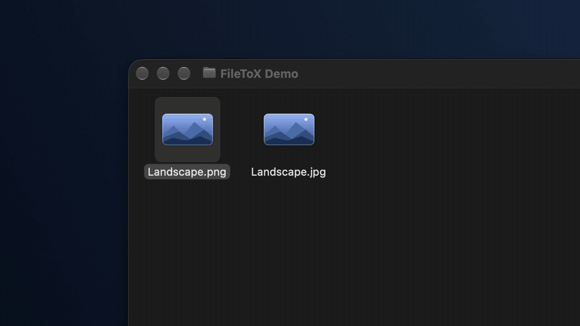
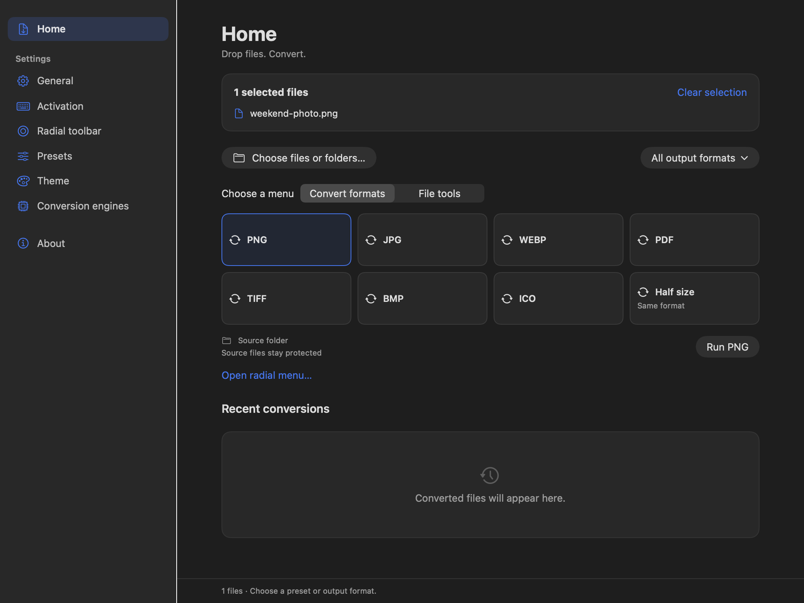
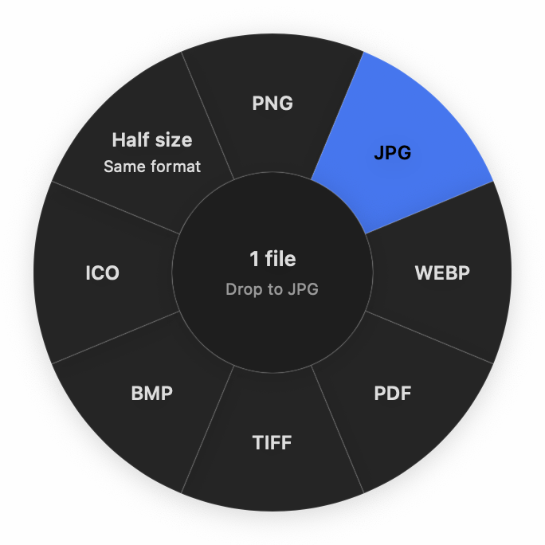
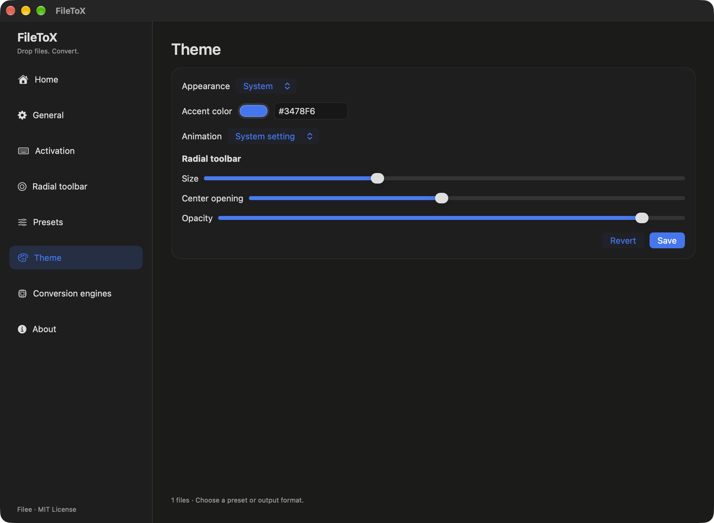

# FileToX

[English](README.md) | [한국어](README.ko.md) | [日本語](README.jp.md)

FileToXは、[Filee](https://github.com/KnifeLemon/Filee)から着想を得て作ったMac専用のファイル変換アプリです。ファイルをドロップし、変換先の形式を選ぶだけで使えます。

SwiftUIとAppKitで開発し、Apple Silicon M1以降（arm64）、macOS 15以降に対応しています。Intel Mac・Rosettaでの実行と検証はサポート対象外です。初期言語は英語で、韓国語と日本語にも対応しています。

## 20秒で見るFileToX

[](docs/media/filetox-demo.mp4)

[20秒の紹介動画を見る](docs/media/filetox-demo.mp4) · FinderのOptionドラッグを実際に撮影した、英語字幕付き・音声なしの動画です。

FileToXをメニューバーで実行したまま、FinderでファイルをドラッグしてからControl（⌃）キーを押します。円形メニューの変換先にドロップすれば変換できます。アプリのメインウィンドウは閉じておけます。**設定 → 呼び出し**でControl・Option・Shift・Commandを組み合わせ、文字・数字・ファンクションキー・矢印キー・スペースを追加できます。**保存**すると、このMacで設定が維持されます。有効なmacOSシステムショートカットやFinderのドラッグ操作と重なる場合は警告を表示します。他のアプリが登録したショートカットは検査対象に含まれません。

## 機能

- Finderでドラッグしながら設定した呼び出しキー（初期値はControl）を押すか、アプリのホームでファイル・フォルダとプリセットを選んで実行するか、円形の変換メニューを開けます。
- 171形式と23のエンジンで、画像・文書・動画・音声・アーカイブを扱えます。
- プリセットと円形ツールバーを編集し、変換したファイルの保存先を指定できます。
- 進捗の確認、キャンセル、失敗した変換の再試行、最近の変換の確認ができます。
- 英語・韓国語・日本語を選び、macOS標準のカラーピッカーでアクセント色を変更できます。
- 元のファイルを保護し、名前の衝突と複数の出力を処理します。

## アプリの画面



<table>
<tr><th>円形の変換メニュー</th><th>テーマとアクセント色</th></tr>
<tr><td width="40%" align="center"></td><td width="60%"></td></tr>
</table>

ホームと円形メニューは、隔離したエンジンデータフォルダを使ったネイティブSwiftUI画面です。テーマ画面は以前の英語Releaseビルドで撮影しました。

## 使い方

1. ホーム画面にファイルをドロップするか、ファイル・フォルダを選びます。
2. ホームでプリセット・ファイルツールを選んで実行するか、円形メニューを開きます。**すべての出力形式**から変換先を選ぶこともできます。
3. 元のファイルと同じフォルダ、または指定した出力フォルダで結果を確認します。

初回起動時にFinderのドラッグ操作の検出で使用するアクセシビリティの設定ガイドが表示され、システム設定から戻るとアクセス権を確認します。**後で**を選ぶとホームで変換を続けられ、**呼び出し → 設定方法を見る**からガイドを開き直せます。ネイティブ変換コンポーネントを同梱しており、.NETランタイムは使用しません。

登録されたすべての形式間で変換できるわけではありません。変換経路の探索が入力とエンジンの状態から利用可能なプリセット・出力形式を判断します。読み取り専用の58形式は出力候補に表示しません。未導入のエンジンやmacOSで利用できない経路には理由を表示します。

標準バンドルには内蔵ライブラリとrhwp・7-Zipを含みます。**変換エンジン**の管理対象エンジン欄から、固定バージョンのarm64 Pandoc・LibreOffice・CalibreをFileToX専用にダウンロードできます。インストール前にサイズとSHA-256を検証し、進捗表示とキャンセルに対応します。既存のエンジンフォルダは保持し、**外部エンジンの実行ファイル**で指定したコピーを優先します。FFmpeg・Ghostscriptはシステムのインストールまたは指定したコピーを使います。終了時は進行中のダウンロードをキャンセルして後処理を待ちます。中断したダウンロードの再開には対応していません。

出力は各出力先フォルダの非表示作業フォルダに書き込み、結果ごとに確定します。Overwriteでも元ファイルは保護し、名前が衝突した場合は初期設定で新しい名前を選びます。複数の出力の確定が途中で失敗しても、確定済みの結果を正しく報告します。バッチ全体を一括で巻き戻す原子性は保証しません。アプリのデータは`~/Library/Application Support/FileToX/{core,engines,tmp}`に分けて保存します。

<details>
<summary>開発・ビルド手順と検証記録</summary>

## ビルドと実行

Xcode 27 / Swift 6.4、XcodeGen 2.46以降を使います。ビルドスクリプトはPython 3の標準ライブラリを使用します。アプリと変換helperはSwiftとネイティブライブラリでビルドし、.NET SDK・ランタイム・NuGetの復元は不要です。

```sh
xcodegen generate
xcodebuild -project FileToX.xcodeproj -scheme FileToX -configuration Debug \
  -destination 'platform=macOS,arch=arm64' ARCHS=arm64 -derivedDataPath build/DerivedData build
open 'build/DerivedData/Build/Products/Debug/FileToX Dev.app'
```

Xcodeはルートの`Package.swift`にあるエンジン・Core製品を使用し、Swift helper・PDFium・同梱ツールを署名して組み込みます。アプリ・helper・テストはarm64のみを対象とし、ダウンロードツールはx64を拒否します。初回に固定バージョンのlibwebp・libjxlソースを取得し、rhwp・7-Zipは検証済みキャッシュがない場合だけ取得します。LibRaw・libjpeg-turbo・OpenJPEGのソース、元のuniversal PDFium dylib、arm64専用Skia SVG静的ライブラリを保持します。staging時にPDFium・同梱ツールからarm64のみを抽出して署名し、検証済み原本は変更しません。Skiaは限定した基本図形に使用し、その他のSVG機能とベクターPDFにはCoreSVGを使います。出典とライセンス告知を保持します. 固定されたlibavif 1.4.2・libaom 3.14.1の静的ライブラリを使うarm64の`FileToXAvifEncoder`と、そのライセンス告知も同梱します。

```sh
swift build -c release --product FileToXAvifEncoder
swift build -c release --product FileToXEngine
python3 Tools/fetch-optional-engines.py --help
```

DebugのバンドルIDは`forked.filetox.local.dev`、Releaseは`forked.filetox.local`です。個人設定はGitの対象外となる`Config/Local.xcconfig`に保存します。Debug・Releaseの既定値はローカル用のad-hoc署名です。arm64 Releaseは既存チームの開発証明書による実際のXcodeビルド、deep/strict署名検証、およびリポジトリと.NET SDKへのアクセスを拒否した再配置実行23項目を通過しました。Developer ID署名・公証は未検証です。検証環境はM2 Max/macOS 27で、M1実機やmacOS 15での実行結果ではありません。範囲と残る差異は[最新の検証記録](docs/design/engine-differential-triage.md#remaining-work-integration-2026-10-26)に記載しています。

## 検証

```sh
swift test
xcodebuild -project FileToX.xcodeproj -scheme FileToX -configuration Debug \
  -destination 'platform=macOS,arch=arm64' ARCHS=arm64 -derivedDataPath build/DerivedData test
python3 -I Tools/engine-compare/test_harness.py
python3 -I Tools/test-engine-entitlements.py
```

実際のhelperを使う統合テストの前に、helperをビルドしてください。見つからない場合は、そのテストだけをスキップします。別のhelperを使うには`FILETOX_TEST_HOST`でパスを指定します。実エンジンのサンプルは次のスクリプトで再現できます。作業フォルダには新しい絶対パスを指定してください。

```sh
FILETOX_SMOKE_HOST="$PWD/build/DerivedData/Build/Products/Debug/FileToX Dev.app/Contents/Helpers/FileToXEngine.app/Contents/MacOS/FileToXEngine"
python3 Tools/engine-smoke.py "$FILETOX_SMOKE_HOST" "$PWD/build/smoke-new"
python3 Tools/engine-optional-smoke.py "$FILETOX_SMOKE_HOST" "$PWD/build/optional-smoke-new"
```

以前のアプリ検証ではApple siliconで、Xcodeテスト32件、Swift Packageテスト12件、内蔵エンジンの検証22件（実変換20件・選択判定2件）、追加エンジン・動画・音声・処理中のキャンセル・添付画像の衝突を含むサンプル11件が成功しました。Swiftとの通信でも、PNG→JPG、PDF結合→複数PNG、不明な形式のファイル・フォルダ→ZIP→展開、履歴を確認しました。実行中のアプリでは、円形メニューのJPGクリック→結果生成→最近の履歴を確認しました。実際のFinder Optionドラッグでは、遅い動き、元ファイルの保持、ドロップ後のFinderのフォーカス維持を確認しました。韓国語のHWP・DOCXから生成したPDFのテキスト抽出とPNG描画も確認しています。英語・韓国語・日本語の切り替えは、実行中のアプリとhelperにすぐ反映されます。標準カラーピッカーで選んだ色の再起動後の保持、組み込みプリセット名の翻訳、ユーザーが付けた名前の保持も確認しました。

**設定 → 監視フォルダ**で入力フォルダとプリセットを選び、ルールを有効にして保存します。**監視中**になってからファイルを追加してください。起動時に存在するファイルは変更せず、アプリの実行中に新規・変更ファイルを処理します。出力先の既定値は`converted`で、原本は保持します。選択すると、変換に成功し変更されていない原本を`originals`へ移動します。パッケージ内部と一時ダウンロードフォルダは除外します。3秒の安定待ちはヒューリスティックです。長い書き込み停止がある場合は、完成したファイルをatomic renameで渡してください。スキャンは10,000項目、ジョブは入力128件までです。

すべての形式の組み合わせ・コーデックを検証したわけではありません。このマシンにはGhostscriptがなく、FFmpegにも一部のエンコーダーがありません。ログイン項目と通知は実装済みですが、実際のログアウト・ログイン後の自動起動と通知配信は未検証です。外部exFAT・SMBボリューム、配布用公証、TCCの再起動時の動作も未検証です。

最終統合ソース`bff5988`には、画像メタデータ保持の拡張、TGAの色処理、SVGテキストの正規化、Markdownの最適化、独立したAVIFエンコーダーを反映しました。clean build、Swiftエンジン728件（14 skip）・Core18件、Xcodeエンジン728件（58 skip）・アプリ81件、開発証明書の署名と再配置23項目の検査を、失敗なく完了しました。バンドル内のMach-O 6個はすべてarm64で、.NETファイルやHomebrewへの動的リンクはありません。

新しい849件の実行は786件完了・従来と同じ63件失敗で、harness・検査エラーは0です。拡張した意味検査でのC#比較は**599 PASS / 202 WARN / 48 FAIL**です。過去の判定方針とは区別し、FAILを免除していません。順次測定したMarkdown TXT・PDF TXTの中央値は**0.556秒・0.603秒**で、各5回すべてで0.60秒・0.84秒の目標を満たしました。

AVIFの選択基準はImageIOで読み込んだ色・アルファの標本誤差と限定的なメタデータ保持です。追加の時間・メモリ、入れ子のメタデータ、Q8・SVGの差異は残ります。ソースと実行ファイルの対応、厳密な比較結果、検証範囲は[最新の統合検証](docs/design/engine-differential-triage.md#remaining-work-integration-2026-10-26)を参照してください。過去の比較も同じ記録に保存しています。安全なTCR出力には、解決済みの`ebook-convert`と同じ場所に`calibre-debug`がある完全なCalibre環境が必要で、別途Pythonのインストールは不要です。

## ソースと設計

開発時の参考は[KnifeLemon/Filee](https://github.com/KnifeLemon/Filee)のコミット`21fdd05ef7181b032ed83ec895cc9bbc4b198985`です。現在のCore・host・エンジンは`Sources/Engine`、アプリ向けCoreパッケージは`Sources/Core`にあります。上流のライセンスと告知は`docs/upstream`に保管し、現在のビルドはFileeのC#プロジェクトを参照しません。

- [全形式の一覧](docs/formats.md)、[全体設計](docs/architecture.md)
- [通信仕様](docs/design/host-wire-v1.md)、[hostの実装](Sources/Engine/Host/Host.swift)
- [UI設計](docs/design/swiftui-port.md)、[パッケージング・署名](docs/design/macos-packaging.md)
- [Claudeによる設計レビュー](docs/design/review.md)、[エンジン実装・検証状況](docs/design/engine-differential-triage.md)

以前の会話の試案は`docs/archive/pre-filetox/`に保存しています。ノッチ棚、ファイルの保管・移動・コピーは現在の対象範囲に含みません。

</details>

## 謝辞

FileToXは、[Filee](https://github.com/KnifeLemon/Filee)から着想を得て作ったMac専用のファイル変換アプリです。SwiftUIとAppKitでmacOSに合わせて開発した独立プロジェクトであり、Fileeの公式リリースではありません。

FileToXは[MITライセンス](LICENSE)で公開します。Fileeの[MITライセンス](docs/upstream/Filee.LICENSE)と[外部コンポーネントの利用表記](docs/upstream/Filee.THIRD-PARTY-NOTICES.md)を保持します。MITは各外部エンジンのライセンスに代わるものではありません。カメラRAWは[LibRaw](https://www.libraw.org) 0.22.2で読み込み、LibRawは[CDDL-1.0](docs/upstream/LibRaw.LICENSE)([利用表記](docs/upstream/LibRaw.THIRD-PARTY-NOTICES.md))で使用します。変更していないソースは`Vendor/LibRaw`にあります。JPEGの書き出しと非可逆圧縮DNGの読み込みには[libjpeg-turbo](https://libjpeg-turbo.org) 3.2.0をIJGライセンス([ライセンス](docs/upstream/libjpeg-turbo.LICENSE)、[利用表記](docs/upstream/libjpeg-turbo.THIRD-PARTY-NOTICES.md))で使用します。本ソフトウェアは一部Independent JPEG Groupの成果に基づいています。変更していないソースは`Vendor/libjpeg-turbo`にあります。実際のバンドルの利用表記はhelperの`Contents/Resources/Notices`に含めます。 PDFのラスター出力は旧C#版と同じ[同梱PDFium](Vendor/PDFium/README.md) 147.0.7690.0（arm64配布コピー）を使用します。[BSD-3ライセンス](docs/upstream/PDFium.LICENSE)と[同梱コンポーネントの利用表記](docs/upstream/PDFium.THIRD-PARTY-NOTICES.md)をhelperに含めます。
