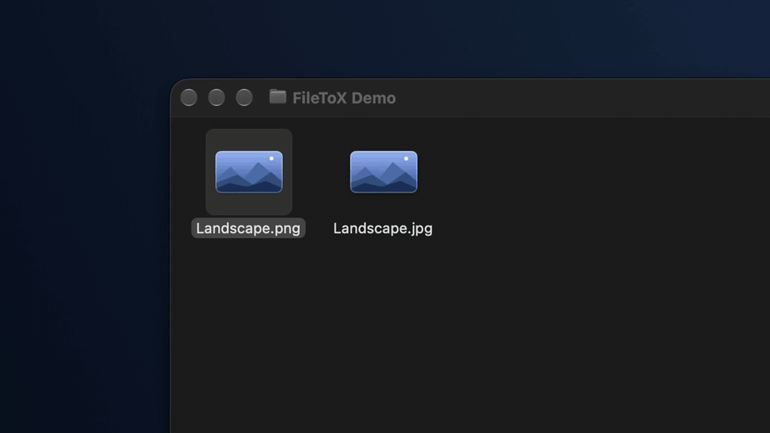
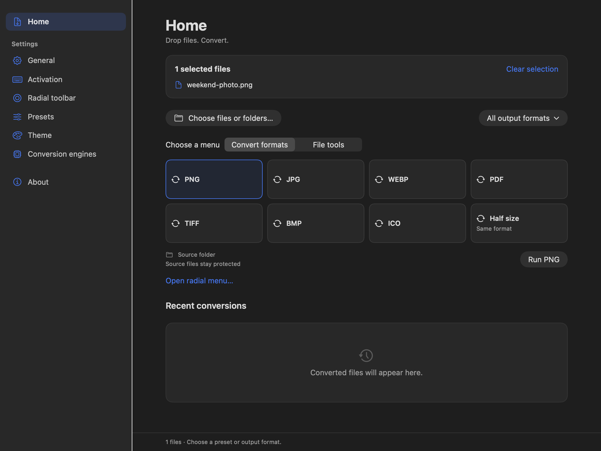
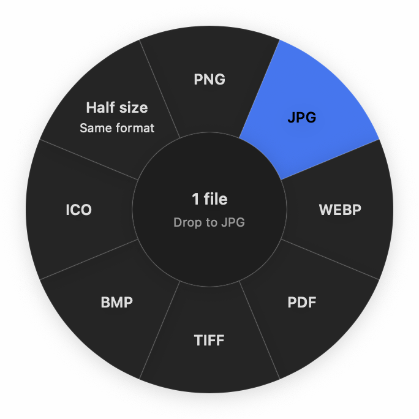
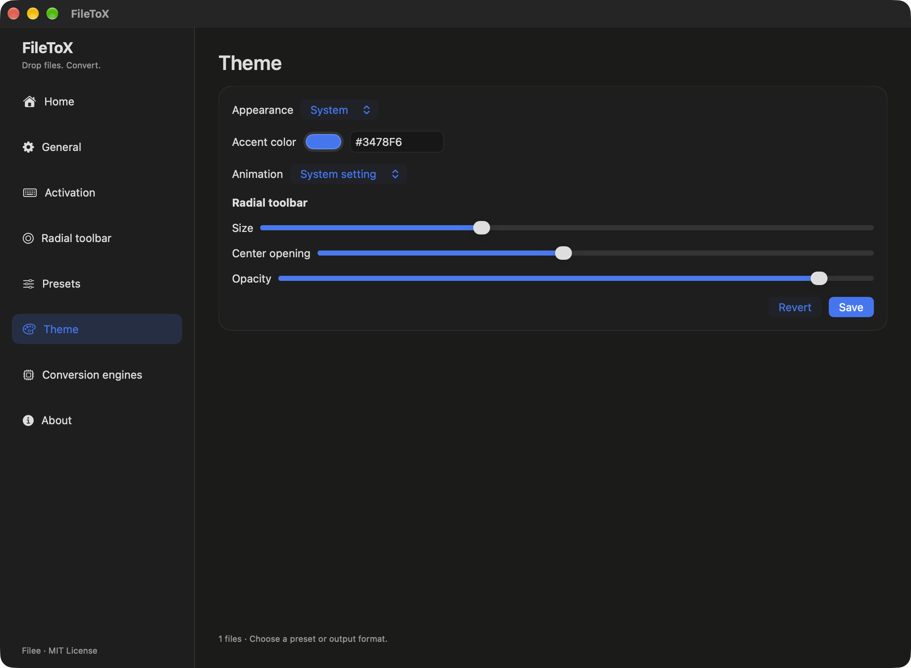

# FileToX

[English](README.md) | [한국어](README.ko.md) | [日本語](README.jp.md)

FileToX는 [Filee](https://github.com/KnifeLemon/Filee)에서 영감을 받아 만든 Mac 전용 파일 변환 앱이다. 파일을 놓고 원하는 형식을 고르면 변환할 수 있다.

SwiftUI와 AppKit으로 만들었으며 Apple Silicon M1 이상(arm64), macOS 15 이상을 지원한다. Intel Mac·Rosetta 실행과 그 검증은 지원 범위에 포함하지 않는다. 기본 언어는 영어이고 한국어와 일본어도 지원한다.

## 20초로 보는 FileToX

[](docs/media/filetox-demo.mp4)

[20초 소개 영상 보기](docs/media/filetox-demo.mp4) · Finder Option 드래그를 실제로 촬영한 영어 자막의 무음 영상이다.

FileToX를 메뉴 막대에서 실행해 둔 채, Finder에서 파일을 드래그한 뒤 Control(⌃)을 누른다. 원형 메뉴의 변환 형식에 드롭하면 된다. 앱의 메인 창은 닫아둬도 된다. **설정 → 호출 키**에서 Control·Option·Shift·Command를 조합하고 문자·숫자·기능 키·방향 키·스페이스를 추가할 수 있다. **저장**을 누르면 이 Mac에 유지된다. 활성화된 macOS 시스템 단축키와 Finder 드래그 동작이 겹치면 경고를 표시하며, 다른 앱이 등록한 단축키는 검사 범위에 포함되지 않는다.

## 기능

- Finder에서 파일을 드래그하며 설정한 호출 키(기본값 Control)를 누르거나, 앱의 홈에서 파일·폴더와 프리셋을 선택해 실행하거나 원형 변환 메뉴를 연다.
- 171개 형식과 23개 엔진으로 이미지·문서·영상·음성·압축 파일을 다룬다.
- 프리셋과 원형 툴바를 편집하고, 변환한 파일의 저장 위치를 지정한다.
- 진행 상황을 확인하고 작업을 취소하거나 실패한 변환을 재시도한다. 최근 변환도 다시 볼 수 있다.
- 영어·한국어·일본어를 선택하고, macOS 색상 선택기로 강조색을 바꾼다.
- 원본 파일을 보호하고, 이름 충돌과 여러 결과를 처리한다.

## 앱 화면



<table>
<tr><th>원형 변환 메뉴</th><th>테마와 강조색</th></tr>
<tr><td width="40%" align="center"></td><td width="60%"></td></tr>
</table>

홈·원형 메뉴는 격리된 엔진 데이터 폴더로 실행한 네이티브 SwiftUI 화면이다. 테마 화면은 이전 영어 Release 빌드에서 촬영했다.

## 사용 방법

1. 홈 화면에 파일을 놓거나 파일·폴더를 선택한다.
2. 홈에서 프리셋·파일 도구를 골라 실행하거나 원형 메뉴를 연다. **모든 출력 형식**에서 원하는 형식을 선택할 수도 있다.
3. 원본 폴더 또는 지정한 출력 폴더에서 결과를 확인한다.

첫 실행에는 Finder 드래그 호출에 쓰는 손쉬운 사용 권한 안내가 뜨고, 시스템 설정에서 돌아오면 허용 여부를 확인한다. **나중에**를 선택하면 홈에서 바로 변환할 수 있고, **호출 키 → 설정 방법 보기**에서 안내를 다시 열 수 있다. 앱에 네이티브 변환 구성 요소를 포함하며 .NET 런타임을 사용하지 않는다.

**설정 → 일반**에서 로그인 시 자동 실행, 메뉴 막대 아이콘 표시, 로그인 시 메인 창 열기, 완료·실패 알림을 각각 설정할 수 있다. 이 옵션은 즉시 적용된다. 자동 실행과 알림은 기본으로 꺼져 있고 메뉴 막대 아이콘은 켜져 있다. 아이콘을 숨겨도 드래그 호출은 유지되며, FileToX를 다시 실행하면 설정에 접근할 수 있다. 직접 실행하면 항상 메인 창이 열린다. 알림을 클릭하면 Finder에서 결과를 표시하고 결과가 없으면 앱을 연다. 일부 실패는 실패 알림 설정을 따르며 취소한 작업은 알리지 않는다. **설정 → 호출 키 → 드래그 호출 제외 앱**에서 앱을 추가·제거하면 즉시 적용되며, 해당 앱에서 시작한 드래그에는 원형 메뉴가 나타나지 않는다. 자동 실행 승인과 알림 권한이 필요하면 시스템 설정으로 이동할 수 있다.

등록된 모든 형식 사이의 변환을 보장하지는 않는다. 변환 경로 탐색기가 입력·엔진 상태에 따라 사용 가능한 프리셋과 출력 형식을 판단한다. 읽기 전용 형식 58개는 출력에 나타나지 않는다. 설치되지 않은 엔진과 macOS에서 불가능한 경로는 이유를 표시한다.

기본 번들에는 내장 라이브러리와 rhwp·7-Zip을 포함한다. FFmpeg·Ghostscript·Pandoc·LibreOffice·Calibre는 시스템 설치 또는 **변환 엔진 → 외부 엔진 실행 파일**에서 지정한 사본을 사용한다. 개발용 다운로드 도구가 받은 사본은 자동으로 사용자의 설정에 등록하지 않는다.

출력은 각 최종 저장 폴더의 숨김 작업 폴더에 쓴 뒤 결과별로 게시한다. 원본 파일은 Overwrite에서도 보호하고, 기본 충돌 정책은 새 이름이다. 여러 결과의 게시 중 실패하면 이미 게시한 결과를 정확히 보고한다. 전체 묶음을 한 번에 되돌리는 원자성을 약속하지 않는다. 데이터는 `~/Library/Application Support/FileToX/{core,engines,tmp}`로 분리한다.

<details>
<summary>개발·빌드 방법과 검증 기록</summary>

## 빌드와 실행

Xcode 27 / Swift 6.4, XcodeGen 2.46 이상을 사용한다. 빌드 스크립트는 Python 3 표준 라이브러리를 쓴다. 앱과 변환 helper는 Swift·네이티브 라이브러리로 빌드하며 .NET SDK·런타임·NuGet 복원이 필요 없다.

현재 앱 버전은 **0.0.1 (빌드 2)**이며, 아직 출시하지 않은 내부 개발 버전이다. 버전은 `project.yml`의 `MARKETING_VERSION`과 `CURRENT_PROJECT_VERSION`에서 관리하고, 생성된 Info.plist와 두 정보 화면이 이 값을 사용한다. 같은 버전의 새 빌드는 빌드 번호를 올리고, 버전을 바꾸면 빌드 번호는 1부터 시작한다. 버전을 수정한 뒤 `xcodegen generate`를 실행한다. Git 태그(`v0.0.1`)와 GitHub Release는 배포할 때 별도로 만든다. 내장 엔진 호스트는 자체 버전을 유지한다.

```sh
xcodegen generate
xcodebuild -project FileToX.xcodeproj -scheme FileToX -configuration Debug \
  -destination 'platform=macOS,arch=arm64' ARCHS=arm64 -derivedDataPath build/DerivedData build
open 'build/DerivedData/Build/Products/Debug/FileToX Dev.app'
```

Xcode는 루트 `Package.swift`의 엔진·Core 제품을 사용하고 Swift helper·PDFium·번들 도구를 서명해 포함한다. 앱·helper·테스트는 arm64를 대상으로 하며 다운로드 도구는 x64를 거부한다. 첫 패키지 해석에서 고정 버전 libwebp·libjxl 소스를 받고, rhwp·7-Zip은 검증된 캐시가 없을 때만 받는다. LibRaw·libjpeg-turbo·OpenJPEG 소스, 원본 universal PDFium dylib와 arm64 전용 Skia SVG 정적 라이브러리를 보관한다. staging은 PDFium·번들 도구의 arm64만 추출한 뒤 서명하며 검증된 원본은 바꾸지 않는다. Skia는 제한된 기본 도형에 사용하고 나머지 SVG 기능·벡터 PDF는 CoreSVG를 유지한다. 출처와 라이선스 고지는 보존한다.

```sh
swift build -c release --product FileToXEngine
python3 Tools/fetch-optional-engines.py --help
```

개발 식별자는 `forked.filetox.local.dev`, Release는 `forked.filetox.local`이다. 개인 설정은 Git에서 제외하는 `Config/Local.xcconfig`에 둔다. Debug·Release의 기본 서명은 로컬 ad-hoc용이다. arm64 Release는 기존 팀 개발 인증서의 실제 Xcode 빌드·deep/strict 서명 검사와 저장소·.NET SDK 접근을 차단한 재배치 실행 22개 검사를 통과했다. Developer ID 서명·공증은 미검증이다. 검증 환경은 M2 Max/macOS 27이며 물리 M1 또는 macOS 15 실행 결과는 아니다. 범위와 남은 차이는 [최신 검증 기록](docs/design/engine-differential-triage.md#apple-silicon-only-final-verification-2026-10-25)을 따른다.

## 검증

```sh
swift test
xcodebuild -project FileToX.xcodeproj -scheme FileToX -configuration Debug \
  -destination 'platform=macOS,arch=arm64' ARCHS=arm64 -derivedDataPath build/DerivedData test
python3 -I Tools/engine-compare/test_harness.py
python3 -I Tools/test-engine-entitlements.py
```

실제 helper 통합 테스트는 먼저 helper를 빌드해야 한다. 없으면 해당 테스트만 skip한다. 별도 helper 경로는 `FILETOX_TEST_HOST`로 지정할 수 있다. 실제 엔진 표본은 아래 스크립트로 재현한다. 작업 폴더는 새 절대 경로를 사용한다.

```sh
FILETOX_SMOKE_HOST="$PWD/build/DerivedData/Build/Products/Debug/FileToX Dev.app/Contents/Helpers/FileToXEngine.app/Contents/MacOS/FileToXEngine"
python3 Tools/engine-smoke.py "$FILETOX_SMOKE_HOST" "$PWD/build/smoke-new"
python3 Tools/engine-optional-smoke.py "$FILETOX_SMOKE_HOST" "$PWD/build/optional-smoke-new"
```

이전 앱 검증에서는 Apple silicon에서 Xcode 테스트 32개, Swift Package 테스트 12개, 내장 엔진 검증 22개(실제 변환 20개·선택 판단 2개), 추가 엔진·영상·음성·실행 중 취소·첨부 이미지 충돌 표본 11개를 통과했다. Swift 통신에서도 실제 PNG→JPG, PDF 병합→여러 PNG, unknown 파일·폴더 ZIP→압축 해제와 이력을 확인했다. 실제 앱의 도넛 JPG 클릭→결과 생성→최근 이력도 통과했다. 실제 Finder Option 드래그에서도 느린 움직임, 원본 보존과 드롭 후 Finder 포커스 유지를 확인했다. 한글 HWP·DOCX에서 만든 PDF의 텍스트 추출과 PNG 렌더링도 확인했다. 영어·한국어·일본어 변경은 실행 중인 앱과 helper에 바로 반영된다. 기본 색상 선택기로 고른 색의 재실행 후 유지, 기본 프리셋 이름 번역과 사용자 이름 보존도 확인했다.

**과거 비교 기록:** 전체 변환 849건은 578 PASS / 263 WARN / 8 FAIL이었다. 이후 Calibre TCR 압축 손상을 우회하고 RGB/회색조 JPEG 읽기에 libjpeg-turbo를 적용했다. 위 전체 비교 수치는 이 후속 변경 전 결과다. 당시 테스트·C/C++ 대안 비교·남은 한계는 [후속 검증 기록](docs/design/engine-differential-triage.md#native-library-follow-up-2026-10-23), 기존 사용자 데이터·격리·서명 검증은 [통합 기록](docs/design/engine-differential-triage.md#performance-integration-2026-10-23)을 따른다. 안전한 TCR 쓰기는 심볼릭 링크를 해석한 `ebook-convert` 옆에 `calibre-debug`가 있는 완전한 Calibre 설치본이 필요하며, 별도 Python 설치는 필요 없다.

2026-10-25 arm64 엔진으로 **849건 전체**를 실행했다. 786건 완료·기준선과 같은 63건 실패이며 작업 상태·오류 키·출력 수 변경은 없었다. WOFF2 5개 결과는 변환을 반복하지 않고 검사기만 수정해 재검사했으며 최종 검사 오류는 0건이다. 기존 정책의 C# 비교는 **580 PASS / 264 WARN / 5 FAIL**, TCR 내용·PDF 래스터 검사를 강화한 별도 정책은 **585 / 255 / 9**다. 기준선 그림 참조 누락 4건과 Calibre 자동 표지 차이 등을 면제하지 않았다. WARN은 시각적·레이아웃 동등성을 입증하지 않는다. 명령·이미지 품질·서명·남은 한계는 [최신 검증 기록](docs/design/engine-differential-triage.md#apple-silicon-only-final-verification-2026-10-25)을 따른다. 이전 Intel 교차 빌드 증거는 현재 지원·검증 의무를 뜻하지 않는다.

**설정 → 자동 변환 폴더**에서 입력 폴더와 프리셋을 지정하고 규칙을 켠 뒤 저장한다. **감시 중** 상태가 된 뒤 파일을 넣는다. 시작할 때 이미 있던 파일은 그대로 두고, 앱이 실행 중일 때 새 파일과 변경된 파일을 처리한다. 기본 출력은 `converted`이며 원본은 유지한다. 선택하면 변환에 성공하고 변경되지 않은 원본을 `originals`로 이동한다. 패키지 내부와 임시 다운로드 폴더는 제외한다. 3초 안정화 대기는 휴리스틱이므로 쓰기 중 오래 멈출 수 있는 프로그램은 완료한 파일을 원자적 rename으로 전달해야 한다. 스캔은 10,000개 항목, 작업은 입력 128개로 제한한다.

모든 형식 조합·코덱을 검사하지 않았다. Ghostscript는 이 머신에 없고, 현재 FFmpeg에는 일부 인코더가 없다. 앱 안에서 엔진 다운로드는 아직 연결하지 않았다. 실제 로그아웃·로그인 후 자동 실행과 알림 전달은 검증하지 않았다. 외장 exFAT·SMB, 배포 공증·TCC 재실행 검증도 남아 있다. 감시 폴더·ICC 후속 변경은 최종 통합 검증 중이며, 위 비교 수치는 이전 스냅샷의 결과다.

## 소스와 설계

개발 참고 기준은 [KnifeLemon/Filee](https://github.com/KnifeLemon/Filee) 커밋 `21fdd05ef7181b032ed83ec895cc9bbc4b198985`다. 현재 Core·host·엔진 구현은 `Sources/Engine`, 앱에서 사용하는 Core 패키지는 `Sources/Core`에 있다. 원본 라이선스와 고지는 `docs/upstream`에 보존하며 현재 빌드는 Filee C# 프로젝트를 참조하지 않는다.

- [전체 형식 목록](docs/formats.md), [전체 설계](docs/architecture.md)
- [통신 계약](docs/design/host-wire-v1.md), [host 구현](Sources/Engine/Host/Host.swift)
- [UI 설계](docs/design/swiftui-port.md), [패키징·서명](docs/design/macos-packaging.md)
- [Claude 설계 검토](docs/design/review.md), [엔진 구현·검증 현황](docs/design/engine-differential-triage.md)

이전 대화의 시안은 `docs/archive/pre-filetox/`에 보존한다. 노치 선반·파일 보관·이동·복사는 현재 범위에 포함하지 않는다.

</details>

## 감사의 말

FileToX는 [Filee](https://github.com/KnifeLemon/Filee)에서 영감을 받아 만든 Mac 전용 파일 변환 앱이다. SwiftUI와 AppKit으로 macOS에 맞게 만들었으며, Filee의 공식 배포판이 아닌 독립 프로젝트다.

FileToX는 [MIT 라이선스](LICENSE)로 배포한다. Filee의 [MIT 라이선스](docs/upstream/Filee.LICENSE)와 [외부 구성요소 고지](docs/upstream/Filee.THIRD-PARTY-NOTICES.md)를 보존한다. MIT는 각 외부 엔진의 라이선스를 대신하지 않는다. 카메라 RAW는 [LibRaw](https://www.libraw.org) 0.22.2로 읽으며, LibRaw는 [CDDL-1.0](docs/upstream/LibRaw.LICENSE)([고지](docs/upstream/LibRaw.THIRD-PARTY-NOTICES.md))으로 사용한다. 수정하지 않은 소스는 `Vendor/LibRaw`에 있다. JPEG 쓰기와 손실 압축 DNG 읽기에는 [libjpeg-turbo](https://libjpeg-turbo.org) 3.2.0을 IJG 라이선스([라이선스](docs/upstream/libjpeg-turbo.LICENSE), [고지](docs/upstream/libjpeg-turbo.THIRD-PARTY-NOTICES.md))로 사용한다. 이 소프트웨어는 일부 Independent JPEG Group의 작업에 기반한다. 수정하지 않은 소스는 `Vendor/libjpeg-turbo`에 있다. 실제 번들 고지는 helper의 `Contents/Resources/Notices`에 포함한다. PDF 래스터 출력은 기존 C#와 같은 [번들 PDFium](Vendor/PDFium/README.md) 147.0.7690.0(arm64 배포 사본)을 쓴다. [BSD-3 라이선스](docs/upstream/PDFium.LICENSE)와 [번들 구성요소 고지](docs/upstream/PDFium.THIRD-PARTY-NOTICES.md)를 helper에 포함한다.
