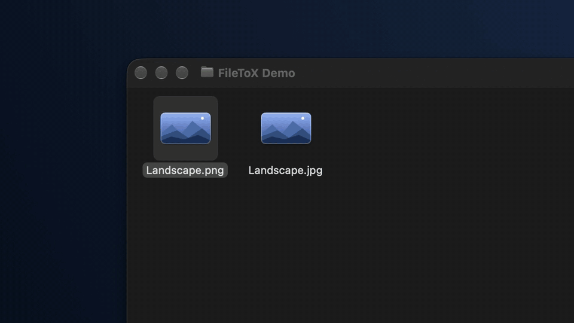
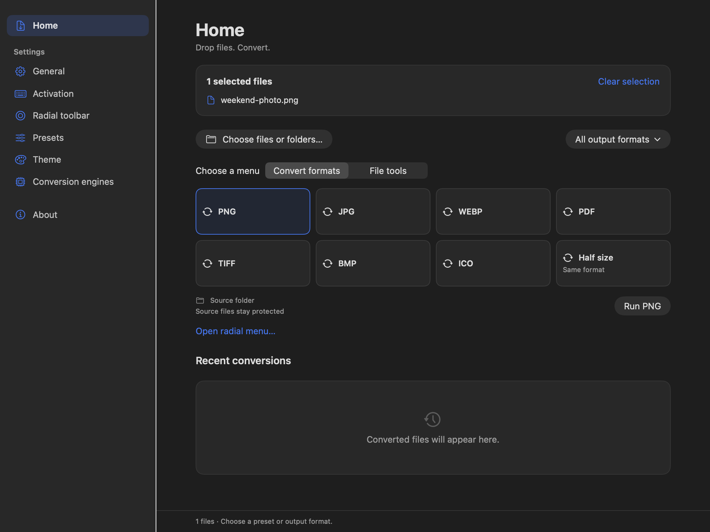
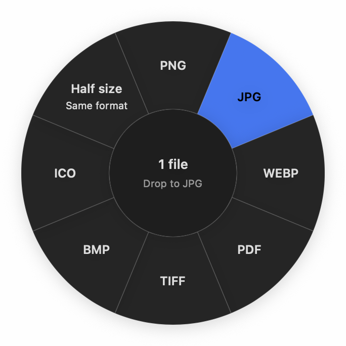
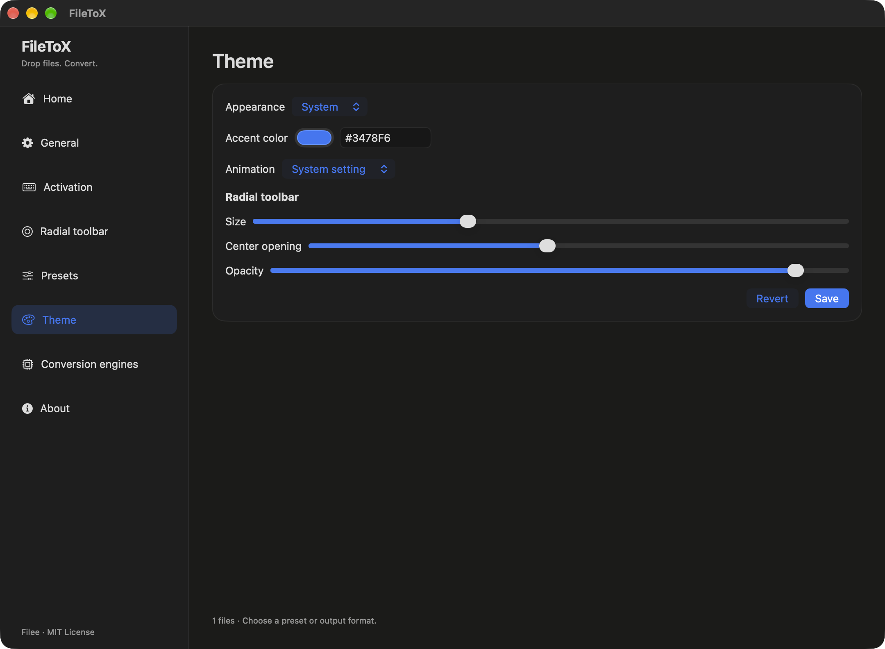

# FileToX

[English](README.md) | [한국어](README.ko.md) | [日本語](README.jp.md)

FileToX is a Mac-only file converter inspired by [Filee](https://github.com/KnifeLemon/Filee). Drop a file and pick a format to convert it.

Built with SwiftUI and AppKit for macOS 15 or later. English is the default language, with Korean and Japanese also available.

## See it in action

[](docs/media/filetox-demo.mp4)

[Watch the 20-second video](docs/media/filetox-demo.mp4) · Finder Option-drag, English captions, no audio.

With FileToX running in the menu bar, hold Option (⌥) and drag a file in Finder. Drop it on a format in the radial menu; the main app window can stay closed.

## Features

- Open a radial conversion menu with Option-drag in Finder, or choose files and folders in the app.
- Convert images, documents, video, audio and archives through a catalog of 171 formats and 23 engines.
- Create presets, arrange your radial toolbar and choose where converted files are saved.
- Follow progress, cancel a job, retry failures and revisit recent conversions.
- Choose English, Korean or Japanese, and customize the accent with the native macOS color picker.
- Keep source files protected, with clear handling of name conflicts and multiple outputs.

## Screenshots



<table>
<tr><th>Radial conversion menu</th><th>Theme and accent color</th></tr>
<tr><td width="40%" align="center"></td><td width="60%"></td></tr>
</table>

Captured from the English Release build on macOS.

## Getting started

1. Drop a file onto Home, or choose files and folders.
2. Pick a preset in the radial menu or select an output from **All output formats**.
3. Find the result beside the source, or in your chosen output folder.

On first launch, a setup guide explains Accessibility access for Finder Option-drag and checks access when you return from System Settings. Choose **Later** to keep converting through Home, or reopen the guide through **Activation → Show setup guide**. The app includes its conversion runtime; a separate .NET installation is not needed.

This does not guarantee conversion between every registered format. The route planner determines available presets and targets from the inputs and engine status. The 58 read-only formats are excluded from output choices. Missing engines and unavailable macOS routes show a reason.

The default bundle includes built-in libraries, rhwp and 7-Zip. FFmpeg, Ghostscript, Pandoc, LibreOffice and Calibre use system installations or copies selected under **Conversion engines → External engine executables**. Copies fetched by the development download tool are not automatically added to user settings.

Outputs are written to a hidden staging folder beside the source, then published individually. Source files stay protected even with Overwrite; the default conflict policy chooses a new name. If publishing multiple outputs fails partway through, already published results are reported accurately. The whole batch is not an atomic transaction. App data is separated under `~/Library/Application Support/FileToX/{core,engines,tmp}`.

<details>
<summary>Development, build instructions and verification</summary>

## Build and run

Use Xcode 27 / Swift 6.4 and XcodeGen 2.46 or later. Builds require .NET SDK 10.0.401, pinned in `Config/EngineHost.global.json`. Use the SDK in `~/.dotnet` or set `DOTNET_ROOT` to its installation directory. See [Microsoft's official download](https://dotnet.microsoft.com/download/dotnet/10.0) for installation.

```sh
xcodegen generate
xcodebuild -project FileToX.xcodeproj -scheme FileToX -configuration Debug \
  -destination 'platform=macOS' -derivedDataPath build/DerivedData build
open 'build/DerivedData/Build/Products/Debug/FileToX Dev.app'
```

The Xcode build phase verifies upstream hashes, applies patches to a staged copy, and publishes, signs and embeds the helper. The first build downloads NuGet packages and pinned rhwp and 7-Zip versions. Later builds use the cached output when the source is unchanged.

```sh
Tools/build-engine-host.sh --rid osx-arm64 --configuration Debug
python3 Tools/fetch-optional-engines.py --help
```

The Debug bundle ID is `forked.filetox.local.dev`; Release uses `forked.filetox.local`. Keep personal settings in the Git-excluded `Config/Local.xcconfig`. Debug and Release currently use local ad-hoc signing. Developer ID signing and notarization are unfinished. Intel build options exist, but execution has not been verified.

## Verification

```sh
swift test
xcodebuild -project FileToX.xcodeproj -scheme FileToX -configuration Debug \
  -destination 'platform=macOS' -derivedDataPath build/DerivedData test
python3 -I Tools/verify-filee-vendor.py --selftest
python3 -I Tools/verify-filee-vendor.py
python3 -I Tools/import-filee-formats.py --check
python3 -I -m unittest discover -s Tests/Tools -v
```

Build the helper before running real helper integration tests; those tests alone are skipped if it is absent. Set `FILETOX_TEST_HOST` to use another helper path. The scripts below reproduce real-engine samples. Use a new absolute path for the work directory.

```sh
python3 EngineHost/smoke.py \
  "$PWD/build/engine-host/osx-arm64/Debug/FileToXEngine.app/Contents/MacOS/FileToXEngine" \
  "$PWD/build/smoke-new"
python3 EngineHost/optional-smoke.py --help
```

On Apple silicon, 32 Xcode tests, 12 Swift Package tests, 22 built-in engine checks (20 actual conversions and 2 selection checks), and 11 additional samples covering optional engines, video, audio, in-flight cancellation and attached-image collisions passed. Swift communication also verified PNG→JPG, PDF merge→multiple PNGs, unknown files and folders→ZIP→extraction, and history. In the running app, clicking the donut's JPG preset produced an output and a recent-history entry. Actual Finder Option-drag checks covered slow movement, source preservation and Finder focus after dropping. Korean HWP and DOCX→PDF text extraction and PNG rendering were also verified. Language switches between English, Korean and Japanese update the running app and host. The native color picker, saved colors after relaunch, localized built-in names and preservation of custom names were also verified.

Upstream Core tests passed 154 with 2 skipped; patched Core passed 164 with 2 skipped. Both upstream and patched Engines tests passed 445 and failed 3; these 3 failures come from missing FFmpeg encoders on this machine. The 4 added real-engine tests pass when Pandoc and LibreOffice are available.

Not every format pair or codec has been tested. Ghostscript is absent on this machine, and its FFmpeg lacks some encoders. Automatic watch folders, in-app engine downloads and login items are not connected yet. External exFAT and SMB volumes, Intel, distribution notarization and TCC relaunch checks remain unverified.

## Source and design

Development reference: [KnifeLemon/Filee](https://github.com/KnifeLemon/Filee) commit `21fdd05ef7181b032ed83ec895cc9bbc4b198985`. File metadata and SHA-256 hashes are recorded in `Vendor/filee-manifest.json`, and build patches are tracked in `Vendor/Filee.patches/`. The `.reference/Filee` checkout is needed only to regenerate the catalog.

- [Full format list](docs/formats.md), [architecture](docs/architecture.md)
- [Wire contract](docs/design/host-wire-v1.md), [host implementation](EngineHost/README.md)
- [UI design](docs/design/swiftui-port.md), [packaging and signing](docs/design/macos-packaging.md)
- [Claude design review](docs/design/review.md), [engine implementation and verification](EngineHost/IMPLEMENTATION.md)

Mockups from the earlier conversation are kept in `docs/archive/pre-filetox/`. A notch shelf, file storage, moving and copying are outside the current scope.

</details>

## Acknowledgments

FileToX is a Mac-only file converter inspired by [Filee](https://github.com/KnifeLemon/Filee), built with SwiftUI and AppKit for macOS. It is an independent project, not an official Filee release.

FileToX is licensed under the [MIT License](LICENSE). Filee's [MIT license](docs/upstream/Filee.LICENSE) and [third-party notices](docs/upstream/Filee.THIRD-PARTY-NOTICES.md) are preserved. MIT does not replace the licenses of external engines. Notices for the actual bundle are included in the helper's `Contents/Resources/Notices`.
