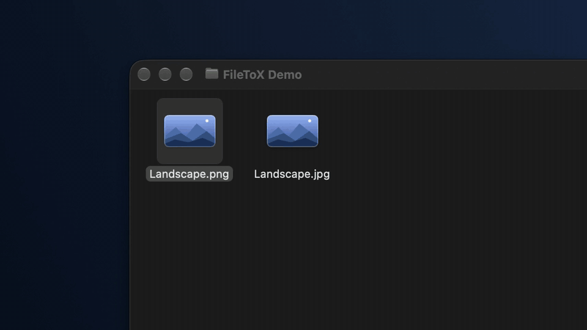
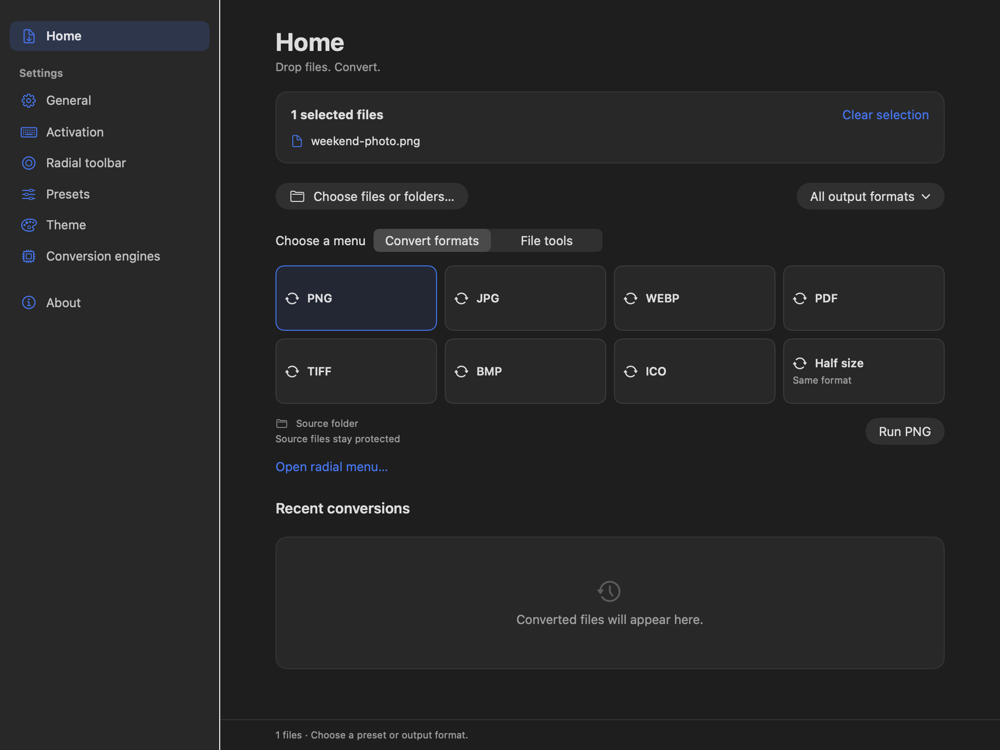
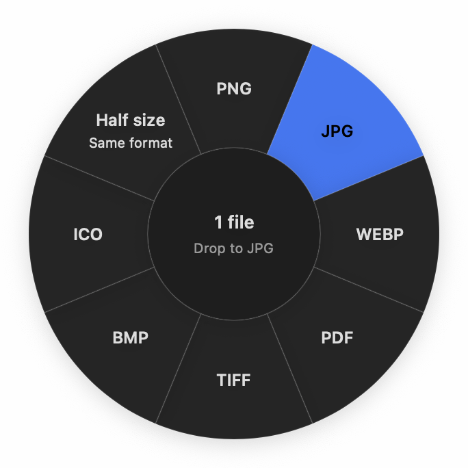
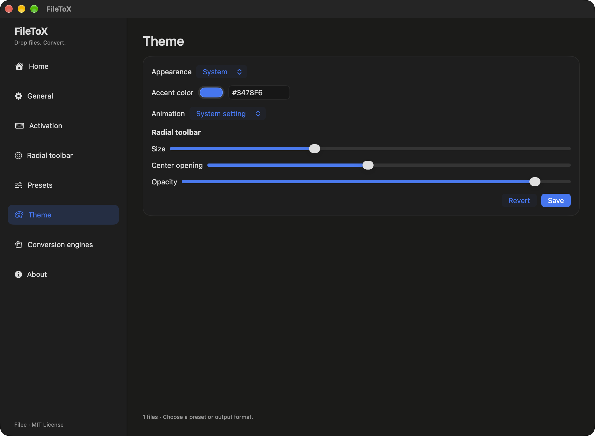

# FileToX

[English](README.md) | [한국어](README.ko.md) | [日本語](README.jp.md)

FileToX is a Mac-only file converter inspired by [Filee](https://github.com/KnifeLemon/Filee). Drop a file and pick a format to convert it.

Built with SwiftUI and AppKit for Apple Silicon Macs (M1 or later, arm64) running macOS 15 or later. Intel Macs and Rosetta execution are outside the support and validation scope. English is the default language, with Korean and Japanese also available.

## See it in action

[](docs/media/filetox-demo.mp4)

[Watch the 20-second video](docs/media/filetox-demo.mp4) · Finder Option-drag, English captions, no audio.

With FileToX running in the menu bar, drag a file in Finder, then hold Control (⌃). Drop it on a format in the radial menu; the main app window can stay closed. Under **Settings → Activation**, choose Control, Option, Shift and Command in any combination, optionally with a letter, number, function or arrow key (or Space), then click **Save**. Below the shortcut editor, choose whether to hold the keys before dragging, press them after dragging starts, or allow either order (the default). In the after-dragging mode, keys already held at the start must be released and pressed again. The shortcut and activation order persist on this Mac; existing shortcuts keep allowing either order. Warnings identify enabled macOS system shortcuts and Finder drag gestures; shortcuts registered by other apps are outside this check.

The radial menu has two modes: **Control (⌃)** opens **Convert formats**, and **Control+Shift (⌃⇧)** opens **File tools**. You can release the keys after the menu opens and press the other combination to switch during the same drag. Activation order applies to opening a menu. Configure each shortcut separately under **Activation**; duplicate key combinations cannot be saved. Existing primary shortcuts are preserved. If an existing primary uses Control+Shift, the new secondary defaults to Control+Option+Shift instead.

Under **Radial toolbar → File tools**, automatic mode selects relevant tools such as resizing, grayscale, PDF splitting/merging and archive packing, followed by **Show in Finder**, **Copy files** and **Copy paths**. Turn automatic mode off to arrange any saved preset and these file actions together, up to 12 items. Copy files places file URLs on the clipboard for pasting in Finder. File tools use the same conversion engine checks and source protection as other presets. File actions do not run a conversion.

Home keeps file selection, preset selection and execution in the main window. Choose **Open radial menu…** to use the popup. In the popup's click mode, arrow keys select an item, Enter runs it, **M** switches modes, and Escape closes it. The conversion menu continues to use your existing file-type profiles.

## Features

- Open a radial conversion menu by dragging in Finder and holding the configured shortcut (Control by default), or choose files and folders in the app and run them from Home.
- Convert images, documents, video, audio and archives through a catalog of 171 formats and 23 engines.
- Create presets, arrange your radial toolbar and choose where converted files are saved.
- Follow progress, cancel a job, retry failures and revisit recent conversions.
- Choose English, Korean or Japanese, and customize the accent with the native macOS color picker.
- Keep source files protected, with clear handling of name conflicts and multiple outputs.

## Screenshots



<table>
<tr><th>Radial conversion menu</th><th>Theme and accent color</th></tr>
<tr><td width="40%" align="center"></td><td width="60%"></td></tr>
</table>

Home and both radial menus are captured from native SwiftUI views using an isolated engine data folder. The theme screenshot is from the earlier English Release build. [File tools menu](docs/images/filetox-tools.png).

## Getting started

1. Drop a file onto Home, or choose files and folders.
2. Pick a preset or file tool on Home and click its Run button, open the radial menu, or select an output from **All output formats**.
3. Find the result beside the source, or in your chosen output folder.

On first launch, a setup guide explains Accessibility access for Finder drag activation and checks access when you return from System Settings. Choose **Later** to keep converting through Home, or reopen the guide through **Activation → Show setup guide**. The app includes native conversion components and uses no .NET runtime.

Under **Settings → General**, configure launch at login, menu bar visibility, whether login launches open the main window, and separate completion/failure notifications. These options apply immediately; automatic startup and notifications are off by default, and the menu bar icon is on. Hiding the icon keeps drag activation running; open FileToX again to reach its settings. Manual launches always open the main window. Notification clicks reveal available outputs in Finder, or open FileToX when there are no outputs. Partial failures follow the failure notification option; cancelled jobs do not notify. **Settings → Activation → Exclude apps from drag activation** lets you add or remove apps immediately; drags started in those apps do not open the radial menu. Login approval and notification permissions are managed by macOS, with links to System Settings when access is blocked.

This does not guarantee conversion between every registered format. The route planner determines available presets and targets from the inputs and engine status. The 58 read-only formats are excluded from output choices. Missing engines and unavailable macOS routes show a reason.

The default bundle includes built-in libraries, rhwp and 7-Zip. Under **Conversion engines → Managed engines**, download the pinned arm64 versions of Pandoc, LibreOffice and Calibre for FileToX. Downloads are checked against their size and SHA-256 before installation, with progress and cancellation. Existing engine folders are preserved, and copies selected under **External engine executables** take priority. FFmpeg and Ghostscript still use system installations or selected copies. Quitting cancels active downloads and waits for cleanup; partial downloads are not resumed.

Outputs are written to a hidden staging folder beside each final destination, then published individually. Source files stay protected even with Overwrite; the default conflict policy chooses a new name. If publishing multiple outputs fails partway through, already published results are reported accurately. The whole batch is not an atomic transaction. App data is separated under `~/Library/Application Support/FileToX/{core,engines,tmp}`.

<details>
<summary>Development, build instructions and verification</summary>

## Build and run

Use Xcode 27 / Swift 6.4 and XcodeGen 2.46 or later. Python 3 runs the standard-library build scripts. The app and conversion helper build with Swift and native libraries; no .NET SDK, runtime or NuGet restore is required.

The current app version is **0.0.1 (build 2)**, an internal development version with no published release. `MARKETING_VERSION` and `CURRENT_PROJECT_VERSION` in `project.yml` are the app version source of truth; generated Info.plist values and both About views use those values. Increment the build number for a new build of the same version, and reset it to 1 when changing the version. Run `xcodegen generate` after editing the version. Git tags (`v0.0.1`) and GitHub Releases are created separately when publication is intended. The embedded engine host has its own version.

```sh
xcodegen generate
xcodebuild -project FileToX.xcodeproj -scheme FileToX -configuration Debug \
  -destination 'platform=macOS,arch=arm64' ARCHS=arm64 -derivedDataPath build/DerivedData build
open 'build/DerivedData/Build/Products/Debug/FileToX Dev.app'
```

Xcode consumes the engine and Core products from the root `Package.swift`, then signs and embeds the Swift helper, PDFium and bundled tools. App, helper and tests target arm64; download tools reject x64. Initial package resolution fetches pinned libwebp/libjxl sources, and staging fetches pinned rhwp/7-Zip archives only when the verified cache is missing. LibRaw, libjpeg-turbo and OpenJPEG sources, the original universal PDFium dylib and an arm64-only static Skia SVG bridge are checked in. Staging extracts arm64 from PDFium and bundled tools before signing, preserving the verified source copies. Native SVG covers a conservative primitive subset; other SVG features and vector PDF retain CoreSVG. Vendor records preserve provenance and license notices. The arm64 `FileToXAvifEncoder` tool is also embedded, using the pinned libavif 1.4.2/libaom 3.14.1 static archive and its preserved notices.

```sh
swift build -c release --product FileToXAvifEncoder
swift build -c release --product FileToXEngine
python3 Tools/fetch-optional-engines.py --help
```

The Debug bundle ID is `forked.filetox.local.dev`; Release uses `forked.filetox.local`. Keep personal settings in the Git-excluded `Config/Local.xcconfig`. Debug and Release default to local ad-hoc signing. The arm64 Release also passed an actual Xcode build with the existing team's development certificate, deep/strict signature verification and 23 relocated checks with repository and .NET SDK access denied. Developer ID signing and notarization remain unverified. Validation ran on an M2 Max/macOS 27; physical M1 or macOS 15 execution is not claimed. See the [latest verification record](docs/design/engine-differential-triage.md#remaining-work-integration-2026-10-26) for scope and remaining differences.

## Verification

```sh
swift test
xcodebuild -project FileToX.xcodeproj -scheme FileToX -configuration Debug \
  -destination 'platform=macOS,arch=arm64' ARCHS=arm64 -derivedDataPath build/DerivedData test
python3 -I Tools/engine-compare/test_harness.py
python3 -I Tools/test-engine-entitlements.py
```

Build the helper before running real helper integration tests; those tests alone are skipped if it is absent. Set `FILETOX_TEST_HOST` to use another helper path. The scripts below reproduce real-engine samples. Use a new absolute path for the work directory.

```sh
FILETOX_SMOKE_HOST="$PWD/build/DerivedData/Build/Products/Debug/FileToX Dev.app/Contents/Helpers/FileToXEngine.app/Contents/MacOS/FileToXEngine"
python3 Tools/engine-smoke.py "$FILETOX_SMOKE_HOST" "$PWD/build/smoke-new"
python3 Tools/engine-optional-smoke.py "$FILETOX_SMOKE_HOST" "$PWD/build/optional-smoke-new"
```

During earlier app verification on Apple silicon, 32 Xcode tests, 12 Swift Package tests, 22 built-in engine checks (20 actual conversions and 2 selection checks), and 11 additional samples covering optional engines, video, audio, in-flight cancellation and attached-image collisions passed. Swift communication also verified PNG→JPG, PDF merge→multiple PNGs, unknown files and folders→ZIP→extraction, and history. In the running app, clicking the donut's JPG preset produced an output and a recent-history entry. Actual Finder Option-drag checks covered slow movement, source preservation and Finder focus after dropping. Korean HWP and DOCX→PDF text extraction and PNG rendering were also verified. Language switches between English, Korean and Japanese update the running app and host. The native color picker, saved colors after relaunch, localized built-in names and preservation of custom names were also verified.

Under **Settings → Watch folders**, choose an input folder and preset, enable the rule and save. Wait for **Watching** before adding files. Monitoring leaves existing files untouched at startup and processes new or changed files while FileToX is running. Output defaults to `converted`; originals stay in place unless you select moving successful, unchanged inputs to `originals`. Packages and temporary download folders are excluded. The three-second settling window is a heuristic: producers with longer write pauses should publish completed files by atomic rename. A scan is limited to 10,000 entries and a job to 128 inputs.

Not every format pair or codec has been tested. Ghostscript is absent on this machine, and its FFmpeg lacks some encoders. Login registration and notification delivery across a real logout/login remain unverified. External exFAT and SMB volumes, distribution notarization and TCC relaunch checks remain unverified.

Final integrated source `bff5988` adds broader image metadata preservation, corrected TGA colour handling, SVG text normalization, Markdown optimization and a separate AVIF encoder. Clean builds, Swift engine 728 tests (14 skips), Core 18, Xcode engine 728 (58 skips), app 81, development-certificate signing and 23 relocated checks completed with zero test failures. All six packaged Mach-O files are arm64, with no .NET files or Homebrew dynamic links.

The fresh 849-case replay has 786 completed jobs and the same 63 failed jobs, with zero harness or inspection errors. Expanded semantic comparison against C# is **599 PASS / 202 WARN / 48 FAIL**; the stricter policy is kept separate from historical counts and failures remain unwaived. Sequential Markdown TXT and PDF TXT medians are **0.556 s** and **0.603 s**, meeting their 0.60 s and 0.84 s targets in all five rounds.

AVIF selection checks ImageIO-decoded colour/alpha sample error and limited metadata retention; extra time/memory, nested metadata and remaining Q8/SVG differences are documented. See the [latest integrated verification](docs/design/engine-differential-triage.md#remaining-work-integration-2026-10-26) for source/binary bindings, strict comparison results and limits. Earlier comparisons remain in the same report. Safe TCR writing requires `calibre-debug` beside the resolved `ebook-convert` in a complete Calibre installation; no separate Python installation is needed.

## Source and design

Development reference: [KnifeLemon/Filee](https://github.com/KnifeLemon/Filee) commit `21fdd05ef7181b032ed83ec895cc9bbc4b198985`. Current Core, host and engine implementations are in `Sources/Engine`; the app-facing Core package is in `Sources/Core`. Upstream licences and notices are retained under `docs/upstream`. The current build does not reference Filee C# projects.

- [Full format list](docs/formats.md), [architecture](docs/architecture.md)
- [Wire contract](docs/design/host-wire-v1.md), [host implementation](Sources/Engine/Host/Host.swift)
- [UI design](docs/design/swiftui-port.md), [packaging and signing](docs/design/macos-packaging.md)
- [Claude design review](docs/design/review.md), [engine implementation and verification](docs/design/engine-differential-triage.md)

Mockups from the earlier conversation are kept in `docs/archive/pre-filetox/`. A notch shelf, file storage, moving and copying are outside the current scope.

</details>

## Acknowledgments

FileToX is a Mac-only file converter inspired by [Filee](https://github.com/KnifeLemon/Filee), built with SwiftUI and AppKit for macOS. It is an independent project, not an official Filee release.

FileToX is licensed under the [MIT License](LICENSE). Filee's [MIT license](docs/upstream/Filee.LICENSE) and [third-party notices](docs/upstream/Filee.THIRD-PARTY-NOTICES.md) are preserved. MIT does not replace the licenses of external engines. Camera RAW is decoded with [LibRaw](https://www.libraw.org) 0.22.2, used under the [CDDL-1.0](docs/upstream/LibRaw.LICENSE) ([notices](docs/upstream/LibRaw.THIRD-PARTY-NOTICES.md)); its unmodified source is in `Vendor/LibRaw`. JPEG files are written, and lossy DNGs decoded, with [libjpeg-turbo](https://libjpeg-turbo.org) 3.2.0 under the IJG License ([licence](docs/upstream/libjpeg-turbo.LICENSE), [notices](docs/upstream/libjpeg-turbo.THIRD-PARTY-NOTICES.md)); this software is based in part on the work of the Independent JPEG Group. Its unmodified source is in `Vendor/libjpeg-turbo`. Notices for the actual bundle are included in the helper's `Contents/Resources/Notices`. PDF pages are rasterized with bundled [PDFium](Vendor/PDFium/README.md) 147.0.7690.0 (arm64 distribution copy), matching the former C# renderer; its [BSD-3 license](docs/upstream/PDFium.LICENSE) and [bundled third-party notices](docs/upstream/PDFium.THIRD-PARTY-NOTICES.md) ship with the helper.
