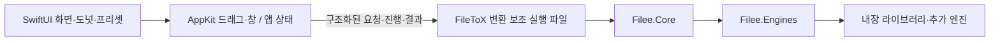

# FileToX 설계

## 현재 구현과 지원 범위 (2026-10-26)

FileToX는 Filee에서 영감을 받은 Mac 전용 파일 변환 앱이다. **Apple Silicon M1 이상(arm64), macOS 15 이상**을 지원한다. 최소 OS는 바뀌지 않는다. Intel Mac·Rosetta 실행과 그 검증은 제품 지원 범위에 포함하지 않는다.

앱은 SwiftUI·AppKit, 변환 helper는 Swift다. 현재 빌드에는 .NET SDK·런타임·NuGet 복원이나 Filee C# 프로젝트가 필요 없다. C# 기준선은 이식 결과를 비교하기 위한 과거 증거로 보존한다.

## 소스와 빌드 경계

- `Sources/App`, `Sources/UI`, `Sources/Platform`: 앱 상태·화면·원형 메뉴, Finder 드래그·창·권한·로그인·알림 등 macOS 연동.
- `Sources/Core` → `FileToXCore`: 앱이 사용하는 공개 통신 클라이언트(`EngineHost`), wire 모델과 정적 카탈로그 로더. 변환 엔진을 앱 프로세스에서 실행하지 않는다.
- `Sources/Engine` → `FileToXEngineKit`: Swift host, 형식·프리셋·프로필·설정·이력, 경로 탐색·작업 큐, 변환기와 외부 도구 실행.
- `Sources/EngineMain`: `EngineHostMain.run`을 호출하는 `FileToXEngine` 실행 진입점.
- `Vendor/LibAVIF/FileToX/avifenc.c`: 취소 가능한 별도 `FileToXAvifEncoder` 실행 파일. 고정한 arm64 libavif·libaom 정적 라이브러리를 사용한다.
- `Package.swift`: Core·EngineKit·helper 실행 제품, 네이티브 라이브러리·리소스·패키지 테스트의 공통 정의.
- `project.yml`: 로컬 Swift 패키지를 사용하는 앱·helper 번들, 내장 라이브러리·도구·리소스, 서명·Xcode 테스트. 공통 `ARCHS: arm64`를 사용하고 bundled-engine staging도 다른 아키텍처를 거부한다.

PDFium의 검증된 universal 원본과 upstream 출처·고지는 보존한다. Skia 정적 bridge는 arm64 전용으로 줄인 뒤 취소 확인을 위해 다시 빌드했으며 현재 빌드·다운로드도 arm64만 사용한다. 각 출력의 해시와 경위는 Vendor/SkiaSVG의 출처 기록에 보존한다. 배포 staging은 PDFium·번들 도구에서 arm64만 추출한 뒤 서명한다. 앱·helper·번들 도구·배포 PDFium 모두 arm64이며, 원본 라이브러리의 보존은 Intel 지원을 뜻하지 않는다. 상세 배치는 [패키징](design/macos-packaging.md)을 따른다.

## 형식과 변환 엔진

실행 시점의 기준은 Swift `FormatRegistry`, `EngineRegistry`, `ConverterCatalog`다. 가상 `folder`를 제외한 171개 형식과 23개 엔진을 등록하며, 읽기 전용 형식은 출력 선택에서 제외한다. PDB(PalmDoc)는 Windows-1252 글자만 담아 한글을 저장할 수 없으므로 Filee와 달리 읽기 전용이며, 이를 대상으로 저장된 프리셋은 검증을 통과하되 경로가 없어 사용할 수 없음으로 표시된다. 등록 수가 모든 형식 쌍의 변환 가능성을 뜻하지 않는다. `ConverterCatalog.statusOf`·`createPlanner`가 사용 가능한 엔진을 반영하고 `RoutePlanner`는 최대 3단계 경로를 찾는다. 원본에 없는 내용이 필요한 대상은 계획하지 않는다. 오디오는 영상·오디오 원본에서만 만들고, 영상의 TXT는 정지 프레임 하나의 글자 인식이 되므로 만들지 않는다. PDF→TXT는 글자가 없는 페이지(스캔, PDF 페이지로 만든 그림·만화)를 PDFium으로 300dpi·긴 변 4,000px 이하로 렌더링해 Vision으로 읽고, 기존 줄·문단·2단 읽기 순서 처리에 넣는다. 인식 언어는 Mac 언어 순서 중 Vision이 지원하는 언어이며 한중일 언어를 앞에, 영어를 끝에 둔다. Vision은 첫 언어의 문자 모델만 쓰므로 다른 한중일 문자는 읽지 못할 수 있고, 자동 언어 감지는 첫 사용이 느리고 영어가 많은 페이지의 한글을 놓쳐 쓰지 않는다. EPUB·FB2·HTMLZ·TXTZ·ODT처럼 페이지를 그림으로 담는 출력은 인식 글자를 더하지 않는다. `Selection`·`ProfileSelector`가 입력별 프로필과 프리셋·출력 선택을 판단한다. UI는 host의 판단 결과를 사용한다.

`Resources/FileeFormats.json`은 앱의 정적 카탈로그용이다. 엔진의 실행 가능 여부나 경로를 이 JSON으로 판단하지 않는다. 형식 목록은 [formats.md](formats.md), 기능별 이식 근거는 [Swift 전환 기록](design/swift-engine-migration.md)에 있다.

내장 변환기는 Swift 코드와 macOS 프레임워크, LibRaw·libjpeg-turbo·libwebp·libjxl·OpenJPEG·PDFium·Skia 등의 네이티브 구성 요소를 사용한다. `MagickImageConverter`·`PdfSharpConverter` 등 기존 id/타입 이름은 호환성을 위해 남아 있으며 해당 NuGet 패키지를 실행한다는 뜻이 아니다. PDF 래스터는 PDFium, PDF 편집·텍스트 처리는 PDFKit을 사용한다. Skia SVG bridge는 허용한 기본 도형만 처리하며 나머지 SVG 기능과 벡터 PDF는 CoreSVG를 유지한다.

AVIF는 ImageIO 결과를 먼저 만들고 입력과 색·알파 표본 오차가 모두 0이면 추가 인코딩을 생략한다. 나머지 단일 8비트 RGB 이미지의 후보를 별도 `FileToXAvifEncoder` 프로세스(libavif 1.4.2·libaom 3.14.1)로 인코딩한다. 두 결과를 ImageIO로 읽어 입력의 premultiplied 8비트 표본과 비교한다. 색·알파 제곱 오차가 모두 증가하지 않고 하나 이상 감소하며 메타데이터 가드를 통과할 때만 후보를 쓴다. 입력 메타데이터 중 ImageIO가 보존한 태그의 형식·문자열·중첩 배열·구조·한정자를 비교한다. 순서 있는 배열은 순서까지, 순서 없는 배열은 항목별 개수까지 확인하며 필드와 한정자는 namespace와 이름으로 구분한다. Aux 렌즈 태그는 XMP로 전달한다. 올바른 출력 크기를 기록하기 위해 EXIF 픽셀 치수는 비교에서 제외한다. ImageIO가 Exif와 XMP를 병합해 읽으므로 raw 컨테이너나 다른 독자가 보는 값의 동등성을 보장하지 않는다. 회색조·색인·고정밀·다중 프레임·도구 없는 빌드는 ImageIO 경로를 유지한다. 인코딩 도구는 온라인 CPU 수에 따라 2~8스레드를 사용하며 취소 때 프로세스 트리와 함께 종료하고 전용 0700 임시 폴더를 정리한다. 이 기준은 시각적·SSIM·전체 메타데이터 동등성을 보장하지 않는다.

SVG 정규화는 상대 `font` 단축 속성, 상속·대소문자·공백, 세로쓰기와 글리프 방향을 보완한다. `textPath`는 CoreText 문자 묶음과 경로 기하를 이용해 윤곽선을 배치하며 닫힌 경로의 offset과 숨겨진 문자의 위치 목록을 처리한다. 표현할 수 없는 양방향 선언·회전·상대 도형 기하 등은 텍스트 전체를 기존 CoreSVG로 되돌린다. 이 fallback의 경로 텍스트 렌더링까지 올바르다고 보장하지 않는다. 기하 cache·segment·flatten 작업에 예산을 두지만 XML·CoreText shaping·전체 메모리를 제한하는 예산은 아니다. 최종 66개 출력과 윤곽선 대조군 2개에서 기존 63개 중 61개를 유지하고 textPath 두 개를 개선했다. 두 표본은 흰 배경의 보충 품질 기준에는 아직 못 미친다. `method=stretch`·`spacing=auto`·`textLength`와 전체 SVG/C# 동등성은 지원 범위 밖이다. 제한된 가로 텍스트에는 윤곽선과 같은 위치의 보이지 않는 PDF 글리프를 더해 검색·선택과 TXT 추출을 지원한다. 중첩 숨김·투명 채움·clip/mask·잘린 글자·세로쓰기·경로 텍스트·복잡한 재배열 등은 검색 텍스트를 추가하지 않는다. 그림 문서 경로는 페이지 이미지를 유지하며 SVG를 편집 가능한 문서 글자로 복원하는 기능은 아니다.

기본 번들에는 rhwp·7-Zip·FFmpeg 실행 파일을 포함한다. 앱의 관리형 설치는 고정된 arm64 Pandoc·LibreOffice·Calibre를 사용자 데이터의 `engines` 아래에 설치한다. 사용자가 지정한 FFmpeg 사본은 번들보다 우선하고, Ghostscript는 시스템 설치나 지정한 사본을 사용한다. FFmpeg는 선택한 실행 파일의 인코더·muxer와 실제 변환 계획을 비교해 누락된 기능을 변환 전에 알린다. `Tools/build-ffmpeg.py`는 앱 필수 코덱과 AV1 소프트웨어 디코더를 포함한 고정 소스 arm64 빌드를 만든다. staging은 기본 `build/ffmpeg/ffmpeg` 또는 `FILETOX_FFMPEG_BUNDLE`의 선언된 버전·플랫폼·고정 소스 목록, 번들 자체 출처 기록의 실행 파일 해시, 고지의 존재를 확인한 뒤 서명해 앱에 포함한다. 소스 ZIP·레시피 해시 검증과 번들 출처 인증은 하지 않는다. 공개 관리형 FFmpeg 다운로드는 제공하지 않는다. `EngineEnvironment`는 사용자 지정 → 번들/다운로드 경로 → 시스템 경로 순서로 찾는다. 설치는 사용자 지정 경로 설정을 바꾸지 않으며 기존 폴더를 교체하지 않는다. 없는 엔진과 지원하지 않는 macOS 경로는 사용 불가 이유를 반환한다.

`ManagedEngineInstaller`는 내려받은 크기·SHA-256을 확인한 뒤 전용 staging에서 압축 경로·심볼릭 링크를 검사하고 실행 파일을 확인한다. DMG는 읽기 전용으로 연결하고 복사 후 분리한다. 최종 배치는 기존 경로를 덮어쓰지 않는 rename을 사용한다. 디스크 작업은 상태 잠금 밖에서 수행하며 정리가 반환된 뒤 종료 상태와 작업 제거를 함께 반영한다. `engine.install`은 즉시 상태를 반환하고 앱이 짧은 상태 요청으로 진행을 읽는다. 종료 시 새 설치를 막고 취소·정리를 기다린 뒤 helper stdin을 닫는다. 이미 배치한 설치는 취소로 되돌리지 않으며 정리는 최선 노력이다. 자동 업데이트·기존 폴더 교체·이어받기는 제공하지 않는다.

## 통신·진행·취소·이력

SwiftUI/AppKit → `AppModel` → `FileToXCore.EngineHost` → 번들의 Swift helper → `Host`·`JobQueue` → 내장 변환기/외부 도구 순서로 실행한다. 앱은 `Contents/Helpers/FileToXEngine.app/Contents/MacOS/FileToXEngine`을 별도 프로세스로 시작한다.

통신은 stdin/stdout의 버전 1 NDJSON이다. `EngineHostMain`은 protocol fd를 분리하고 엔진의 일반 stdout을 stderr로 돌려 wire 오염을 막는다. 요청 id, 버전·형식·입력 경로와 프리셋 옵션을 검증한다. 주요 요청은 `catalog.get`, `selection.resolve`, `job.start`, `job.cancel`, `library.get/save`, `settings.save`, `history.get/clear`다. 계약은 [host-wire-v1](design/host-wire-v1.md), 실제 구현은 `Sources/Core/Host/EngineHost.swift`, `Sources/Engine/Host/Host.swift`다.

앱은 helper를 `--chunked-output`으로 실행한다. 한 줄의 4 MiB 제한은 유지하면서 큰 응답·이벤트를 원문 2 MiB 단위로 나눠 전송하고, 클라이언트가 순서·전송 id·전체 길이를 확인해 복원한다. 논리 메시지와 대기 큐는 각각 64 MiB까지이며 파일 목록이나 오류 내용을 잘라내지 않는다. 옵션 없는 기존 클라이언트의 동작과 요청 크기 제한은 그대로다. 64 MiB를 넘는 결과는 여전히 거부되므로 무제한 이력·출력을 보장하지 않는다.

`job.start` 응답으로 job id를 먼저 보낸다. `JobQueue`는 작업을 순서대로 실행하고 작업 안에서는 CPU 수와 엔진별 동시 실행 제한에 따라 파일을 처리한다. 단계별 진행을 파일 진행률로 합산하며 작업 진행률은 파일 평균이다. `Host`가 변경분을 100ms 간격으로 `job.updated`로 보내고 종료 시 `job.finished`에 파일별 결과·복수 출력·오류·재시도 입력을 담는다. `UserDataStore.addHistory`는 이력 저장 설정을 따르며 최대 200개를 보존한다. 이력 저장 실패는 stderr로 기록하고 변환 결과는 계속 보고한다.

`job.cancel`은 `ConversionJob.cancel()`과 Swift Task 취소로 이어진다. 단계 사이와 출력 확정 전에 취소를 검사하며 동기 네이티브 호출은 즉시 중단되지 않을 수 있다. `ProcessRunner`는 외부 도구를 셸 없이 실행 파일과 인자 배열로 시작하고, timeout·취소 시 자식 프로세스 트리를 종료한다. 취소 요청 후 30초 안에 종료 이벤트가 오지 않으면 앱 클라이언트는 helper 프로세스 그룹을 종료한다. 다른 대기 작업도 중단되며 host 재시작은 제한된 횟수로 시도한다. 취소한 작업을 자동 재실행하지 않는다.

Skia SVG는 기록한 그리기 명령을 재생하는 사이에도 취소를 확인한다. SVG 파싱·명령 기록·단일 복잡한 그리기는 즉시 중단되지 않는다. OpenJPEG는 샘플 복사와 출력 콜백에서 취소를 확인하지만 웨이블릿·엔트로피 계산 중에는 수 초 지연될 수 있다. 앞서 실행하는 ImageIO JP2 컨테이너 인코딩도 즉시 취소를 보장하지 않는다. 취소된 결과는 출력 확정에 사용하지 않는다.

## 데이터 경계와 출력 안전

앱은 `~/Library/Application Support/FileToX/`의 `core`·`engines`·`tmp`를 생성한다. helper는 명시한 `--data`·`--engines` 경로를 사용하고 `TMPDIR`을 같은 루트의 `tmp`로 설정한다. `UserDataStore`의 Filee 기본 경로에 의존하지 않는다. `core`에는 설정·프리셋·프로필·이력과 엔진 상태를 저장하고 `engines`는 선택 엔진 경로, `tmp/Filee/<jobId>`는 작업 중간 파일이다. 서명한 앱 내부에는 사용자 데이터를 쓰지 않는다.

helper는 `core/.lock`으로 같은 데이터 디렉터리의 중복 실행을 막는다. 설정·라이브러리 저장 요청은 revision 충돌과 옵션을 검증한다. JSON은 임시 파일에 쓴 뒤 rename으로 교체하고, 읽지 못하는 기존 파일은 `.broken` 사본 보존을 시도한다. 여러 설정 파일을 한 번에 바꾸는 트랜잭션을 보장하지는 않는다.

최종 출력은 프리셋의 저장 규칙으로 결정한다. 기본은 원본 옆·이름 충돌 시 새 이름이다. `StagedOutputs`는 각 최종 출력의 부모 폴더에 숨김 `.filee-out-<8자리 hex>` 폴더를 만들고 엔진이 그 안에 쓰게 한다. `OutputCommit`은 확정 시 기존 경로와 입력 파일의 identity를 확인해 Overwrite에서도 입력을 보호한다. 파일별로 확정하며 다중 결과·부속 파일·압축 해제 디렉터리 전체가 하나의 원자적 트랜잭션은 아니다. 중간에 실패하면 이미 확정한 출력은 결과에 남긴다.

정상 종료·실패·취소 시 미확정 staging과 작업 임시 파일 정리를 시도한다. staging 경로는 `core/staging.journal`에 기록하고 다음 helper 시작 시 이름·절대 경로·symlink 여부를 검사해 잔여 staging을 정리한다. 강제 종료가 이미 게시한 결과를 되돌리지는 않는다. 실제 경계는 `JobQueue.swift`, `OutputCommit.swift`, `StagingJournal.swift`와 해당 회귀 테스트를 따른다.

## 감시 폴더와 이미지 메타데이터

감시 규칙은 기존 설정 schema 8에 저장하고 `WatchFolderMonitor`가 별도 직렬 큐에서 1초 간격으로 확인한다. 시작·규칙 활성화 때 기존 파일은 기준선으로 남기고 이후 새 파일과 변경 파일을 처리한다. 안정화는 monotonic clock으로 관측한 3초이며, 긴 쓰기 중단을 파일 완성으로 구분할 수 없는 휴리스틱이다. 한 스캔은 10,000개 항목, 한 작업은 입력 128개까지다. 패키지·임시 다운로드 폴더·다른 규칙의 출력·원본 보관 폴더와 앱의 데이터·임시 폴더는 제외한다.

규칙의 출력 폴더는 물리 경로로 고정하고 할당·게시 단계에서 원본 보관 경로와 겹치지 않는지 다시 확인한다. 선택한 경우 성공한 작업의 변경되지 않은 원본만 `originals`로 독점 rename한다. 병합·압축의 여러 입력도 각각 확인하며 실패·취소된 입력은 이동하지 않는다. 현재 스캔·경로 검증 실패는 대기 작업을 무효화하지만 과거 변환·이동 오류 표시는 정상적인 후속 작업을 취소하지 않는다. `watch.status`는 캐시를 읽고 종료 때 `watch.stop`이 새 감시 작업을 막는다. 설정·이력의 로컬 저장은 여전히 동기식이며, 입력 수 제한이 큰 출력 목록의 wire 크기까지 보장하지는 않는다. 지원하지 않는 독점 rename은 원본을 유지한 채 실패한다.

JPEG·PNG 이외에도 TIFF·PSD/PSB·WebP·GIF·HEIF·JPEG XL·JPEG 2000의 지원하는 컨테이너에서 실제 ICC를 추적한다. TIFF는 IFD와 ImageIO 페이지가 일치할 때 페이지별 프로필·IPTC를 연결하며, 확인하지 못한 경로는 디코더가 추정한 색 공간으로 구분한다. 제한된 BMP V5의 내장 RGB ICC도 검증 후 처리한다. 링크된 프로필은 읽지 않는다. EXIF는 출력 크기·방향·해상도에 맞춰 직렬화하고 PSD/PSB의 허용한 EXIF·XMP·IPTC·문서 리소스와 PNG 주석을 보존한다. 비-sRGB RGB/인덱스 그림을 프로필 없는 TGA로 쓸 때는 sRGB로 변환한다. 형식이 표현하지 못하는 태그나 지원하지 않는 컨테이너까지 무손실 보존한다고 주장하지 않는다. JPEG ICC의 16,707,345바이트 제한, PNG 누적 해제량과 PSD ICC의 16 MiB 예산을 지키며 초과·손상 자료는 안전하게 거부하거나 확인 가능한 디코더 경로로 처리한다. TIFF BigTIFF, ICO 프레임 매핑, XCF 프로필 등은 원본 ICC 바이트 보존 범위 밖이다.

## 현재 UI와 검증 범위

홈에서 파일·폴더와 프리셋/파일 도구를 선택해 실행하거나 원형 메뉴를 연다. Finder 드래그의 기본 호출 키는 Control, 파일 도구 메뉴는 Control+Shift이며 사용자 설정과 호출 순서를 따른다. 앱은 프리셋·프로필·테마·언어·엔진 경로 편집, 진행·취소·실패 재시도·최근 이력을 연결한다. 로그인 항목·메뉴 막대·알림·호출 제외 앱과 자동 변환 폴더도 연결돼 있다. 앱 내 관리형 엔진 다운로드·취소·설치 상태도 연결했다.

2026-10-27~28 후속 수정은 위치 정보가 없는 슬라이드의 텍스트·그림·표, 그룹 확대율과 병합 셀의 열 위치, FB2 텍스트 상자 내용을 보완한다. 경로 계획은 생성된 PDF의 텍스트 추출을 다른 형식으로 가는 중간 연결 단계로 쓰지 않으며, 그림 문서는 PDF→DOCX 경로로 페이지를 보존한다. 원래 이미지 바이트·투명도나 SVG의 편집 가능한 글자 보존을 뜻하지 않는다. 원본 PDF에서 EPUB·FB2·HTMLZ·TXTZ·ODT로 가는 텍스트 경로가 그림·스캔·회전된 페이지 내용을 잃게 되면, PDF→DOCX 대체 경로가 확보되면 출력 할당 전에 한 번 재계획해 텍스트·기존 OCR 층·그림을 함께 담는다. 투명 OCR 글자만 있는 페이지는 전체를 렌더링해 마스크·벡터 윤곽도 보존한다. 보이는 글자가 있는 페이지의 벡터 그림·셰이딩·인라인 이미지·스텐실 마스크는 PDFium으로 글자 객체(폼 안 포함)를 뺀 페이지를 렌더링해 흰 종이가 아닌 영역으로 자른 한 장의 그림으로, 종이 위 원래 위치의 글자 뒤에 둔다. 글자는 텍스트로 한 번만 남고, 이 페이지의 다른 그림은 원래 바이트 대신 이 렌더링에 포함된다. 리치 출력의 텍스트 경로는 이 렌더링에 흰 종이 외의 내용이 있을 때만 PDF→DOCX로 재계획한다. PDFKit의 문자열·글꼴·문자 위치 조회에는 같은 공유 잠금을 적용한다. 텍스트만 있는 PDF와 실제 빈 페이지는 텍스트 경로를 유지한다. 읽은 페이지가 없는 오류와 최종 TXT 요청은 대체 경로에 넣지 않으며 새 OCR은 수행하지 않는다. TS/M2TS는 빠른 seek가 성공 코드와 빈 결과를 반환했을 때만 같은 10% 시점까지 처음부터 디코딩해 한 번 재시도한다. GIF의 경로 비용은 유지한다. ffprobe가 한 프레임을 명시한 GIF를 WebM으로 쓸 때만 실제 평균 프레임률을 지정해 100 Hz 시간 단위가 프레임률로 기록되는 문제를 막는다. 여러 프레임이나 프레임 수가 불명확한 GIF에는 적용하지 않는다. SVG의 검색용 투명 글자는 나중에 그린 것이 그 글자 영역을 일부라도 덮을 수 있거나 영역을 측정하지 않는 그림이 뒤에 오면 넣지 않으며, 렌더링 픽셀은 바꾸지 않는다. PML은 Calibre의 PMLZ를 검증·분리해 동반 PNG 폴더와 게시하고, 한글·일본어 등 BMP 문자를 이스케이프로 보존한다. 비 BMP 문자는 명시적으로 거부한다. 이미지 축소·팔레트 변환을 끄고 대괄호 작업 경로도 처리한다. 검증 근거는 [최종 후속 검증](design/engine-differential-triage.md#remaining-work-final-verification-2026-10-28)과 [텍스트 페이지 그림·가려진 SVG 글자](design/engine-differential-triage.md#priority-one-integration-review-2026-10-29)에 기록한다.

영상 길이 수정 전인 2026-10-29 PDF·SVG 검토 시점의 849건은 **829건 완료·20건 실패**, harness·검사 오류 0이며 모든 사례가 2026-10-28 최종 상태를 유지했다(기존 성공 786건 유지, 그 회차에 복구한 43건 완료). 같은 판독 정책의 엄격 C# 비교는 **484 PASS / 260 WARN / 105 FAIL**이며 성공으로 바뀐 43건도 상태 차이로 FAIL에 포함한다. 위임 구현 검증과 달리 PDB→RB는 다시 FAIL, LRF→HTMLZ는 WARN에서 PASS가 됐다. 두 경로는 리뷰에서 바꾸지 않았으므로 수정 성과로 세지 않으며, 105개 FAIL의 사례 ID는 2026-10-28 최종 비교와 모두 같다. 단일 프레임 GIF→WebM은 실제 평균 프레임률을 명시하고, 가변 GIF의 다섯 영상 형식에서 색 변화 시점·0.6초 길이 보존을 확인했다. 그 시점의 소스로 새 Debug 앱을 빌드하고 AppModel의 파일 선택·옵션 저장·AMR 변환·취소·OGG 재시도·이력·원본 보존, 서명·arm64 구성을 확인했다. 실제 GUI 조작과 Xcode 호스트 XCTest 실행을 검증한 것은 아니다. 그 시점 host의 rich 변환 44건(기존 26건, 그림 텍스트 페이지·스텐실 마스크·가려진 SVG 글자 12건, 루트 선·상대 이미지 좌표 6건)이 통과했고, 그 시점의 전체 Swift 검사는 엔진 793개(15 skip)·Core 18개, 실패 0개다. 그 시점의 PDF 텍스트 검사는 기존 출력 바이트를 유지하며 순차 5회 모두 0.84초 목표를 충족했다(0.673~0.772초, 중앙값 0.701초). 자세한 결과와 한계는 [PDF·SVG 검토 검증](design/engine-differential-triage.md#priority-one-integration-review-2026-10-29)을 따른다.

2026-10-29 영상 길이 수정은 저속 입력의 TS·M2TS·MPG·MXF 마지막 프레임 표시 시간을 채우고, 평균보다 짧은 간격의 색 변화에는 입력의 명목 프레임률도 반영한다. 원래 ICNS의 M2TS·MPG·MXF 세 출력은 파일 길이와 디코딩 표시 시간이 모두 0.1초다. 당시 영상 수정 소스의 집중 검사 **56개**, 실제 변환 **33건**이 통과했고, 849건은 **829건 완료·20건 실패**, harness·검사 오류 0이다. 같은 기준의 엄격 C# 비교는 **482 PASS / 241 WARN / 126 FAIL**이며 프레임률 항목 차이로 새 FAIL 22건이 추가됐다. 변경하지 않은 전자책 경로의 판정 변동 2건도 있으며 수정 성과로 세지 않았다. 변환 완료와 동등성은 구분한다. 프레임 단위로 맞출 수 없는 0.13초 입력은 약 0.1668초로 올림되며, 초소형 MPG의 파일 길이 추정값은 실제 표시 시간보다 짧을 수 있다. 전체 검사·앱/AppModel·PDF 성능은 앞선 PDF·SVG 검토 시점의 결과이며 이번 소스로 반복하지 않았다. [영상 길이 검증](design/engine-differential-triage.md#slow-media-duration-verification-2026-10-29).

2026-10-29 기존 품질 차이 검토에서 DWG 출력의 R2010+ 여유 공간 구조와 페이지 맵 개수를 수정했다. PalmDoc(`.pdb`) 출력은 Windows-1252를 유지하며 한글·일본어·이모지 등 표현할 수 없는 본문 글자가 있으면 출력 할당 전에 명시적으로 실패하고 EPUB 사용을 안내한다. 서유럽 문자는 여러 레코드에 걸친 긴 본문에서도 보존한다. 기존 48건은 생성값 35건·앞선 보존 개선 9건·공백/리소스 순서 각 1건·DWG 구조 2건으로 분류했으며, 엄격 비교의 판정과 임계값은 바꾸지 않는다. [기존 품질 차이·내용 손실 검토](design/engine-differential-triage.md#legacy-quality-loss-verification-2026-10-29).

2026-10-29 DWG·PDB 수정 소스의 전체 검사는 **엔진 800개(15 skip)·Core 18개, 실패 0개**다. 849건은 **822건 완료·27건 실패**, harness·검사 오류 0이며, 직전과의 상태 변화는 문자 손실을 막기 위해 거부한 PDB 7건뿐이다. 같은 정책의 엄격 비교는 **474 PASS / 241 WARN / 134 FAIL**이고 PDB 거부 7건과 변경하지 않은 PDB→SNB의 생성 그림 판정 변동 1건이 새 FAIL이다. DWG 실제 출력 두 건의 독립 판독, 새 Debug 앱 빌드·서명·arm64 구성과 AppModel 변환·취소·재시도·이력·원본 보존도 확인했다. 실제 GUI·Xcode 호스트 XCTest 실행·실기기·배포 검증과 앞서 기술한 영상·PDF·SVG 한계는 남아 있다. [현재 검증](design/engine-differential-triage.md#legacy-quality-loss-verification-2026-10-29).

2026-11-02 PDF 보존 수정은 추출하지 못한 글리프를 그림층에 남기고 합자·문자 묶음 뒤의 글자 누락과 큰 좌표로 인한 종료를 보완한다. 최종 소스의 전체 검사는 **엔진 812개(15 skip)·Core 18개, 실패 0개**이며 실제 리치 변환 94건과 추가 경계 사례 8건이 통과했다. 849건은 사례별 상태 변화 없이 **822건 완료·27건 실패**이고, 같은 현재 검사 환경의 엄격 비교는 이전 출력 재판독과 새 출력 모두 **474 PASS / 241 WARN / 134 FAIL**다. 새 Debug 앱 빌드·서명·arm64 구성·AppModel 흐름과 200쪽 TXT의 0.84초 성능 목표도 확인했다. 150dpi 그림·기울임/겹침 판별·원본 그림 해상도·합자 뒤 배치와 실사용/배포 검증 한계는 [2026-11-02 PDF 검증](design/engine-differential-triage.md#pdf-text-preservation-integration-2026-11-02)을 따른다.

2026-11-06 PDF 후속 수정은 추출한 단어와 글리프의 글자를 대조해 기울임·겹침에서 빠지던 글자를 보존하며, 한글 음절·말줄임표의 호환 분해도 모두 계산한다. 추출 못한 글자 때문에 그림층을 만드는 페이지에서는, 회전하지 않은 별도 사진이 합성이 필요하지 않을 때 원본 바이트와 해상도를 유지한다. 마스크·그래픽 상태·클리핑·폼·이미지 변형·겹침·페이지 밖 그림이나 회전 페이지는 합성 그림에 남기는 보수적인 경로를 따른다. 보존 글자는 150dpi 픽셀이며 겹친 획의 작은 조각·합자 배치·기존 180도 페이지의 글자와 그림 좌표 차이는 남는다. 그림층을 추가하지 않는 일반 그림 추출 경로의 기존 마스크·잘림 한계는 별도다. 최종 소스의 **엔진 821개(15 skip)·Core 18개 검사는 실패 0개**이며, **리치/TXT 변환 142건·경계 사례 25건·검토 재현 변환 36건**이 통과했다. 849건은 사례별 상태 변화 없이 **822건 완료·27건 실패**, 엄격 비교는 같은 FAIL 집합의 **474 PASS / 241 WARN / 134 FAIL**다. 새 Debug 앱의 서명·arm64 구성과 AppModel 흐름도 통과했으며, DOCX·EPUB에서 원본 400×400 사진과 누락 글자 그림을 확인했다. [최신 PDF 검증과 한계](design/engine-differential-triage.md#pdf-geometry-integration-2026-11-06).

이전 통합 검증 소스는 `6c150981`이다. 당시 SDK 접근 차단 Swift 엔진 750개(14개 skip)와 Core 18개, 별도 프로세스 트리 종료 검사, Xcode 클린 빌드·엔진 750개(59개 skip)·앱 81개가 실패 없이 완료됐다. 기존 팀 개발 인증서로 서명한 Release의 Mach-O 6개는 arm64이며, 저장소·SDK 접근을 차단한 재배치 실행 23개에 AVIF 도구도 포함된다. 격리 HOME의 서명 사전 검사 실패와 명시적 키체인 서명 복구 과정은 보고서에 보존했다. 이 Xcode·서명·배포 검사를 후속 소스에 다시 실행한 것으로 보지 않는다.

이전 통합 소스의 849건은 786건 완료·기존과 같은 63건 실패이며 harness·검사 오류는 0이다. 확장 의미 검사의 C# 비교는 **598 PASS / 203 WARN / 48 FAIL**이다. 같은 현재 판독기 기준 엄격 FAIL 집합은 그대로이며 생성 표지 한 건만 PASS→WARN이다. 실패를 면제하지 않았다. 순차 Markdown TXT·PDF TXT 중앙값은 각각 **0.542초·0.631초**이며 0.60초·0.84초 목표를 각각 5회 모두 충족했다. 최종 LIT→AZW3의 목차 CSS와 본문 보존도 독립 readback으로 확인했다.

비교 정책별 수치·보존된 실패·AVIF 전체 비용·라이브러리 대안·소스와 실행 파일 연결은 [최신 품질 후속 검증](design/engine-differential-triage.md#quality-follow-up-and-alternatives-2026-10-26)을 따른다. 검증 환경은 M2 Max/macOS 27.0.1이다. 물리 M1/macOS 15, 외장 exFAT·SMB·TCC 재실행·실제 로그인 후 자동 실행/알림과 Developer ID 서명·공증은 검증하지 않았다. 과거의 Intel 교차 빌드는 현재 지원 범위를 넓히지 않는다.

## 전환 전 .NET 설계·검증 기록 (2026-10-11)

이하 본문은 2026-10-11의 C#·NuGet·Filee manifest 설계와 당시 검증 기록이다. 당시의 지원 계획·완료 조건·파일 크기·미연결 기능을 보존하며 현재 구현이나 배포 의무로 적용하지 않는다. Intel·Rosetta 검증은 현재 지원 범위에 포함되지 않는다.

FileToX는 Filee에서 영감을 받아 만든 Mac 전용 파일 변환 앱이다. UI는 SwiftUI·AppKit으로 구성하고, 변환 작업은 C# 보조 실행 파일에서 처리한다. 지원 범위를 JPEG·PNG로 제한하지 않는다. 최소 OS는 macOS 15이며 Swift 앱과 host의 타깃도 동일하다. .NET 10의 공식 지원 범위를 따른다.

검토 기준은 Filee 커밋 `21fdd05ef7181b032ed83ec895cc9bbc4b198985`다. 이 설계를 바탕으로 전체 변환 host와 SwiftUI 앱을 연결했다. 구현 범위와 검증 결과는 마지막 절에 구분했다.

### 설계와 구현 구성

- [전체 형식 목록](formats.md): 실제 171개 형식·257개 확장자, 읽기 전용과 가상 폴더를 보존한 생성 문서.
- [변환 host](design/engine-host.md): 요청·진행·취소·작업 결과, 전체 프리셋·프로필·설정과 파일 안전.
- [SwiftUI 화면 설계](design/swiftui-port.md): 홈·도넛의 드롭·클릭 흐름, 입력별 활성 상태와 편집·접근성.
- [macOS 배포](design/macos-packaging.md): OS·아키텍처·런타임·네이티브 라이브러리·엔진·서명과 검증 조건.
- [Claude 검토 결과](design/review.md): 원본 대조 결과와 구현 후 확인할 항목.

`Vendor/Filee`의 버전은 위 커밋으로 고정한다. Core·Engines, 테스트, 지역화와 배포 참고 파일의 목록을 manifest로 관리한다. NuGet 의존성과 기본 rhwp·7-Zip을 helper에 포함했다. Pandoc·LibreOffice·Calibre의 고정 버전은 개발용 사본으로 받아 실제 실행을 확인했다.

`Vendor/filee-manifest.json`에 원본 경로와 236개 파일의 SHA-256을 보존했다. `Tools/verify-filee-vendor.py`가 파일 목록·해시를 확인한다. 라이선스는 원본과 함께 보존한다. 필요한 코어 수정은 이유·테스트와 함께 별도 패치로 기록하고, 검증한 원본의 빌드 작업 사본에 적용한다.

`Resources/FileeFormats.json`은 고정 소스에서 생성한 정적 카탈로그이며 `Sources/Core/FormatCatalog.swift`로 읽는다. 원본 `FormatRegistry`가 실행 시점의 기준이다. 이 JSON을 엔진 사용 가능 여부나 변환 경로 판단에 쓰지 않는다.

### 참고 소스와 담당 기능

| 참고 소스 | FileToX에서 처리할 방식 |
| --- | --- |
| `Filee.App/Views/MainWindow.axaml`, `Views/Pages/` | 사이드바와 페이지를 SwiftUI로 구성 |
| `Controls/DonutMenu.cs`, `DonutGeometry.cs`, `ViewModels/RadialViewModel.cs` | 원형 메뉴, 입력별 형식 필터, 드롭·클릭 선택, 진행·완료 표시를 SwiftUI·AppKit으로 구현 |
| `Filee.Core/Formats/FormatRegistry.cs` | 전체 형식·확장자·분류·쓰기 가능 여부 처리 |
| `Filee.Core/Conversion/ConverterCatalog.cs`, `RoutePlanner.cs`, `JobQueue.cs` | 엔진 상태, 다단계 변환 경로, 진행·오류·취소 처리 |
| `Filee.Core/Presets/`, `Profiles/`, `Settings/`, `History/`, `Watching/` | 프리셋·프로필·저장 규칙·이력·폴더 감시 처리 |
| `Filee.Engines/EngineRegistry.cs`와 개별 변환기 | C# 변환 처리 및 외부 실행 파일 연동 |
| `Filee.App/Services/Triggers/` | macOS 호출 동작을 AppKit으로 구현 |

화면과 상호작용은 SwiftUI·AppKit으로 구현한다. 변환 모듈은 별도의 host에서 실행하며, SwiftUI 타깃에는 Avalonia 의존성을 넣지 않는다.

### UI 범위

- **홈:** 큰 파일 드롭 영역과 작업 단위 최근 변환. 파일을 넣으면 해당 입력에 맞는 도넛을 열고 클릭으로 프리셋을 선택한다.
- **도넛:** Option 드래그로 커서 위치에 열고 프리셋별 부채꼴에 드롭한다. 중앙에는 파일 수·입력 형식 또는 선택 안내를 표시한다. 변환 후 진행 링·취소·성공·실패 상태로 바뀐다. 중심·Escape는 닫기, 프리셋 우클릭은 편집이다.
- **원형 툴바:** 프로필 목록, 도넛 배치·순서, 프리셋 팔레트와 입력별 표시 규칙을 편집한다.
- **프리셋:** 목록과 편집 화면. 형식·품질·크기 등 실제 엔진 옵션과 출력 위치·파일명·충돌 처리·날짜 유지 등을 연결한다. 도넛의 편집 팝업에도 같은 편집 화면을 쓴다.
- **자동 변환 폴더:** 원본 감시 규칙과 실행 상태를 보여준다.
- **설정:** 일반, 호출 키, 테마, 변환 엔진, 정보 페이지. 권한·로그인 항목·Finder 연동은 macOS에 맞게 구현한다.

Filee에서 영감을 받아 홈·원형 툴바·프리셋 편집 화면을 macOS에 맞게 구성한다. 창 장식과 기본 글꼴은 macOS를 따른다. 모든 메뉴를 빈 페이지로 먼저 추가하지 않고 실제 코어 기능과 함께 연결한다. 제품 이름과 업데이트·배포 경로는 FileToX에 맞춘다.

### 형식과 엔진

`FormatRegistry`의 전체 형식을 카탈로그에 담는다. 현재 가상 `folder`를 제외한 171개 형식이 14개 분류로 등록돼 있다. 읽기 전용 형식과 확장자 별칭도 보존한다. 이미지, 벡터, PDF, 문서, HWP, 표, 프레젠테이션, 텍스트, 전자책, 영상, 음성, 압축, 글꼴, CAD가 대상이다.

등록된 형식 수는 모든 형식 사이의 변환이 가능하다는 뜻이 아니다. `ConverterCatalog.StatusOf`와 `CreatePlanner`가 실제 사용 가능한 변환을 판단하고 `RoutePlanner`가 최대 3단계 경로를 탐색한다. `ProfileSelector`가 입력에 맞는 프로필을 고른다. UI가 이 규칙을 별도로 하드코딩하지 않는다.

내장 변환기와 NuGet 의존성은 helper에 포함한다. rhwp·7-Zip은 해당 실행 파일도 필요하다. 영상·음성은 FFmpeg, 일부 형식은 LibreOffice·Pandoc·Ghostscript·Calibre 등이 필요하다. 엔진이 없는 경우 설치 필요 상태와 이유를 표시한다. macOS에서는 EMF·WMF 등 Windows 전용 경로도 구분한다. 세부 지원은 원본 `docs/ENGINES.md`와 실제 macOS 검사 결과를 기준으로 한다.

### 실행 구조

Swift 앱은 UI와 macOS 연동을 소유한다. 보조 실행 파일은 변환 코어의 형식·프리셋·작업 큐·엔진을 사용한다. 변환 경로와 출력 규칙을 Swift와 C# 양쪽에 중복 구현하지 않는다.

`Filee.Cli`의 `convert --json`은 완료 결과를 제공하지만, `formats`·`presets`는 텍스트 출력이다. 실시간 진행·전체 프리셋 편집·독립 데이터 경로를 위한 공개 프로토콜도 없다. 따라서 CLI의 코어 사용 방식을 참고해 Core·Engines를 직접 참조하는 작은 FileToX 전용 host를 만든다. 전체 UI 연동에는 CLI 명령 외에 실시간 이벤트와 편집용 프로토콜이 필요하다.

첫 연결에는 카탈로그 조회, 선택 판단, 작업 시작·취소 요청과 진행·완료 이벤트가 필요하다. 정확한 메시지와 순서는 [host 설계](design/engine-host.md)를 따른다. 형식·엔진·프리셋·프로필·이력을 전달하고, 결과는 여러 출력 파일을 보존한다. 파일 경로는 셸 문자열로 합치지 않는다. `JobQueue.JobUpdated`를 진행 이벤트로 전달하고 취소 메시지는 `ConversionJob.Cancel`에 연결한다. 큐의 오류 처리와 입력 파일 보호를 유지한다.

홈 이력을 위해 작업 완료 시 `HistoryEntry.From(job)`을 취소·병합 실패에 맞게 보정한 뒤 `UserDataStore.AddHistory`에 연결한다. 기존 CLI는 이력을 저장하지 않으므로 홈의 작업 이력 표시를 위해 이 연결이 필요하다.

저장 경로는 `~/Library/Application Support/FileToX/` 아래 `core`·`engines`·`tmp`로 분리한다. `UserDataStore`의 디렉터리와 `EngineEnvironment.DownloadRoot`를 모두 FileToX 경로로 지정한다. 기존 Filee의 설정·이력·엔진 상태를 변경하지 않는다. 초기 출력은 원본 옆에 저장하고 이름 충돌은 별도 이름으로 처리한다.

### 병렬 작업과 순서

공통 메시지·데이터 구조를 먼저 고정한 뒤 세 갈래로 진행한다.

1. **변환:** 변환 host, 형식·사용 가능 경로·프리셋 노출, 작업·진행·취소 연결과 실제 변환 검증.
2. **UI:** 홈·도넛부터 SwiftUI로 구성하고 프리셋·프로필·설정·폴더 감시를 실제 host 기능과 연결.
3. **macOS·통합:** 비활성 팝업과 드롭 연동, host 실행·상태 경로, 런타임·네이티브 라이브러리 패키징, 서명·라이선스·전체 검증.

첫 통합은 도넛 UI와 변환 코어를 연결한다. 이후 프리셋·프로필·설정 페이지를 구현한다. 이 순서는 구현 순서이며 지원 형식을 이미지 두 가지로 줄이는 결정이 아니다.

### 완료 기준과 배포 확인

- 원본 형식 목록과 실제 사용 가능한 변환 조합을 코어에서 읽어 UI에 반영한다.
- 이미지 외에도 PDF·문서·표·압축·전자책 등 연결된 엔진의 대표 파일을 실제 변환해 확인한다.
- 도넛 드롭·홈 클릭 선택·프리셋 편집·진행·실패·취소·최근 변환을 처음부터 끝까지 확인한다.
- 원본 보호·이름 충돌 처리·사용자가 고른 Overwrite의 경로별 확정과 부분 실패 보고, 한글·공백 경로, 손상 입력, 다중 결과, 실패 후 임시 파일 정리와 취소를 검증한다.
- .NET SDK가 없는 Mac에서도 host가 실행되도록 런타임을 포함하고, arm64와 x86_64의 네이티브 의존성을 각각 검증한다.
- 기존 Filee 데이터가 변경되지 않는지 검사한다.

.NET 10의 현재 공식 macOS 지원 최저 버전은 15다. 원본 README의 macOS 14 안내와 구분한다. [Microsoft 지원표](https://github.com/dotnet/core/blob/main/release-notes/10.0/supported-os.json)를 기준으로 한다.

arm64 개발 번들에서 .NET 런타임·내장 엔진과 rhwp·7-Zip의 실행, ad-hoc hardened runtime 서명을 확인했다. 현재 앱은 약 197 MB, helper는 약 193 MB다. Developer ID 서명·공증은 별도 배포 검증 대상이다. Filee의 MIT 고지와 실제 포함한 각 의존성·외부 엔진의 고지를 함께 관리한다.

Swift 앱은 XcodeGen으로 생성하는 Xcode 프로젝트를 유지한다. 조직 서명 팀은 넣지 않고 `forked.filetox.local` 및 Debug의 `.dev` 식별자를 쓴다. 개인 설정은 Git에서 제외한 `Config/Local.xcconfig`에 둔다.

### 당시 구현 상태

2026-10-11 Apple silicon에서 엔진 23개·전체 카탈로그를 .NET host로 연결했고 SwiftUI 홈·도넛·프리셋·프로필·설정·엔진 페이지를 구현했다. 실제 앱에서 도넛 JPG 클릭, 결과 생성과 최근 이력 표시를 확인했다. 기존 JPEG·PNG 전용 ImageIO 경로는 실제 helper 통합 테스트를 통과한 뒤 삭제했다.

기본 엔진 22개 검증(변환 20개·선택 판단 2개)과 추가 엔진·영상·음성·취소·첨부 이미지 충돌 11개 표본이 통과했다. 원본 Core/Engines 테스트와 패치 테스트를 비교해 FFmpeg 인코더 부족의 기존 실패를 구분했다. 원본 236개 파일의 SHA-256은 유지한다. 실제 실행 명령과 제한은 [README](../README.md), 당시 세부 결과는 현재 제거한 `EngineHost/IMPLEMENTATION.md`에 기록했다. 최신 Swift 검증은 [통합 기록](design/engine-differential-triage.md#apple-silicon-only-final-verification-2026-10-25)을 따른다.

자동 변환 폴더·앱 내 엔진 다운로드·로그인 항목은 후속 UI/host 연결 대상이다. 모든 형식 조합이나 Intel·외장 볼륨·공증 완료를 의미하지 않는다.
