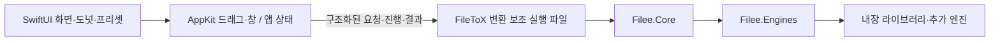

# FileToX 설계

## 현재 구현과 지원 범위 (2026-10-25)

FileToX는 Filee에서 영감을 받은 Mac 전용 파일 변환 앱이다. **Apple Silicon M1 이상(arm64), macOS 15 이상**을 지원한다. 최소 OS는 바뀌지 않는다. Intel Mac·Rosetta 실행과 그 검증은 제품 지원 범위에 포함하지 않는다.

앱은 SwiftUI·AppKit, 변환 helper는 Swift다. 현재 빌드에는 .NET SDK·런타임·NuGet 복원이나 Filee C# 프로젝트가 필요 없다. C# 기준선은 이식 결과를 비교하기 위한 과거 증거로 보존한다.

## 소스와 빌드 경계

- `Sources/App`, `Sources/UI`, `Sources/Platform`: 앱 상태·화면·원형 메뉴, Finder 드래그·창·권한·로그인·알림 등 macOS 연동.
- `Sources/Core` → `FileToXCore`: 앱이 사용하는 공개 통신 클라이언트(`EngineHost`), wire 모델과 정적 카탈로그 로더. 변환 엔진을 앱 프로세스에서 실행하지 않는다.
- `Sources/Engine` → `FileToXEngineKit`: Swift host, 형식·프리셋·프로필·설정·이력, 경로 탐색·작업 큐, 변환기와 외부 도구 실행.
- `Sources/EngineMain`: `EngineHostMain.run`을 호출하는 `FileToXEngine` 실행 진입점.
- `Package.swift`: Core·EngineKit·helper 실행 제품, 네이티브 라이브러리·리소스·패키지 테스트의 공통 정의.
- `project.yml`: 로컬 Swift 패키지를 사용하는 앱·helper 번들, 내장 라이브러리·도구·리소스, 서명·Xcode 테스트. 공통 `ARCHS: arm64`를 사용하고 bundled-engine staging도 다른 아키텍처를 거부한다.

PDFium의 검증된 universal 원본과 upstream 출처·고지는 보존한다. Skia 정적 bridge는 arm64 전용으로 줄인 뒤 취소 확인을 위해 다시 빌드했으며 현재 빌드·다운로드도 arm64만 사용한다. 각 출력의 해시와 경위는 Vendor/SkiaSVG의 출처 기록에 보존한다. 배포 staging은 PDFium·번들 도구에서 arm64만 추출한 뒤 서명한다. 앱·helper·번들 도구·배포 PDFium 모두 arm64이며, 원본 라이브러리의 보존은 Intel 지원을 뜻하지 않는다. 상세 배치는 [패키징](design/macos-packaging.md)을 따른다.

## 형식과 변환 엔진

실행 시점의 기준은 Swift `FormatRegistry`, `EngineRegistry`, `ConverterCatalog`다. 가상 `folder`를 제외한 171개 형식과 23개 엔진을 등록하며, 읽기 전용 형식은 출력 선택에서 제외한다. 등록 수가 모든 형식 쌍의 변환 가능성을 뜻하지 않는다. `ConverterCatalog.statusOf`·`createPlanner`가 사용 가능한 엔진을 반영하고 `RoutePlanner`는 최대 3단계 경로를 찾는다. `Selection`·`ProfileSelector`가 입력별 프로필과 프리셋·출력 선택을 판단한다. UI는 host의 판단 결과를 사용한다.

`Resources/FileeFormats.json`은 앱의 정적 카탈로그용이다. 엔진의 실행 가능 여부나 경로를 이 JSON으로 판단하지 않는다. 형식 목록은 [formats.md](formats.md), 기능별 이식 근거는 [Swift 전환 기록](design/swift-engine-migration.md)에 있다.

내장 변환기는 Swift 코드와 macOS 프레임워크, LibRaw·libjpeg-turbo·libwebp·libjxl·OpenJPEG·PDFium·Skia 등의 네이티브 구성 요소를 사용한다. `MagickImageConverter`·`PdfSharpConverter` 등 기존 id/타입 이름은 호환성을 위해 남아 있으며 해당 NuGet 패키지를 실행한다는 뜻이 아니다. PDF 래스터는 PDFium, PDF 편집·텍스트 처리는 PDFKit을 사용한다. Skia SVG bridge는 허용한 기본 도형만 처리하며 나머지 SVG 기능과 벡터 PDF는 CoreSVG를 유지한다.

기본 번들에는 rhwp·7-Zip 실행 파일을 포함한다. 앱의 관리형 설치는 고정된 arm64 Pandoc·LibreOffice·Calibre를 사용자 데이터의 `engines` 아래에 설치한다. FFmpeg·Ghostscript는 시스템 설치나 사용자가 지정한 사본을 사용한다. `EngineEnvironment`는 사용자 지정 → 번들/다운로드 경로 → 시스템 경로 순서로 찾는다. 설치는 사용자 지정 경로 설정을 바꾸지 않으며 기존 폴더를 교체하지 않는다. 없는 엔진과 지원하지 않는 macOS 경로는 사용 불가 이유를 반환한다.

`ManagedEngineInstaller`는 내려받은 크기·SHA-256을 확인한 뒤 전용 staging에서 압축 경로·심볼릭 링크를 검사하고 실행 파일을 확인한다. DMG는 읽기 전용으로 연결하고 복사 후 분리한다. 최종 배치는 기존 경로를 덮어쓰지 않는 rename을 사용한다. 디스크 작업은 상태 잠금 밖에서 수행하며 정리가 반환된 뒤 종료 상태와 작업 제거를 함께 반영한다. `engine.install`은 즉시 상태를 반환하고 앱이 짧은 상태 요청으로 진행을 읽는다. 종료 시 새 설치를 막고 취소·정리를 기다린 뒤 helper stdin을 닫는다. 이미 배치한 설치는 취소로 되돌리지 않으며 정리는 최선 노력이다. 자동 업데이트·기존 폴더 교체·이어받기는 제공하지 않는다.

## 통신·진행·취소·이력

SwiftUI/AppKit → `AppModel` → `FileToXCore.EngineHost` → 번들의 Swift helper → `Host`·`JobQueue` → 내장 변환기/외부 도구 순서로 실행한다. 앱은 `Contents/Helpers/FileToXEngine.app/Contents/MacOS/FileToXEngine`을 별도 프로세스로 시작한다.

통신은 stdin/stdout의 버전 1 NDJSON이다. `EngineHostMain`은 protocol fd를 분리하고 엔진의 일반 stdout을 stderr로 돌려 wire 오염을 막는다. 요청 id, 버전·형식·입력 경로와 프리셋 옵션을 검증한다. 주요 요청은 `catalog.get`, `selection.resolve`, `job.start`, `job.cancel`, `library.get/save`, `settings.save`, `history.get/clear`다. 계약은 [host-wire-v1](design/host-wire-v1.md), 실제 구현은 `Sources/Core/Host/EngineHost.swift`, `Sources/Engine/Host/Host.swift`다.

앱은 helper를 `--chunked-output`으로 실행한다. 한 줄의 4 MiB 제한은 유지하면서 큰 응답·이벤트를 원문 2 MiB 단위로 나눠 전송하고, 클라이언트가 순서·전송 id·전체 길이를 확인해 복원한다. 논리 메시지와 대기 큐는 각각 64 MiB까지이며 파일 목록이나 오류 내용을 잘라내지 않는다. 옵션 없는 기존 클라이언트의 동작과 요청 크기 제한은 그대로다. 64 MiB를 넘는 결과는 여전히 거부되므로 무제한 이력·출력을 보장하지 않는다.

`job.start` 응답으로 job id를 먼저 보낸다. `JobQueue`는 작업을 순서대로 실행하고 작업 안에서는 CPU 수와 엔진별 동시 실행 제한에 따라 파일을 처리한다. 단계별 진행을 파일 진행률로 합산하며 작업 진행률은 파일 평균이다. `Host`가 변경분을 100ms 간격으로 `job.updated`로 보내고 종료 시 `job.finished`에 파일별 결과·복수 출력·오류·재시도 입력을 담는다. `UserDataStore.addHistory`는 이력 저장 설정을 따르며 최대 200개를 보존한다. 이력 저장 실패는 stderr로 기록하고 변환 결과는 계속 보고한다.

`job.cancel`은 `ConversionJob.cancel()`과 Swift Task 취소로 이어진다. 단계 사이와 출력 확정 전에 취소를 검사하며 동기 네이티브 호출은 즉시 중단되지 않을 수 있다. `ProcessRunner`는 외부 도구를 셸 없이 실행 파일과 인자 배열로 시작하고, timeout·취소 시 자식 프로세스 트리를 종료한다. 취소 요청 후 30초 안에 종료 이벤트가 오지 않으면 앱 클라이언트는 helper 프로세스 그룹을 종료한다. 다른 대기 작업도 중단되며 host 재시작은 제한된 횟수로 시도한다. 취소한 작업을 자동 재실행하지 않는다.

Skia SVG는 기록한 그리기 명령을 재생하는 사이에도 취소를 확인한다. SVG 파싱·명령 기록·단일 복잡한 그리기는 즉시 중단되지 않는다. OpenJPEG는 샘플 복사와 출력 콜백에서 취소를 확인하지만 웨이블릿·엔트로피 계산 중에는 수 초 지연될 수 있다. 앞서 실행하는 ImageIO JP2 컨테이너 인코딩도 즉시 취소를 보장하지 않는다. 취소된 결과는 출력 확정에 사용하지 않는다.

## 데이터 경계와 출력 안전

앱은 `~/Library/Application Support/FileToX/`의 `core`·`engines`·`tmp`를 생성한다. helper는 명시한 `--data`·`--engines` 경로를 사용하고 `TMPDIR`을 같은 루트의 `tmp`로 설정한다. `UserDataStore`의 Filee 기본 경로에 의존하지 않는다. `core`에는 설정·프리셋·프로필·이력과 엔진 상태를 저장하고 `engines`는 선택 엔진 경로, `tmp/Filee/<jobId>`는 작업 중간 파일이다. 서명한 앱 내부에는 사용자 데이터를 쓰지 않는다.

helper는 `core/.lock`으로 같은 데이터 디렉터리의 중복 실행을 막는다. 설정·라이브러리 저장 요청은 revision 충돌과 옵션을 검증한다. JSON은 임시 파일에 쓴 뒤 rename으로 교체하고, 읽지 못하는 기존 파일은 `.broken` 사본 보존을 시도한다. 여러 설정 파일을 한 번에 바꾸는 트랜잭션을 보장하지는 않는다.

최종 출력은 프리셋의 저장 규칙으로 결정한다. 기본은 원본 옆·이름 충돌 시 새 이름이다. `StagedOutputs`는 각 최종 출력의 부모 폴더에 숨김 `.filee-out-<8자리 hex>` 폴더를 만들고 엔진이 그 안에 쓰게 한다. `OutputCommit`은 확정 시 기존 경로와 입력 파일의 identity를 확인해 Overwrite에서도 입력을 보호한다. 파일별로 확정하며 다중 결과·부속 파일·압축 해제 디렉터리 전체가 하나의 원자적 트랜잭션은 아니다. 중간에 실패하면 이미 확정한 출력은 결과에 남긴다.

정상 종료·실패·취소 시 미확정 staging과 작업 임시 파일 정리를 시도한다. staging 경로는 `core/staging.journal`에 기록하고 다음 helper 시작 시 이름·절대 경로·symlink 여부를 검사해 잔여 staging을 정리한다. 강제 종료가 이미 게시한 결과를 되돌리지는 않는다. 실제 경계는 `JobQueue.swift`, `OutputCommit.swift`, `StagingJournal.swift`와 해당 회귀 테스트를 따른다.

## 감시 폴더와 이미지 메타데이터

감시 규칙은 기존 설정 schema 8에 저장하고 `WatchFolderMonitor`가 별도 직렬 큐에서 1초 간격으로 확인한다. 시작·규칙 활성화 때 기존 파일은 기준선으로 남기고 이후 새 파일과 변경 파일을 처리한다. 안정화는 monotonic clock으로 관측한 3초이며, 긴 쓰기 중단을 파일 완성으로 구분할 수 없는 휴리스틱이다. 한 스캔은 10,000개 항목, 한 작업은 입력 128개까지다. 패키지·임시 다운로드 폴더·다른 규칙의 출력·원본 보관 폴더와 앱의 데이터·임시 폴더는 제외한다.

규칙의 출력 폴더는 물리 경로로 고정하고 할당·게시 단계에서 원본 보관 경로와 겹치지 않는지 다시 확인한다. 선택한 경우 성공한 작업의 변경되지 않은 원본만 `originals`로 독점 rename한다. 병합·압축의 여러 입력도 각각 확인하며 실패·취소된 입력은 이동하지 않는다. 현재 스캔·경로 검증 실패는 대기 작업을 무효화하지만 과거 변환·이동 오류 표시는 정상적인 후속 작업을 취소하지 않는다. `watch.status`는 캐시를 읽고 종료 때 `watch.stop`이 새 감시 작업을 막는다. 설정·이력의 로컬 저장은 여전히 동기식이며, 입력 수 제한이 큰 출력 목록의 wire 크기까지 보장하지는 않는다. 지원하지 않는 독점 rename은 원본을 유지한 채 실패한다.

JPEG·PNG 입력의 실제 ICC를 추적하고, 화소의 색 공간이 달라지면 이전 프로필을 붙이지 않는다. 네이티브 JPEG 디코더의 화소는 번호가 올바른 ICC 조각을 파일 순서와 무관하게 조합해 해석한다. JPEG 프로필은 최대 16,707,345바이트이며 초과하면 출력 게시 전에 실패한다. PNG iCCP 스캔은 손상 스트림의 산출량도 세어 누적 16 MiB에 최대 1 MiB 버퍼 한 개의 추가 해제만 허용한다. TIFF·JP2 등 다른 입력·출력의 추론 프로필과 JXL의 내부 프로필 표현까지 원본 바이트 보존을 보장하지 않는다. BMP 쓰기는 indexed 화소를 RGB로 변환하고 헤더 없는 결과를 거부하며, 확인된 24비트 행 패딩만 0으로 만든다.

## 현재 UI와 검증 범위

홈에서 파일·폴더와 프리셋/파일 도구를 선택해 실행하거나 원형 메뉴를 연다. Finder 드래그의 기본 호출 키는 Control, 파일 도구 메뉴는 Control+Shift이며 사용자 설정과 호출 순서를 따른다. 앱은 프리셋·프로필·테마·언어·엔진 경로 편집, 진행·취소·실패 재시도·최근 이력을 연결한다. 로그인 항목·메뉴 막대·알림·호출 제외 앱과 자동 변환 폴더도 연결돼 있다. 앱 내 관리형 엔진 다운로드·취소·설치 상태도 연결했다.

이전 최종 통합 기록은 개발 인증서로 서명한 Release 빌드, SDK 접근을 막은 빌드·테스트와 재배치한 앱의 22개 검사를 통과했다. [기록](design/engine-differential-triage.md#final-native-quality-integration-2026-10-24)의 849건 비교는 581 PASS / 264 WARN / 4 FAIL이며 WARN은 시각적 동등성의 증거가 아니다. 과거 x86_64 교차 컴파일·링크 성공과 Intel/Rosetta 실행 불가는 당시 증거로만 보존한다.

실행 소스 `70fff7d`에서 arm64 SDK 접근 차단 clean build와 엔진 테스트(581개, 57개 skip, 실패 0), 별도 clean 환경 앱 테스트 74개, 기존 팀 개발 인증서의 실제 Release 빌드·서명 검사, 저장소·SDK 접근을 차단한 재배치 실행 22개 검사를 통과했다. 실행 환경은 M2 Max/macOS 27이며 물리 M1 또는 macOS 15 실행을 주장하지 않는다. Developer ID 서명·공증은 미검증이다. 실제 변환 비교와 남은 차이는 [이전 arm64 검증 기록](design/engine-differential-triage.md#apple-silicon-only-final-verification-2026-10-25)을 따른다.

직전 검증 소스 `5f9486a`는 SDK 접근 차단 clean build·엔진 테스트 644개(57개 skip), 별도 clean 환경 앱 74개, 개발 인증서 Release·서명·재배치 22개 검사를 통과했다. CMYK JPEG 반전·PSD/PSB의 CMYK/ICC·BMP 해상도와 검사기를 보완했다. 새 849건은 786완료·기존 63실패, 검사 오류 0이며 V2 C# 비교는 586 PASS / 255 WARN / 8 FAIL이다. 이전 V1 수치와 구분하며 실패는 면제하지 않았다. 이미지 엄격 일치는 103→112/135건이고 TGA 검사 오류만 수정한 별도 수치는 113건이다. 이전 순차 PDF TXT 0.630초·Markdown TXT 0.667초는 재측정하지 않았다. [최신 수정·검증·남은 한계](design/engine-differential-triage.md#cmyk-bmp-and-inspection-corrections-2026-10-25)를 따른다.

최종 후속 앱 소스 `d9b260d`의 클린 빌드·앱 81개·서명·재배치 22개 검사를 통과했다. 엔진은 앞선 전체 Swift 669개(14개 skip)와 별도 프로세스 트리 1개, Core 18개, Xcode 엔진 669개(58개 skip)의 소스와 같다. 관리형 설치의 실제 HTTPS 전송·서명된 helper 실행도 확인했다. 변환 검증 소스 `a5d32f2` 이후 바뀐 것은 AppModel과 그 테스트뿐이며 SwiftPM helper·리소스 13개는 바이트가 같다. Xcode 배포 helper는 별도 빌드·서명·재배치 검사를 수행했다. 새 849건 V2 C# 비교는 587/254/8이고 새 엄격 실패 ID는 없다. PSD/PSB IPTC를 보존하며 다른 화소는 유지한다. 순차 PDF TXT 0.547초·Markdown TXT 0.665초와 남은 제한은 [최종 후속 기록](design/engine-differential-triage.md#managed-engine-installation-and-final-follow-up-2026-10-25)에 구분했다.

## 전환 전 .NET 설계·검증 기록 (2026-10-11)

이하 본문은 2026-10-11의 C#·NuGet·Filee manifest 설계와 당시 검증 기록이다. 당시의 지원 계획·완료 조건·파일 크기·미연결 기능을 보존하며 현재 구현이나 배포 의무로 적용하지 않는다. Intel·Rosetta 검증은 현재 지원 범위에 포함되지 않는다.

FileToX는 Filee에서 영감을 받아 만든 Mac 전용 파일 변환 앱이다. UI는 SwiftUI·AppKit으로 구성하고, 변환 작업은 C# 보조 실행 파일에서 처리한다. 지원 범위를 JPEG·PNG로 제한하지 않는다. 최소 OS는 macOS 15이며 Swift 앱과 host의 타깃도 동일하다. .NET 10의 공식 지원 범위를 따른다.

검토 기준은 Filee 커밋 `21fdd05ef7181b032ed83ec895cc9bbc4b198985`다. 이 설계를 바탕으로 전체 변환 host와 SwiftUI 앱을 연결했다. 구현 범위와 검증 결과는 마지막 절에 구분했다.

### 설계와 구현 구성

- [전체 형식 목록](formats.md): 실제 171개 형식·257개 확장자, 읽기 전용과 가상 폴더를 보존한 생성 문서.
- [변환 host](design/engine-host.md): 요청·진행·취소·작업 결과, 전체 프리셋·프로필·설정과 파일 안전.
- [SwiftUI 화면 설계](design/swiftui-port.md): 홈·도넛의 드롭·클릭 흐름, 입력별 활성 상태와 편집·접근성.
- [macOS 배포](design/macos-packaging.md): OS·아키텍처·런타임·네이티브 라이브러리·엔진·서명과 검증 조건.
- [Claude 검토 결과](design/review.md): 원본 대조 결과와 구현 후 확인할 항목.

`Vendor/Filee`의 버전은 위 커밋으로 고정한다. Core·Engines, 테스트, 지역화와 배포 참고 파일의 목록을 manifest로 관리한다. NuGet 의존성과 기본 rhwp·7-Zip을 helper에 포함했다. Pandoc·LibreOffice·Calibre의 고정 버전은 개발용 사본으로 받아 실제 실행을 확인했다.

`Vendor/filee-manifest.json`에 원본 경로와 236개 파일의 SHA-256을 보존했다. `Tools/verify-filee-vendor.py`가 파일 목록·해시를 확인한다. 라이선스는 원본과 함께 보존한다. 필요한 코어 수정은 이유·테스트와 함께 별도 패치로 기록하고, 검증한 원본의 빌드 작업 사본에 적용한다.

`Resources/FileeFormats.json`은 고정 소스에서 생성한 정적 카탈로그이며 `Sources/Core/FormatCatalog.swift`로 읽는다. 원본 `FormatRegistry`가 실행 시점의 기준이다. 이 JSON을 엔진 사용 가능 여부나 변환 경로 판단에 쓰지 않는다.

### 참고 소스와 담당 기능

| 참고 소스 | FileToX에서 처리할 방식 |
| --- | --- |
| `Filee.App/Views/MainWindow.axaml`, `Views/Pages/` | 사이드바와 페이지를 SwiftUI로 구성 |
| `Controls/DonutMenu.cs`, `DonutGeometry.cs`, `ViewModels/RadialViewModel.cs` | 원형 메뉴, 입력별 형식 필터, 드롭·클릭 선택, 진행·완료 표시를 SwiftUI·AppKit으로 구현 |
| `Filee.Core/Formats/FormatRegistry.cs` | 전체 형식·확장자·분류·쓰기 가능 여부 처리 |
| `Filee.Core/Conversion/ConverterCatalog.cs`, `RoutePlanner.cs`, `JobQueue.cs` | 엔진 상태, 다단계 변환 경로, 진행·오류·취소 처리 |
| `Filee.Core/Presets/`, `Profiles/`, `Settings/`, `History/`, `Watching/` | 프리셋·프로필·저장 규칙·이력·폴더 감시 처리 |
| `Filee.Engines/EngineRegistry.cs`와 개별 변환기 | C# 변환 처리 및 외부 실행 파일 연동 |
| `Filee.App/Services/Triggers/` | macOS 호출 동작을 AppKit으로 구현 |

화면과 상호작용은 SwiftUI·AppKit으로 구현한다. 변환 모듈은 별도의 host에서 실행하며, SwiftUI 타깃에는 Avalonia 의존성을 넣지 않는다.

### UI 범위

- **홈:** 큰 파일 드롭 영역과 작업 단위 최근 변환. 파일을 넣으면 해당 입력에 맞는 도넛을 열고 클릭으로 프리셋을 선택한다.
- **도넛:** Option 드래그로 커서 위치에 열고 프리셋별 부채꼴에 드롭한다. 중앙에는 파일 수·입력 형식 또는 선택 안내를 표시한다. 변환 후 진행 링·취소·성공·실패 상태로 바뀐다. 중심·Escape는 닫기, 프리셋 우클릭은 편집이다.
- **원형 툴바:** 프로필 목록, 도넛 배치·순서, 프리셋 팔레트와 입력별 표시 규칙을 편집한다.
- **프리셋:** 목록과 편집 화면. 형식·품질·크기 등 실제 엔진 옵션과 출력 위치·파일명·충돌 처리·날짜 유지 등을 연결한다. 도넛의 편집 팝업에도 같은 편집 화면을 쓴다.
- **자동 변환 폴더:** 원본 감시 규칙과 실행 상태를 보여준다.
- **설정:** 일반, 호출 키, 테마, 변환 엔진, 정보 페이지. 권한·로그인 항목·Finder 연동은 macOS에 맞게 구현한다.

Filee에서 영감을 받아 홈·원형 툴바·프리셋 편집 화면을 macOS에 맞게 구성한다. 창 장식과 기본 글꼴은 macOS를 따른다. 모든 메뉴를 빈 페이지로 먼저 추가하지 않고 실제 코어 기능과 함께 연결한다. 제품 이름과 업데이트·배포 경로는 FileToX에 맞춘다.

### 형식과 엔진

`FormatRegistry`의 전체 형식을 카탈로그에 담는다. 현재 가상 `folder`를 제외한 171개 형식이 14개 분류로 등록돼 있다. 읽기 전용 형식과 확장자 별칭도 보존한다. 이미지, 벡터, PDF, 문서, HWP, 표, 프레젠테이션, 텍스트, 전자책, 영상, 음성, 압축, 글꼴, CAD가 대상이다.

등록된 형식 수는 모든 형식 사이의 변환이 가능하다는 뜻이 아니다. `ConverterCatalog.StatusOf`와 `CreatePlanner`가 실제 사용 가능한 변환을 판단하고 `RoutePlanner`가 최대 3단계 경로를 탐색한다. `ProfileSelector`가 입력에 맞는 프로필을 고른다. UI가 이 규칙을 별도로 하드코딩하지 않는다.

내장 변환기와 NuGet 의존성은 helper에 포함한다. rhwp·7-Zip은 해당 실행 파일도 필요하다. 영상·음성은 FFmpeg, 일부 형식은 LibreOffice·Pandoc·Ghostscript·Calibre 등이 필요하다. 엔진이 없는 경우 설치 필요 상태와 이유를 표시한다. macOS에서는 EMF·WMF 등 Windows 전용 경로도 구분한다. 세부 지원은 원본 `docs/ENGINES.md`와 실제 macOS 검사 결과를 기준으로 한다.

### 실행 구조

Swift 앱은 UI와 macOS 연동을 소유한다. 보조 실행 파일은 변환 코어의 형식·프리셋·작업 큐·엔진을 사용한다. 변환 경로와 출력 규칙을 Swift와 C# 양쪽에 중복 구현하지 않는다.

`Filee.Cli`의 `convert --json`은 완료 결과를 제공하지만, `formats`·`presets`는 텍스트 출력이다. 실시간 진행·전체 프리셋 편집·독립 데이터 경로를 위한 공개 프로토콜도 없다. 따라서 CLI의 코어 사용 방식을 참고해 Core·Engines를 직접 참조하는 작은 FileToX 전용 host를 만든다. 전체 UI 연동에는 CLI 명령 외에 실시간 이벤트와 편집용 프로토콜이 필요하다.

첫 연결에는 카탈로그 조회, 선택 판단, 작업 시작·취소 요청과 진행·완료 이벤트가 필요하다. 정확한 메시지와 순서는 [host 설계](design/engine-host.md)를 따른다. 형식·엔진·프리셋·프로필·이력을 전달하고, 결과는 여러 출력 파일을 보존한다. 파일 경로는 셸 문자열로 합치지 않는다. `JobQueue.JobUpdated`를 진행 이벤트로 전달하고 취소 메시지는 `ConversionJob.Cancel`에 연결한다. 큐의 오류 처리와 입력 파일 보호를 유지한다.

홈 이력을 위해 작업 완료 시 `HistoryEntry.From(job)`을 취소·병합 실패에 맞게 보정한 뒤 `UserDataStore.AddHistory`에 연결한다. 기존 CLI는 이력을 저장하지 않으므로 홈의 작업 이력 표시를 위해 이 연결이 필요하다.

저장 경로는 `~/Library/Application Support/FileToX/` 아래 `core`·`engines`·`tmp`로 분리한다. `UserDataStore`의 디렉터리와 `EngineEnvironment.DownloadRoot`를 모두 FileToX 경로로 지정한다. 기존 Filee의 설정·이력·엔진 상태를 변경하지 않는다. 초기 출력은 원본 옆에 저장하고 이름 충돌은 별도 이름으로 처리한다.

### 병렬 작업과 순서

공통 메시지·데이터 구조를 먼저 고정한 뒤 세 갈래로 진행한다.

1. **변환:** 변환 host, 형식·사용 가능 경로·프리셋 노출, 작업·진행·취소 연결과 실제 변환 검증.
2. **UI:** 홈·도넛부터 SwiftUI로 구성하고 프리셋·프로필·설정·폴더 감시를 실제 host 기능과 연결.
3. **macOS·통합:** 비활성 팝업과 드롭 연동, host 실행·상태 경로, 런타임·네이티브 라이브러리 패키징, 서명·라이선스·전체 검증.

첫 통합은 도넛 UI와 변환 코어를 연결한다. 이후 프리셋·프로필·설정 페이지를 구현한다. 이 순서는 구현 순서이며 지원 형식을 이미지 두 가지로 줄이는 결정이 아니다.

### 완료 기준과 배포 확인

- 원본 형식 목록과 실제 사용 가능한 변환 조합을 코어에서 읽어 UI에 반영한다.
- 이미지 외에도 PDF·문서·표·압축·전자책 등 연결된 엔진의 대표 파일을 실제 변환해 확인한다.
- 도넛 드롭·홈 클릭 선택·프리셋 편집·진행·실패·취소·최근 변환을 처음부터 끝까지 확인한다.
- 원본 보호·이름 충돌 처리·사용자가 고른 Overwrite의 경로별 확정과 부분 실패 보고, 한글·공백 경로, 손상 입력, 다중 결과, 실패 후 임시 파일 정리와 취소를 검증한다.
- .NET SDK가 없는 Mac에서도 host가 실행되도록 런타임을 포함하고, arm64와 x86_64의 네이티브 의존성을 각각 검증한다.
- 기존 Filee 데이터가 변경되지 않는지 검사한다.

.NET 10의 현재 공식 macOS 지원 최저 버전은 15다. 원본 README의 macOS 14 안내와 구분한다. [Microsoft 지원표](https://github.com/dotnet/core/blob/main/release-notes/10.0/supported-os.json)를 기준으로 한다.

arm64 개발 번들에서 .NET 런타임·내장 엔진과 rhwp·7-Zip의 실행, ad-hoc hardened runtime 서명을 확인했다. 현재 앱은 약 197 MB, helper는 약 193 MB다. Developer ID 서명·공증은 별도 배포 검증 대상이다. Filee의 MIT 고지와 실제 포함한 각 의존성·외부 엔진의 고지를 함께 관리한다.

Swift 앱은 XcodeGen으로 생성하는 Xcode 프로젝트를 유지한다. 조직 서명 팀은 넣지 않고 `forked.filetox.local` 및 Debug의 `.dev` 식별자를 쓴다. 개인 설정은 Git에서 제외한 `Config/Local.xcconfig`에 둔다.

### 당시 구현 상태

2026-10-11 Apple silicon에서 엔진 23개·전체 카탈로그를 .NET host로 연결했고 SwiftUI 홈·도넛·프리셋·프로필·설정·엔진 페이지를 구현했다. 실제 앱에서 도넛 JPG 클릭, 결과 생성과 최근 이력 표시를 확인했다. 기존 JPEG·PNG 전용 ImageIO 경로는 실제 helper 통합 테스트를 통과한 뒤 삭제했다.

기본 엔진 22개 검증(변환 20개·선택 판단 2개)과 추가 엔진·영상·음성·취소·첨부 이미지 충돌 11개 표본이 통과했다. 원본 Core/Engines 테스트와 패치 테스트를 비교해 FFmpeg 인코더 부족의 기존 실패를 구분했다. 원본 236개 파일의 SHA-256은 유지한다. 실제 실행 명령과 제한은 [README](../README.md), 당시 세부 결과는 현재 제거한 `EngineHost/IMPLEMENTATION.md`에 기록했다. 최신 Swift 검증은 [통합 기록](design/engine-differential-triage.md#apple-silicon-only-final-verification-2026-10-25)을 따른다.

자동 변환 폴더·앱 내 엔진 다운로드·로그인 항목은 후속 UI/host 연결 대상이다. 모든 형식 조합이나 Intel·외장 볼륨·공증 완료를 의미하지 않는다.
