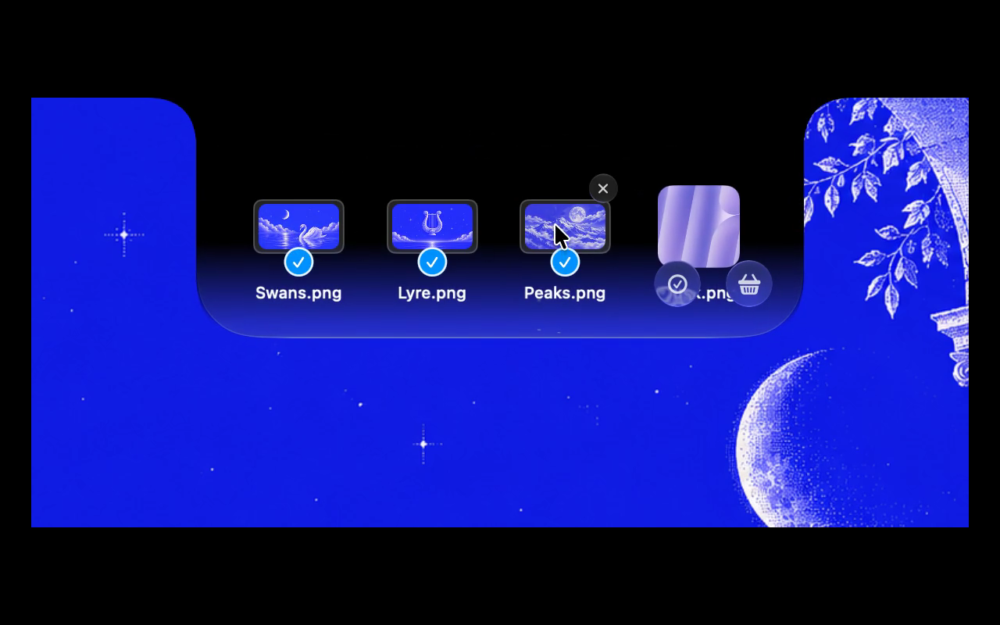
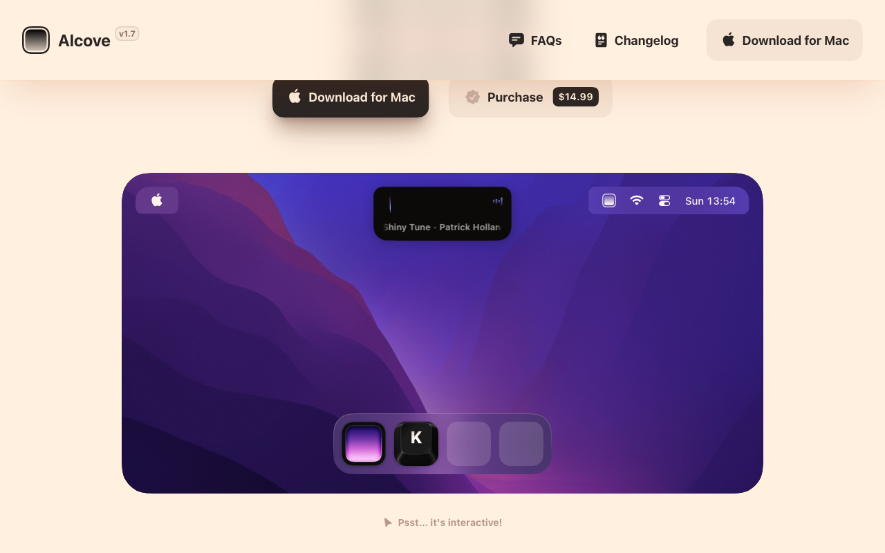

# Perch 노치 UI/UX 참고 조사

조사일: 2026-10-11. 목적: 물리 노치·메뉴바·앱 패널이 따로 보이는 문제를 해결하고, 파일을 잠깐 모아 이동·복사·변환하는 화면의 기준을 정한다. 앱 설치나 실제 기기 실행은 하지 않았다. 공식 제품 설명·공식 공개 소스와 브라우저에서 확인한 공식 시연을 근거로 삼았으며, 제안은 관찰 사실과 구분한다.

## 먼저 바꿀 설계

Perch는 ‘노치 아래에 나타나는 별도 창’ 대신 **화면 상단에 붙어 있는 하나의 검은 형태가 노치에서 좌우·아래로 늘어나는 화면**을 목표로 한다. 메뉴바 자체를 앱 UI처럼 바꾸는 것이 아니라, 중앙의 검은 표면이 하드웨어 노치와 연결되어 보이게 한다. 메뉴바 좌우의 실제 메뉴는 계속 운영체제 영역이다. 이 결론은 아래 Droppy의 제품 설명과 Boring Notch의 형태·애니메이션 코드에서 도출한 설계 제안이다.

## 확인한 사례

### Droppy: 노치에서 자라나는 하나의 표면

- 공식 문서는 하드웨어 노치에서 커져 나오는 형태와, 노치 없는 화면의 떠 있는 island를 구분한다. 호버·드래그 진입으로 열고, 포인터가 나가면 설정한 지연 후 접는다. 열림 크기와 애니메이션 속도도 조정할 수 있다. 텍스트 입력 위젯이 아닌 경우에는 키보드 포커스를 가져가지 않는다고 명시한다. 실제 기본 지연 시간은 문서로 확인하지 못했다. [노치 문서](https://getdroppy.app/docs/notch)
- 파일 트레이는 파일을 받아 보관하고 다시 드래그해 꺼내는 흐름이다. 성공한 드롭 뒤 트레이 페이지를 보여주는 옵션이 있다. 원본 보호 옵션은 복사만 허용하며, 이를 끈 경우에는 같은 디스크로 드래그하면 이동하고 다른 디스크로는 복사한다. 따라서 ‘선반에서 꺼낸다’와 ‘원본을 옮긴다’는 별도로 설계해야 한다. [파일 트레이 문서](https://getdroppy.app/docs/shelf)
- 트레이 안에 2~4개의 작업 타일을 둘 수 있고, 파일을 타일에 놓으면 해당 작업을 실행한다. Convert 타일은 출력 형식을 묻는다. Perch가 파일 선반과 변환을 같은 흐름 안에서 제공할 때 참고할 만하다. [Quick Actions 문서](https://getdroppy.app/docs/quick-actions)
- 공식 홈은 검은 노치에서 유리 재질로 이어지는 Dynamic Glass 스타일도 소개한다. 따라서 모든 노치 앱이 항상 불투명 검정을 쓴다고 일반화할 수는 없다. Perch의 첫 구현은 노치 경계가 드러나지 않는 불투명 검정으로 시작하고, 재질 효과는 이후 판단한다. [공식 홈](https://getdroppy.app/)

### Boring Notch: 형태와 내용의 애니메이션을 나누는 공개 구현

소스 기준: main의 커밋 `64b545929cf31681e09b5c375859c1eceeb733eb`. 다음 설명은 그 버전의 구현 관찰이며 모든 앱에 적용되는 플랫폼 규칙이 아니다.

- 배경은 검정이고, 상단 정렬한 전체 화면에 사용자 정의 `NotchShape`를 적용한다. 상단 접합부를 검정 1pt 사각형으로 보강한다. 단순한 둥근 사각형 패널 대신 화면 윗변에 연결되는 어깨와 둥근 아랫변을 만들고, 위·아래 모서리 값도 애니메이션 가능하게 구성한다. [ContentView.swift](https://github.com/TheBoredTeam/boring.notch/blob/64b545929cf31681e09b5c375859c1eceeb733eb/boringNotch/ContentView.swift#L91), [NotchShape.swift](https://github.com/TheBoredTeam/boring.notch/blob/64b545929cf31681e09b5c375859c1eceeb733eb/boringNotch/components/Notch/NotchShape.swift)
- 외형의 열림에는 interactive spring을 쓰고, 내부 내용에는 상단 기준 scale과 opacity 전환을 함께 적용한다. 즉 패널 안의 내용을 처음부터 같은 속도로 잡아 늘리기보다 외형과 내용의 전환을 각각 정의한다. 코드의 값은 spring response 0.38·damping 0.8, 내용 전환 0.35초다. **이 값은 참고 구현일 뿐 Perch의 확정 사양은 아니다.** ‘외형을 모두 연 다음 내용이 나온다’는 순차 동작은 이 코드로 확인되지 않는다. [애니메이션 선언](https://github.com/TheBoredTeam/boring.notch/blob/64b545929cf31681e09b5c375859c1eceeb733eb/boringNotch/ContentView.swift#L40), [내용 전환](https://github.com/TheBoredTeam/boring.notch/blob/64b545929cf31681e09b5c375859c1eceeb733eb/boringNotch/ContentView.swift#L346)
- 드래그가 드롭 영역에 들어오면 선반을 선택해 열고, 나가면 종료 작업을 지연한다. 그 사이 재진입하면 이전 종료 작업을 취소한다. 성공한 드롭 이벤트는 한 번의 종료 판단을 건너뛰게 하며, 공유 선택기가 활성화된 동안에도 닫힘을 막는다. 경계 근처 왕복이나 AirDrop 선택기 때문에 화면이 갑자기 접히지 않도록 한 장치다. [드롭 타깃 상태 처리](https://github.com/TheBoredTeam/boring.notch/blob/64b545929cf31681e09b5c375859c1eceeb733eb/boringNotch/ContentView.swift#L217), [공유 상태](https://github.com/TheBoredTeam/boring.notch/blob/64b545929cf31681e09b5c375859c1eceeb733eb/boringNotch/models/SharingStateManager.swift)
- 선반에서 이미 드래그를 시작한 상태는 드롭 처리에서 거부한다. 선반 항목을 다시 자기 선반에 추가하는 상황을 방어한다. [ShelfView.swift](https://github.com/TheBoredTeam/boring.notch/blob/64b545929cf31681e09b5c375859c1eceeb733eb/boringNotch/components/Shelf/Views/ShelfView.swift#L35)
- 창은 투명한 NSPanel이며 기본 창 그림자를 끄고, 메인·키 창이 되지 않도록 한다. SwiftUI 내용에서 검은 형태와 필요한 그림자를 직접 만든다. 이는 일반 앱 창의 제목줄·사각 경계가 드러나지 않게 하는 구현 참고다. [BoringNotchWindow.swift](https://github.com/TheBoredTeam/boring.notch/blob/64b545929cf31681e09b5c375859c1eceeb733eb/boringNotch/components/Notch/BoringNotchWindow.swift)

### NotchNook: 과거 공식 설명으로 제한

공식 제품 페이지의 검색 캐시는 v1.6.2를 표시하며 파일 선반·스크롤 스와이프·노치 없는 화면·다중 모니터 지원을 소개한다. 조사 시 직접 페이지 요청은 실패했고, 주 조사자의 실제 브라우저에는 `404: NOT_FOUND`가 표시됐다. **최신 데모를 직접 확인했다고 주장하지 않는다.** 세부 움직임·시간·현재 기능의 근거로 쓰지 않는다. [과거 공식 제품 페이지](https://lo.cafe/notchnook)

### Alcove: 움직임 참고, 파일 처리 근거로는 쓰지 않음

공식 사이트는 직접 조작 가능한 시연, 부드러운 전환, 스와이프 제스처를 강조한다. 이번 텍스트 조사로는 파일 트레이의 세부 규칙을 확인하지 못했으므로 형태·움직임의 시각 참고로만 다룬다. [공식 사이트](https://tryalcove.com/)

## Perch에 적용할 제안

다음은 Perch의 설계안이며 제품에서 관찰한 사실이나 확정 구현 결과가 아니다.

1. **상단 고정, 틈 없는 검정 표면.** 열리고 닫힐 때 화면 윗변과 중앙축을 유지한다. 메뉴바 아래에서 시작하는 패널·노치와 떨어진 간격·별도 제목줄은 제거한다. 화면 전체 메뉴바를 검정으로 덮을 필요는 없다.
2. **노치 몸체가 커지는 외형.** 윗변이 화면 끝에 붙고 좌우 어깨가 이어지며 아랫모서리는 부드러운 형태다. 내부에는 물리 카메라 영역을 비워 두고 실제 조작 내용을 그 아래에 배치한다. ‘노치에서 열린다’는 인상과 ‘내용은 카메라 아래에 있다’는 배치는 양립한다.
3. **외형과 내용의 움직임 분리.** 열림 초반에는 파일명·버튼이 좁은 면적에서 잘리거나 찌그러져 보이지 않게 opacity와 짧은 위치 이동을 사용한다. 닫힐 때는 내용이 먼저 사라지거나 충분히 흐려진 뒤 외형이 줄어들도록 시안에서 확인한다. 구체적 지연·spring 수치는 실제 화면에서 조정한다.
4. **작은 파일 선반에 집중.** 펼치면 파일 썸네일 한 줄과 선택 개수, 필요한 작업만 보인다. 목적지·변환 옵션은 해당 작업을 고른 다음 같은 검은 표면 안에서 표시한다. 음악·캘린더·위젯 탐색은 넣지 않는다. 닫힌 상태는 사용자의 요구대로 기본 노치 크기로 숨긴다.
5. **드래그 중에는 접히지 않음.** 진입·이탈 상태가 흔들려도 닫힘 예약을 취소하고, 드래그 세션·드롭 검증·팝오버/목적지 선택 중에는 열린 상태를 보호한다. 드롭 성공 뒤에는 방금 담긴 파일이 보이고, 취소되면 원래 목록을 유지한다.
6. **이동과 선반 비우기를 구분.** 담기는 파일 참조만 보관한다. 기본 드래그 아웃은 원본 보호를 위해 복사로 시작한다. 선반 항목 제거는 원본 삭제가 아니다. 작업 성공을 확인하기 전에는 선반에서 항목을 빼지 않는다. 명시적 이동·복사는 목적지와 충돌 결과를 보여준다.
7. **메뉴바·외부 화면은 별도 검증.** 펼친 폭이 실제 메뉴 항목을 덮는지, 메뉴바 자동 숨김과 전체 화면에서도 상단 연결이 유지되는지 확인한다. 노치 없는 화면에 동일한 물리 노치 크기를 가정하지 않는다. 이것은 제품 문서의 지원 선언만으로 해결됐다고 볼 수 없다.

## 첫 시안의 확인 기준

- 밝은 배경에서도 화면 윗변 → 하드웨어 노치 → 펼친 검정 몸체 사이에 틈이나 다른 재질의 경계가 보이지 않는다.
- 펼침·접힘 동안 중앙과 상단 기준점이 움직이지 않고, 내부 파일 아이콘·텍스트가 함께 늘어나거나 찌그러지지 않는다.
- Finder에서 여러 파일을 끌고 와서 경계를 왕복해도 화면이 접히지 않는다. 드롭 성공·취소·드래그 아웃 실패를 구분한다.
- 선반의 제거·복사·이동이 각각 무엇을 바꾸는지 사용자가 예측할 수 있으며, 성공 전 원본이나 선반 기록이 사라지지 않는다.

검증 한계: 공식 영상 프레임·공식 웹 시연·문서·공개 코드 조사이며 실제 앱의 체감 지연, 실기기 노치 크기, Finder 상호작용, 메뉴바 및 전체 화면 간섭은 미검증이다. 현재 Perch 구현 파일도 이 작업 폴더에서는 확인되지 않아 구체적인 수정 지점까지 지정하지 않았다.

## 직접 확인한 공식 시연

### Droppy 파일 트레이 영상

공식 홈의 video 요소에서 연결된 [파일 트레이 원본 영상](https://droppy-releases.jordylegrand.workers.dev/site-assets/bento/bento-tray-20260930.mp4)을 브라우저로 열어 확인했다. 영상 길이는 약 12.2초이고, 1초 지점에는 축소된 노치로 파일을 끌고 오는 모습, 4초 지점에는 선택된 썸네일과 파일명을 담은 열린 선반이 보인다. 재생 위치는 실제 애니메이션 소요 시간의 측정값이 아니다. 열린 외곽은 영상 속 화면 윗변에 붙고, 상단의 검정에서 하단의 반투명한 재질로 연결된다. 이 영상에는 메뉴바 전체가 나오지 않으므로 실제 메뉴바 충돌 여부까지 판단하지 않는다.

### Alcove 공식 웹 데모

[공식 홈](https://tryalcove.com/)의 실제 표시 버전은 v1.7이었다. Press to unlock을 누른 뒤 중앙 음악 표면에 hover하여 상태 변화와 펼쳐짐을 확인했다. 이 웹 시연은 위에서 떨어진 둥근 Island 형태를 보여준다. 따라서 물리 노치에 붙는 윤곽의 증거로 쓰지 않고, 작은 표면의 상태 변화와 간결한 내용 배치 참고로만 삼는다. 웹 시연의 동작은 설치된 macOS 앱과 같은 결과를 보장하지 않는다.

