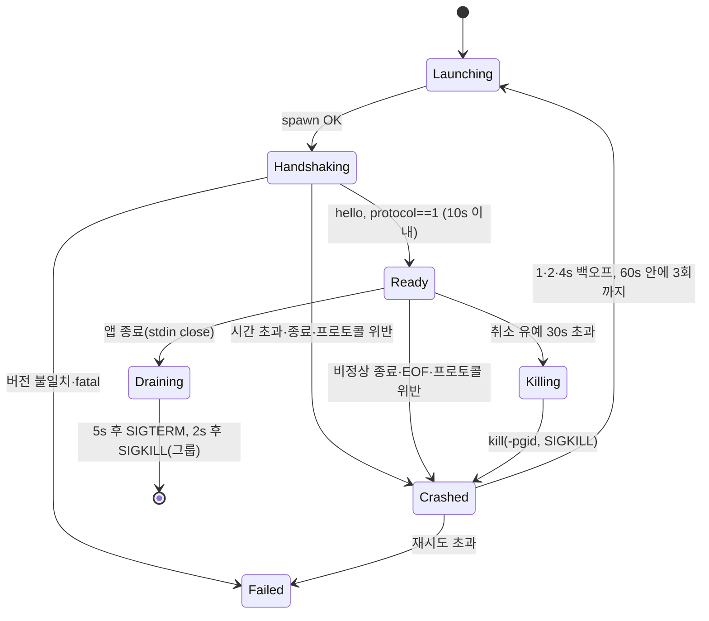

# FileToX 변환 host 설계

Mac 전용 SwiftUI 앱의 변환 작업을 처리하는 C# 보조 실행 파일(이하 host)의 설계다. host와 Swift 연동을 구현했다. 이 문서는 설계 기준이며 실제 검증 상태는 [구현 현황](../../EngineHost/IMPLEMENTATION.md)과 [README](../../README.md)를 따른다. 형식 등록과 모든 조합의 런타임 지원은 구분한다.

근거 소스는 Filee 커밋 `21fdd05ef7181b032ed83ec895cc9bbc4b198985`(1.8.1)이고, 경로는 그 저장소 기준이다. SDK 10.0.401로 arm64 self-contained 게시와 실제 변환을 확인했다. 아래의 게이트에는 아직 수행하지 않은 배포·외장 볼륨 검증도 포함한다.

## 1. 결정 요약

| 항목 | 결정 |
| --- | --- |
| 구조 | Swift `EngineHost` actor → stdio NDJSON → host 프로세스 1개 → Filee `JobQueue`·`UserDataStore`·`ConverterCatalog`. Avalonia(`Filee.App`)와 `Filee.Cli`는 참조하지 않는다. |
| Filee 소스 | `Vendor/Filee`의 버전은 위 커밋으로 고정하고, 빌드 변경은 `Vendor/Filee.patches/*.patch`로 관리한다. 빌드 스크립트가 검증한 원본을 별도 빌드 폴더로 복사하고 그 사본에만 `git apply --check` 후 패치를 적용한다. 원본 manifest와 패치 해시를 빌드 기록에 보존한다(`macos-packaging.md`와 같다). submodule은 쓰지 않는다. `.reference/`는 조사용이다. |
| Filee 패치 | `Vendor/Filee.patches/`에 원본 보호·출력 확정과 staging에 따른 엔진 경로 보정 패치를 둔다. 원본은 수정하지 않으며 각 패치에 회귀 검증을 연결한다. |
| 버전 | `net10.0`, Filee `Directory.Packages.props`의 패키지 버전과 NuGet lock 파일. host는 자체 `global.json`에 **정확한 SDK 버전**을 적고 `rollForward: disable`로 둔다. CI는 그 버전을 설치한다. Filee의 `latestFeature`는 다른 feature band도 허용하므로 재현성 근거로 쓰지 않는다. |
| 최소 OS | 최소 지원 OS는 macOS 15(.NET 10 공식 지원 범위). Swift 패키지·Xcode 타깃 모두 macOS 15로 맞췄다. |
| SDK | 10.0.401. `Config/EngineHost.global.json`에서 고정하고 `~/.dotnet`의 공식 SDK로 빌드했다. |
| 라우팅 | 경로 탐색, 프로필 선택, 프리셋 사용 가능 여부, 출력 이름은 모두 host(C#)가 판단한다. Swift는 결과만 표시한다. |
| 설정의 기준 | 프리셋, 프로필, 설정, 이력은 host의 `UserDataStore`만 기준으로 삼는다. Swift는 받은 전체 값을 편집해 되돌려 보낸다. |
| 언어·테마 기본값 | 새 FileToX 데이터는 영어(`en`)·블루(`#3478F6`)으로 시작한다. 명시적인 기존 언어·사용자 지정 색은 보존한다. |
| 데이터 경로 | `~/Library/Application Support/FileToX/core`(설정), `…/engines`(다운로드 엔진), `TMPDIR=…/tmp`. Filee의 기존 설정·이력·다운로드 기본 경로에 자동으로 기록하지 않는다. |
| 작업 동시성 | 작업은 하나씩, 작업 안의 파일은 CPU 수만큼 병렬, 엔진별 `MaxParallelism` gate. |
| 파일 안전 | 최종 출력은 같은 폴더의 숨김 staging 폴더에 쓴 뒤 경로별 rename으로 확정한다. 묶음 전체의 원자성은 약속하지 않는다(6절). |
| ImageIO 경로 | 실제 helper 이미지·PDF·압축 통합 검증 후 기존 Swift `ImageConverter`를 삭제했다. |


## 2. CLI 연동 평가

| 확인한 사실(소스) | 영향 |
| --- | --- |
| `Filee.Cli/CliHost.cs`는 `internal`이고 `InternalsVisibleTo`는 테스트만 허용한다. | 공개 참조로 연결할 수 없으므로 host에서 직접 조립한다. |
| `Program.cs`가 `Cli.RunAsync(args, …)`를 `createHost` 없이 호출해 `CliHost.Create()`가 `UserDataStore.DefaultDirectory`, 즉 Filee의 데이터 폴더를 쓴다. | 데이터 폴더를 바꿀 수 있는 공개 옵션이 없다. `Load()`는 스키마를 이전하면서 `settings.json`·`presets.json`을 다시 쓰므로 Filee 사용자 데이터가 바뀔 수 있다. 독립 상태 요구를 위반한다. |
| `convert --json`은 완료 후 JSON 한 개만 출력한다(`Cli.WriteJson`). | 진행률, 실행 중 취소, 작업 상태를 받을 수 없다. |
| `formats`·`presets`는 사람이 읽는 텍스트로 출력한다. 프로필, 설정, 이력, 엔진 상태 명령은 없다. | 도넛, 프리셋 편집, 홈 화면을 구현할 수 없다. |
| CLI는 이력을 기록하지 않는다(`ConversionService.OnJobFinished`는 App에만 있다). | 홈의 최근 변환 목록을 유지할 수 없다. |
| 호출마다 새 프로세스가 엔진 상태 검사와 Magick 초기화를 반복한다. | 도넛을 열 때마다 지연이 생긴다. |

전용 host를 구성한다. CLI 설계에서 참고할 패턴은 다음과 같다.

- 조립: `CliHost.Create`를 따르되 데이터 폴더를 인자로 받는다.
- 큐 연결: `Cli.RunJobAsync`의 `JobUpdated` 구독, `job.Cancel`과 프리셋 해석 방식을 쓴다.
- 지역화: `ResolvePreset`의 `Settings.WithDefaultOutput(preset)`과 `EnglishTexts`처럼 i18n JSON을 임베드하는 방식을 쓴다.

## 3. Filee에서 쓰는 공개 API

| 용도 | API(경로) |
| --- | --- |
| 형식 | `FormatRegistry.Known`, `FindById`, `Detect(path)`(확장자 기준), `Folder="folder"`, `FileFormat(Id, DisplayName, Category, Extensions, Writable)`(`Filee.Core/Formats/`) |
| 엔진 | `EngineRegistry.CreateAll(EngineEnvironment)`, `FindPdfMerger`, `FindTiffMerger`, `FindFileCombiner`(`Filee.Engines/EngineRegistry.cs`), `IConverter.Id/DisplayName/Edges/MaxParallelism/GetStatus/ConvertAsync`, `EngineStatus(IsAvailable, ReasonKey, Detail, Version)`(`Filee.Core/Conversion/IConverter.cs`) |
| 경로 | `ConverterCatalog.All/Ordered/StatusOf/Refresh/Priority/CreatePlanner()/CreatePlanner(assumeInstalled)`, `RoutePlanner.Plan/CanConvert`(최대 3단계, `MaxSteps`) |
| 큐 | `JobQueue(catalog, pdfMerger, log, combiner, tiffMerger)`(패치 후 `onStaging` 추가), `Enqueue`, `JobUpdated`, `JobFinished`, `DisposeAsync`. `ConversionJob.Id/State/Files/Outputs/Progress/Cancel()`, `FileResult.SourcePath/State/Progress/Outputs/ErrorKey/ErrorDetail`, `JobState`, `FileState`(`Filee.Core/Conversion/`) |
| 프리셋 | `Preset`(`Image`, `Pdf`, `Document`, `Media`, `Archive`, `Output`), `OutputRule`, `RenameStep`, `OutputPathResolver.Resolve/RenameError`, `BuiltInData.SameAsSource="*"`(`Filee.Core/Presets/`) |
| 프로필 | `ToolbarProfile`(최대 12조각), `ProfileSelector.Select/CatchAll/DetectFormats`(`Filee.Core/Profiles/ToolbarProfile.cs`) |
| 저장 | `UserDataStore(dir).Load/SaveSettings/SaveLibrary/AddHistory/ClearHistory/ResetLibrary/Import/Export`. 원자적 쓰기와 `EnsureConsistency`를 제공한다(`Filee.Core/Settings/UserDataStore.cs`). |
| 설정 | `AppSettings.WithDefaultOutput`, `EnginePriority`, `EngineOwnCopies`, `KeepHistory`, `KeepFileDates`, `DefaultOutput`, `WatchFolders`, `Language` |
| 이력 | `HistoryEntry.From(job)`, `WatchRuleId`, `WatchResults.Of`(`Filee.Core/History/`) |
| 엔진 환경 | `EngineEnvironment.DownloadRoot`, `OwnCopies`, `SearchSystem`, `ForgetSystemCopies`, `FindBundled(name)`(`AppContext.BaseDirectory/engines/<name>`). 모두 **프로세스 전역 static**이다. |
| 다운로드 | `EngineDownloads.Packages`, `CanDownload`, `EngineInstaller(HttpClient, root).InstallAsync/IsInstalled/Uninstall`(`Filee.Engines/Infrastructure/`) |
| 감시 | `FolderWatcher(rule, ConvertFiles, …)`, `WatchRule.Apply(preset)`(`Filee.Core/Watching/`) |

host에서 처리할 C# 로직은 다음 세 가지다(참고 위치는 `Filee.App`, 3은 엔진 관리 화면 단계). SwiftUI는 판단 결과를 표시한다.

1. `Services/PresetAvailability.Check` 약 30줄: 도넛 조각의 활성 여부와 사유를 판단한다. 합치기·묶기 예외와 `PackageEnabling`을 포함한다.
2. `Services/ConversionService.Start`·`OnJobFinished`: `WithDefaultOutput`을 적용하고 이력 항목에 `WatchRuleId`를 넣어 `AddHistory`를 호출한다.
3. `EngineDownloadService.PackageEnabling` 한 줄: `CreatePlanner(package.ConverterIds)`로 설치하면 가능해지는 변환을 판단한다.

## 4. 배치와 프로세스

번들 구조와 이름은 `macos-packaging.md`를 따른다. host는 `Contents/Helpers/FileToXEngine.app/Contents/MacOS/FileToXEngine`(self-contained, `osx-arm64`·`osx-x64` 별도)이고, `engines/rhwp`, `engines/7zip`은 `FindBundled`가 찾는 같은 폴더에 둔다.

Swift는 `Process`로 host를 실행할 때 다음을 넘긴다.

- 인자: `--data <AppSupport>/FileToX/core --engines <AppSupport>/FileToX/engines`. 앱에서는 `--lang`을 고정하지 않고 저장된 언어를 사용한다.
- 환경: 앱이 받은 환경을 그대로 넘기고 `TMPDIR=<AppSupport>/FileToX/tmp`만 덮어쓴다. `JobQueue.RunAsync`의 작업 폴더가 `Path.GetTempPath()/Filee/<jobId>`이므로 이것으로 Filee 임시 폴더와 분리한다. **PATH는 바꾸지 않는다.** `EngineEnvironment.SystemFolders`가 PATH 뒤에 `/opt/homebrew/bin`, `/usr/local/bin`, `/usr/bin`, `/bin`, `/opt/local/bin`과 LibreOffice·calibre의 `/Applications/…app` 위치를 이미 붙인다(`EngineEnvironment.cs:138-163`). 사용자가 지정한 위치는 `EngineOwnCopies`로 처리한다.

host의 시작 순서(엔진·Magick을 로드하기 **전에** 1–2를 끝낸다):

1. **프로토콜 fd 분리.** `proto = fcntl(1, F_DUPFD_CLOEXEC, 3)`으로 stdout 파이프를 새 fd로 복제하고 `dup2(2, 1)`로 fd 1을 stderr로 돌린다. 이후 프로토콜은 `new FileStream(new SafeFileHandle(proto, true), FileAccess.Write)`로만 쓴다. managed `Console.Write`뿐 아니라 네이티브 라이브러리의 `printf`/`write(1, …)`도 stderr로 간다. `CLOEXEC`이므로 `soffice`, `pandoc` 같은 하위 프로세스가 프로토콜 파이프를 물려받아 host 종료 후에도 Swift의 EOF를 막는 일이 없다. stdin도 하위 프로세스에 넘기지 않는다(Filee `ProcessRunner`는 표준 입출력을 리디렉션한다. G1에서 확인).
2. `setpgid(0, 0)`으로 프로세스 그룹 리더가 된다.
3. `core/.lock`을 `FileShare.None`으로 연다. 실패하면 `hello` 대신 `{"event":"fatal","data":{"code":"data_locked"}}`를 보내고 종료한다.
4. staging journal의 잔여 폴더를 정리한다(6절).
5. `EngineEnvironment.DownloadRoot`·`OwnCopies`, `new UserDataStore(dir).Load()`, `CreateAll`, `Priority`, `JobQueue(…, onStaging: journal.Append)`.
6. `hello`를 보낸다.

`EngineEnvironment`가 프로세스 전역 static이므로 프로세스 하나는 데이터 폴더 하나만 다룬다.

## 5. 프로토콜 (NDJSON over stdio)

- 한 줄은 UTF-8 JSON 객체 하나, 최대 4 MiB다. 요청 `{"v":1,"id":"…","method":"…","params":{…}}`, 응답 `{"v":1,"id":"…","result":…}` 또는 `"error":{"code","message"}`, 이벤트 `{"v":1,"event":"…","data":{…}}`.
- 오류 코드: `bad_request`(파싱 실패·4 MiB 초과·스키마 위반, id를 읽을 수 있으면 그 id로 응답), `unknown_method`, `invalid_input`, `not_found`, `conflict`(revision 불일치), `internal`.
- 직렬화: camelCase, 문자열 enum. Filee 타입(`Preset`, `ToolbarProfile`, `AppSettings`, `HistoryEntry`)을 host의 `JsonSerializerContext`로 직렬화한다(`FileeJsonContext`는 `internal`). null도 생략하지 않고 명시적으로 직렬화한다. 역직렬화에는 `UnmappedMemberHandling.Disallow`와, 모든 속성을 `IsRequired = true`로 바꾸는 `TypeInfoResolver` modifier를 건다. Swift가 필드를 빠뜨리거나 잘못 쓰면 기본값으로 조용히 덮이지 않고 `bad_request`가 된다. 이것이 "모든 옵션 보존"의 기계적 검사다.
- host 전용 JSON `ILocalizer`는 원본 `Assets/i18n/{en,ko,zh-CN}.json`과 `EngineHost/i18n/ja.json`을 사용한다. 일본어는 helper의 변환·엔진·오류·프리셋·프로필·형식·도넛 문구 151개를 제공하며, 사용하지 않는 Avalonia 화면 키는 영어로 fallback한다. FileToX staging 오류 3개는 영어·한국어·기존 중국어에도 별도 추가 리소스로 제공한다. `ja-JP`는 `ja`, `auto`·공백·알 수 없는 언어는 `en`으로 해석한다. `settings.save`는 host 재실행 없이 표시 언어를 갱신한다. 사용자 `Name`과 내장 `NameKey`는 번역해서 저장하지 않는다.
- FileToX 초기화가 기존 `auto`·공백 언어를 `en`으로 바꾼다. 이전 기본색 `#7F77DD`는 `core/.filetox-defaults-v1` marker가 없는 첫 초기화에만 `#3478F6`으로 이전한다. 설정을 먼저 원자적으로 저장한 뒤 marker를 쓰며 이후 사용자가 선택한 보라색은 유지한다. 원본 Core 기본값과 236개 Vendor 파일은 수정하지 않는다.
- 사용자에게 보이는 문구는 host가 `errorKey`와 번역문 `errorText`를 함께 보낸다(Filee `Assets/i18n/{en,ko}.json` 임베드, CLI `EnglishTexts`와 같은 방식). `{preset}` 파일명 토큰이 `ILocalizer.DisplayName`을 쓰므로 host 언어가 결과 파일명에 영향을 준다.
- **쓰기 단일화.** 모든 송신 메시지는 하나의 `Channel<byte[]>`에 넣고 writer task 하나가 proto fd에 쓴다. 메시지 순서는 이 채널에 넣는 순서다.

### 메서드

화면을 실제로 연결하는 단계에서만 메서드를 추가한다. 메서드별 CRUD는 만들지 않고 목록 전체를 저장한다.

| 단계 | 메서드 | 요청 → 결과 |
| --- | --- | --- |
| 1 도넛·홈 | (이벤트) `hello` | `protocol:1, hostVersion, fileeCommit, rid, dataDir` |
| 1 | `catalog.get` | `formats[]`(전체 `Known`, `folder` 포함), `engines[]`(`Ordered` 순서와 `EngineStatus`) |
| 1 | `selection.resolve` | `paths[]` → `profileId, formats[], unknown[], rejected[], slices[]`(`presetId, displayName, available, reasonKey, reasonText, runnableCount, needsPackage, canDownload, guidanceKey`) |
| 1 | `job.start` | `paths[]`, `presetId` 또는 `preset`(전체 Preset, 재시도용) → `jobId` |
| 1 | `job.cancel` | `jobId` → `{}`(끝난 작업이면 무시) |
| 1 | (이벤트) `job.updated`, `job.finished` | 7절 |
| 2 이력·편집 | `history.get`, `history.clear` | `entries[]` |
| 2 | `library.get` / `library.save` | `revision, settings, presets, profiles` / `baseRevision, presets, profiles` → 정리된 라이브러리와 새 `revision` |
| 2 | `settings.save` | `baseRevision, settings` → 저장 후 `Priority`·`OwnCopies` 재적용, `ForgetSystemCopies`, `Refresh` |
| 3 엔진·감시 | `engines.install` 등, `watch.status` | 해당 화면을 구현할 때 정의한다. |

종료 요청 메서드는 두지 않는다. stdin EOF가 곧 종료 요청이다(7절). 엔진 상태 새로고침은 `catalog.get`이 매번 `Refresh` 후 응답한다. 프리셋 편집기의 대상 목록은 `catalog.get`의 쓰기 가능 형식으로 그리고, 실제 가능 여부는 `selection.resolve`가 판단한다. 소스 형식별 도달 가능 목록이 편집기에 필요해지면 그때 `routes.query`를 추가한다.

### 예시

```json
{"v":1,"event":"hello","data":{"protocol":1,"hostVersion":"0.1.0","fileeCommit":"21fdd05ef7181b032ed83ec895cc9bbc4b198985","rid":"osx-arm64","dataDir":"/Users/u/Library/Application Support/FileToX/core"}}
{"v":1,"id":"7","method":"selection.resolve","params":{"paths":["/Users/u/문서/보고서 1.hwp","/Users/u/x.unknownext"]}}
{"v":1,"id":"7","result":{"profileId":"mixed","formats":["hwp"],"unknown":["/Users/u/x.unknownext"],"rejected":[],"slices":[{"presetId":"to-pdf","displayName":"PDF로","available":true,"runnableCount":1},{"presetId":"zip-all","displayName":"ZIP으로 묶기","available":true,"runnableCount":2}]}}
{"v":1,"id":"8","method":"job.start","params":{"paths":["/Users/u/a.pdf","/Users/u/b.png"],"presetId":"merge-pdf"}}
{"v":1,"id":"8","result":{"jobId":"3f9a01c2be"}}
{"v":1,"event":"job.updated","data":{"jobId":"3f9a01c2be","state":"running","progress":0.42,"files":[{"source":"/Users/u/a.pdf","state":"done","progress":1},{"source":"/Users/u/b.png","state":"running","progress":0.4}]}}
{"v":1,"event":"job.finished","data":{"jobId":"3f9a01c2be","state":"completed","files":[{"source":"/Users/u/a.pdf","state":"done","outputs":[{"path":"/Users/u/a (2).pdf","isDirectory":false}]},{"source":"/Users/u/b.png","state":"done","outputs":[]}],"historyEntry":{"jobId":"3f9a01c2be"}}}
```

예시의 프리셋 ID·이름·파일명은 형식 설명용이다. 실제 값은 `BuiltInData`와 `OutputPathResolver`가 정한다.

## 6. 경계와 파일 안전

### 입력 검증

판정의 기준은 host다. Swift는 표시용으로만 미리 거른다.

- 경로는 절대 POSIX 경로, NUL 없음. `FileSystemPaths.Comparer`로 중복 제거, 작업당 최대 10,000개.
- 존재하지 않는 경로는 `rejected`. 원격·외장 볼륨이라는 이유로는 거부하지 않는다. 같은 볼륨 rename이 실패하는 파일 시스템이면 그 파일만 실패로 보고된다.
- **형식을 알 수 없는 파일은 거부하지 않고 `unknown[]`으로 돌려준다.** `RunCombinedAsync`는 형식을 검사하지 않고 존재하는 파일·폴더를 그대로 묶는다(`JobQueue.cs:196-214`). 그래서 `Archive.CombineIntoOne` 조각은 unknown·폴더를 포함한 모든 입력을 `runnableCount`에 센다. 다른 프리셋에서 unknown 파일은 `error.unsupported_source`로 그 파일만 실패한다(`JobQueue.cs:311-313`). 배치를 조용히 거르지 않는다.
- 폴더 입력은 `CombineIntoOne` 조각에서만 사용할 수 있다. 다른 조각은 폴더를 `runnableCount`에서 뺀다.
- 프리셋 검사는 `library.save`와 인라인 `preset` 모두에 같게 적용한다.
  - `TargetFormat`: `Known`이면서 `Writable`이거나 `"*"`, `"folder"`.
  - 범위(참고: `Filee.App/Views/PresetEditorView.axaml`): `Quality` 1–100, `ResizePercent` 1–1000, `LongEdge` 16–20000, `Dpi` 36–2400, `RenderDpi` 36–1200, `MarginMm` 0–100.
  - `PageRange.Parse`, `OutputPathResolver.RenameError`, `CustomFolder`는 절대 경로.
  - 필드 누락·알 수 없는 필드는 5절의 직렬화 규칙으로 거부한다.
- 작업 시작 시 `Settings.WithDefaultOutput(preset)`을 적용한다(참고: `ConversionService.Start`).

### 결과 쓰기: 확인한 결함

- 엔진은 `IOutputAllocator.Allocate`가 준 최종 경로에 바로 쓴다(`ImageEncoder.Write`, `PdfiumConverter`, 병합기 3종). 여러 쪽 출력 도중 취소·실패하면 이미 쓴 `_p1…`이 남지만 `FileResult.Outputs`는 `RunFileAsync` 끝에서만 채워지므로(`JobQueue.cs:367-369`) 보고되지 않는다.
- `Overwrite`면 기존 파일을 제자리에서 덮어써 실패 시 손상된다. LibreOffice는 작업 폴더에서 `File.Move(…, overwrite: true)`로 옮기는데(`LibreOfficeConverter.cs:98-101`) 작업 폴더와 대상이 다른 볼륨이면 복사가 된다.
- 실패한 출력의 예약(`_reservedOutputs`)은 해제되지 않는다(`JobQueue.cs:105-107`은 성공한 `job.Outputs`만 지운다).
- 출력 이름에서 파생한 sidecar가 있다. Pandoc `--extract-media=<이름>_files`(`PandocConverter.cs:84`), Ebook Markdown 이미지 폴더(`EbookConverter.cs:195-196`). **출력 파일 이름을 임시 이름으로 바꾸면 이 상대 링크가 깨진다.** 이전 설계의 `.<이름>.ftx-<hex>.<ext>` 방식은 이 때문에 쓸 수 없다.

### 결과 쓰기: Filee 패치 (`0001-jobqueue-staged-outputs.patch`)

decorator 4종(`StagedConverter`, `StagingAllocator`, 병합기 래퍼 3개) 대신 출력 경로를 이미 독점하는 `JobQueue.FinalAllocator` 한 곳을 고친다. 변경은 `JobQueue.cs` 약 30줄과 새 파일 `Conversion/OutputCommit.cs` 약 80줄, 테스트 1개 파일이다.

**할당.** `FinalAllocator.Allocate(ext, suffix)`는 지금처럼 lock 안에서 `OutputPathResolver.Resolve`로 최종 경로 `final`을 정하고 예약한다(충돌·Skip·`(2)`·원본 경로 규칙 그대로). 그다음 `final`과 같은 폴더에 `.filee-out-<8hex>/` 폴더를 만들고, `onStaging(stageDir)`을 호출한 뒤 `stageDir/<final의 파일 이름>`을 돌려준다. 파일 이름이 최종 이름과 같으므로 확장자 기반 엔진(Pandoc)과 sidecar 상대 링크가 그대로 동작한다. `Allocate` 호출마다 staging 폴더가 따로 생기므로 여러 쪽 출력의 sidecar가 섞이지 않는다.

**확정(commit).** 할당자를 쓰는 네 곳(`RunFileAsync` 마지막 단계, `RunMergedAsync`, `RunMultiPageTiffAsync`, `RunCombinedAsync`)에서 변환·병합이 성공하면 `ct.ThrowIfCancellationRequested()` 후 `allocator.Commit(file.Outputs)`를 호출한다. 할당 순서대로 각 staging 폴더를 처리한다.

1. 주 출력이 없으면(엔진이 할당만 하고 쓰지 않음) 건너뛴다.
2. `final`이 이미 있고 정책이 `Overwrite`이면, 먼저 `final`과 작업의 모든 원본의 `(st_dev, st_ino)`를 `lstat`(arm64 `lstat`, x64 `lstat$INODE64`)으로 비교한다. 같으면 `error.output_is_source`로 실패한다. NFC/NFD·대소문자 별칭과 디렉터리 심볼릭 링크 때문에 `PathsEqual`만으로는 원본을 못 지킨다. 하드링크는 rename이 디렉터리 항목만 바꾸므로 원본 내용이 바뀌지 않지만, inode가 같으므로 보수적으로 같은 실패로 처리한다. `final` 자리의 심볼릭 링크는 링크 자체만 교체된다(그래서 `stat`이 아니라 `lstat`으로 비교한다).
3. 파일 이동:
   - `Overwrite`: `rename(2)`. 그 경로 하나에 대해 원자적이다. 다른 프로세스는 이전 내용 전체나 새 내용 전체만 본다.
   - 그 외: `renamex_np(…, RENAME_EXCL)`. 예약 이후 다른 프로세스가 같은 이름을 만들었으면 덮어쓰지 않고 `error.output_exists`로 실패한다. 파일 시스템이 `ENOTSUP`이면 파일은 `link`+`unlink`로 같은 보장을 얻는다.
4. 폴더 이동(압축 풀기 `Allocate("")`, sidecar 폴더): `final`이 없으면 `RENAME_EXCL`(`ENOTSUP`이면 안전한 배타적 확정이 불가능하다는 오류로 종료; 존재 검사 후 일반 rename으로 우회하지 않는다). `final`이 있으면(`Overwrite`만 해당) **병합**한다. 항목마다 재귀적으로 3–4를 적용하고 기존 폴더의 다른 파일은 지우지 않는다. 폴더를 통째로 교체해 사용자 파일을 지우는 방식은 쓰지 않는다.
5. 주 출력 외에 staging 폴더에 남은 항목(sidecar)도 같은 폴더로 3–4 규칙에 따라 옮긴다. sidecar는 `Outputs`에 넣지 않는다.
6. 성공한 `final`은 **옮긴 직후** `file.Outputs`에 추가한다. 그다음 staging 폴더를 지운다.

`KeepDates`의 `CopyDates`는 확정한 경로에 대해 실행한다.

**정리(abort).** 네 곳 모두 `finally`에서 `allocator.Abort()`를 호출한다. 확정하지 않은 staging 폴더를 지우고, 확정하지 않은 예약을 `_reservedOutputs`에서 뺀다.

**보장하는 것과 하지 않는 것.**

| 상황 | 결과 |
| --- | --- |
| 변환 중 실패·취소, `kill -9` | 최종 경로에는 아무것도 생기지 않는다. 기존 파일은 그대로다. staging 폴더는 `Abort` 또는 다음 시작의 journal 정리로 지운다. |
| 확정 전에 취소 | 위와 같다. 파일 상태는 `cancelled`, `outputs`는 비어 있다. |
| 확정 시작 후 취소 | 확정은 metadata 연산이라 중간에 멈추지 않는다. 파일은 `done`, 작업 상태는 취소 요청에 따라 `cancelled`일 수 있다. `outputs`는 실제로 옮긴 경로를 정확히 담는다. |
| N개 출력 중 k번째 확정 실패 | 1…k-1은 최종 경로에 있고(`Overwrite`였다면 이전 파일은 이미 새 내용으로 바뀜) `outputs`에 보고된다. k…N은 staging에서 지운다. 파일 상태는 `failed`, 오류는 k번째 이유. **묶음 전체를 되돌리지 않는다.** |
| `Overwrite`의 기존 파일 | 새 결과가 끝까지 만들어진 뒤에만, 경로 하나씩 원자적으로 교체된다. 손상된 덮어쓰기는 생기지 않는다. 이전 내용은 교체되면 남지 않는다(사용자가 고른 정책 그대로). |
| 폴더 `Overwrite` | 병합한다. 각 파일 교체는 원자적이지만 폴더 전체는 아니다. 중간 실패 시 일부 파일만 교체된 상태가 될 수 있고, 결과에는 폴더 경로와 실패 이유가 함께 보고된다. |

UI에서 형식이나 옵션을 숨겨 이 문제를 피하지 않는다.

**journal.** host가 `onStaging` 콜백에서 `core/staging.journal`에 경로를 한 줄씩 append·flush한다. 시작할 때 각 줄 중 마지막 구성요소가 `.filee-out-[0-9a-f]{8}`인 폴더만 재귀 삭제하고 journal을 비운다. 정상 종료에서는 `Abort`가 이미 지웠으므로 남은 줄은 무시된다.

**패치 테스트**(`tests/Filee.Core.Tests/JobQueueStagingTests.cs`, 기존 `FakeConverter` 사용):

- 3쪽 출력 중 2쪽 후 예외 → 최종 폴더에 `_p*` 없음, staging 폴더 없음, 예약 해제(같은 이름 재실행이 `(2)`가 붙지 않음).
- `Overwrite` 대상 기존 파일 + 변환 실패 → 기존 파일 해시 그대로.
- sidecar(`x_files/img.png`)를 쓰는 가짜 변환기 → 확정 후 `x.html`과 `x_files/img.png`가 같은 폴더에 있음.
- 2개 출력 중 두 번째 확정 실패(대상 자리에 폴더를 미리 만듦) → 첫 번째만 `Outputs`에 있고 파일은 `failed`.
- 예약 후 외부에서 같은 이름 생성 → 덮어쓰지 않고 `error.output_exists`.
- NFD 경로의 `CustomFolder` + `Overwrite`로 원본과 같은 파일을 가리킴 → 원본 해시 그대로, `error.output_is_source`.
- 폴더 `Overwrite`: 기존 폴더의 무관한 파일이 남아 있음.

### 진행 중 스냅샷의 일관성

`FileResult.Outputs`는 `List<string>`이고 `State`·`Progress`와 함께 여러 파일 worker가 lock 없이 바꾼다. 다른 스레드에서 `Outputs`를 열거하면 `InvalidOperationException`이나 찢어진 값을 볼 수 있다. 공유 lock을 Filee 전체에 넣는 대신 읽는 범위를 줄인다.

- `job.updated`에는 작업 `state`, 파일별 `state`·`progress`·`errorKey`만 넣는다. 각각 enum·double·문자열 참조 하나라 64비트에서 찢어지지 않는다. 순간적으로 파일 간 값이 어긋날 수는 있지만 다음 스냅샷에서 맞춰진다.
- `outputs`, `errorDetail`, `historyEntry`는 `job.finished`에만 넣는다. `JobFinished`는 `Parallel.ForEachAsync`와 병합기를 모두 await하고 `finally`를 지난 뒤 같은 worker에서 호출되므로(`JobQueue.cs:88-112`, 취소된 대기 작업은 `423-433`) 그 시점에는 `Outputs`를 바꾸는 코드가 없다.
- `Progress<double>` 콜백은 thread pool에서 늦게 도착해 `JobFinished` 뒤에 `JobUpdated`를 부를 수 있다. host는 끝난 작업의 `JobUpdated`를 버린다(7절).
- 테스트: 64개 파일 × 파일당 20개 출력을 내는 가짜 변환기를 돌리면서 다른 스레드가 1 ms마다 `job.updated` 스냅샷을 직렬화한다. 예외가 없어야 하고, `job.finished`의 출력 수가 1,280개와 같아야 한다.


## 7. 수명 주기

### host 프로세스 (Swift 감독자)



- **프로토콜 위반은 곧 Crashed다.** Swift가 host 출력에서 줄 길이 초과, JSON 파싱 실패, 알 수 없는 응답 id, `v` 불일치를 만나면 그 줄만 버리지 않는다. 프로세스 그룹을 SIGKILL하고, 대기 중인 모든 요청 continuation을 `hostCrashed`로 즉시 실패시키고, 끝나지 않은 작업을 `interrupted`로 표시한다. EOF·종료 감지도 같은 경로를 탄다. 따라서 어떤 경우에도 continuation이 남지 않는다. 요청별 시간 제한(기본 30초, `job.start`는 응답만 기다리므로 같다)도 같은 실패 경로로 끝난다.
- `interrupted`는 Swift에만 있다. 자동으로 다시 제출하지 않는다.
- host는 stdin EOF나 proto fd 쓰기 실패를 감지하면 모든 작업을 `Cancel()`하고 최대 5초 기다린 뒤 종료한다.
- Swift는 stderr를 계속 읽어 크기 제한 로그에 기록한다. 읽지 않으면 pipe가 가득 차 host와 네이티브 라이브러리가 멈춘다.

### 작업 수락과 이벤트 순서

`JobQueue.Enqueue`는 채널에 쓴 **다음** 호출 스레드에서 `JobUpdated`를 부른다(`JobQueue.cs:49-55`). worker는 이미 그 작업을 실행하고 있을 수 있고, 빠른 작업은 `Enqueue`가 반환되기 전에 `JobFinished`까지 끝날 수 있다. 그래서 "응답 전 이벤트는 버린다"거나 "Enqueue 뒤 스냅샷을 다시 보낸다"로는 `job.finished`와 이력을 잃는다. host는 lock 하나(`gate`)로 순서를 정한다. 이 패턴은 Filee 패치 없이 host 안에서 끝난다.

```csharp
// job.start
lock (gate)
{
    var job = queue.Enqueue(paths, preset, name);   // 내부의 동기 JobUpdated는 같은 스레드(재진입) → jobs에 없으므로 무시
    jobs[job.Id] = new Tracked(job);
    send(Response(id, new { jobId = job.Id }));    // 송신 채널에 넣는 순서 = 실제 순서
}
// queue.JobUpdated (worker 스레드)
lock (gate) { if (jobs.TryGetValue(job.Id, out var t) && !t.Finished) t.Dirty = true; }
// 100 ms 타이머
lock (gate) { foreach (var t in jobs.Values.Where(t => t.Dirty && !t.Finished)) { send(Updated(t.Job)); t.Dirty = false; } }
// queue.JobFinished (worker 스레드, 작업당 1회)
lock (gate)
{
    var t = jobs[job.Id];
    var entry = NormalizeHistory(job, HistoryEntry.From(job)); // 아래 취소·재시도 보정
    store.AddHistory(entry); // KeepHistory 정책 적용; 연결 상태와 무관하게 처리
    rememberSessionRetry(job, entry); // 이력 저장을 꺼도 유지
    t.Finished = true; send(Finished(job, entry)); jobs.Remove(job.Id);
}
```

- worker의 이벤트는 `gate`에서 기다리므로 `job.start` 응답보다 먼저 나갈 수 없다. `Enqueue`는 worker를 기다리지 않으므로 교착은 없다.
- `JobFinished`는 Filee가 작업당 정확히 한 번 부른다(`RunAsync` 끝 또는 대기 중 취소 경로). 응답을 보낸 뒤에야 `gate`를 얻으므로 `jobs[job.Id]`는 항상 있다. `job.finished`는 정확히 한 번 나가고, 그 뒤 `job.updated`는 나가지 않는다.
- `send`는 채널에 넣기만 하므로 lock 안에서 stdout 쓰기를 기다리지 않는다. 진행 이벤트는 100 ms마다 작업당 최대 1개로 합쳐 채널 크기를 제한한다.
- 테스트: `ConvertAsync`가 즉시 끝나는 가짜 변환기로 `job.start`를 1,000번 보내 모든 작업에서 "응답 → (updated*) → finished 1회" 순서와 완료 이벤트와 이력 기록 호출 각각 1,000회를 확인한다. 저장된 이력은 원본 MaxHistory=200에 맞게 최신 200개여야 한다. 모든 설정·라이브러리 저장도 같은 gate로 직렬화한다.

### 작업 상태

```
submitted ─job.start 응답→ queued → running → completed | completedWithErrors | failed | cancelled
                                       └ (Swift 전용) cancelling → … | interrupted
```

| 상황 | 동작 |
| --- | --- |
| 대기 중 취소 | worker가 꺼낼 때 `cancelled`로 끝난다(`JobQueue.cs:427-432`). |
| 외부 프로세스 엔진 실행 중 | 토큰 취소로 Filee `ProcessRunner`가 프로세스 트리를 종료한다. G5에서 확인한다. |
| 내장 라이브러리 실행 중(Magick, PDFium 등) | 다음 확인 지점에서 반영된다. Swift는 `cancelling`을 표시한다. |
| 30초 안에 `job.finished`가 오지 않음 | Swift가 host 프로세스 그룹을 SIGKILL한다. 큐의 다른 작업도 `interrupted`가 된다. staging은 journal로 정리한다. |
| 엔진 시간 제한 | Filee 엔진별 고정값(LibreOffice 3분, Pandoc·rhwp 2분, Ghostscript 5분, Calibre 10분, 7-Zip 6시간). 작업 전체 기한은 추가하지 않는다. |

## 8. 일괄 처리 모드와 결과 배열

### 병합 취소·재시도 보정

PDF·TIFF 병합기가 예외를 내면 원본 JobQueue는 파일들이 `done`이어도 작업을 `failed`로 끝낼 수 있다. 취소 예외도 이 경로를 타므로 host의 완료 DTO와 이력은 취소 토큰이 요청됐으면 `cancelled`로 보정한다. `ConversionJob.State`를 host가 임의로 바꾸지는 않는다. 압축으로 묶기의 취소는 원본에서 이미 따로 처리하므로 같은 버그라고 간주하지 않는다.

`HistoryEntry.From`은 `FileState.Failed`만 Failures에 담고 그 목록이 있어야 Preset을 남긴다. 따라서 파일 실패가 없는 작업 수준 `failed`·`cancelled`에서는 원래 입력 전체와 당시 프리셋 복제본을 별도의 `retrySources`·이력 Preset에 보존한다. 파일별 실패가 있으면 해당 파일들만 재시도한다. `KeepHistory=false`여도 최근 완료 작업의 재시도 정보는 host 메모리에 최대 200개 유지한다. G7은 PDF 병합 실패·병합 중 취소·이력 저장 끔을 포함한다.

결과는 항상 배열이고 각 항목은 `{path, isDirectory}`다. 작업 수준 결과는 파일별 `outputs`의 합이므로 따로 보내지 않는다.

| 모드(`JobQueue`) | 조건 | 결과 |
| --- | --- | --- |
| 파일별 | 기본 | 파일마다 0개 이상. 여러 쪽(`_p1…`), 시트별, 분할 결과는 그 파일의 `outputs[]`에 들어간다. 형식을 모르는 파일은 그 파일만 `error.unsupported_source`. |
| PDF 합치기 | `Pdf.MergeIntoSingle`, 대상 `pdf`, 파일 2개 이상 | 첫 파일 이름으로 1개, 첫 파일의 `outputs`. 나머지는 `done`이고 `outputs`가 비어 있다. 날짜 유지는 적용하지 않는다. |
| 다중 페이지 TIFF | `Image.MultiPageTiff`, 대상 `tiff` | 첫 파일 이름으로 1개. |
| 압축으로 묶기 | `Archive.CombineIntoOne`, 대상이 Archive 분류(`folder` 제외) | 존재하는 모든 입력(형식을 모르는 파일과 폴더 포함)을 그대로 묶어 1개. 사라진 입력만 그 파일이 실패한다. |
| 압축 풀기 | 대상 `folder` | 폴더 1개, `isDirectory: true`. 기존 폴더 + `Overwrite`는 병합(6절). |
| 원본과 같은 형식 | 대상 `*` | 자기 형식으로의 직접 변환(edge)이 필요하다. |
| Skip 충돌 | `ConflictPolicy.Skip` | `skipped`, 결과 없음. 합치기·묶기에서는 모든 파일이 `skipped`. |
| 확정 일부 실패 | 6절 | 옮긴 경로만 `outputs`, 파일은 `failed`. |


## 9. 엔진 구분 (macOS)

설치 안내를 만드는 원본 `PackageEnabling`은 `CanDownload`를 검사하지 않는다. host에서는 누락 패키지와 macOS 다운로드 가능 여부를 함께 판단해 `needsPackage`, `canDownload`, `guidanceKey`를 반환한다. FFmpeg처럼 `canDownload=false`이면 설치 버튼 대신 시스템 설치·사용자 경로 지정 안내를 표시한다. G3의 `mp4→mp3` 표본은 이 안내도 확인한다.

엔진의 사용 가능 여부는 런타임의 `EngineStatus`만 기준으로 삼는다. 아래 표는 소스에서 읽은 예상일 뿐이다.

| 구분 | 엔진(근거) |
| --- | --- |
| host에 포함(NuGet) | `magick`, PdfSharp, PDFium, unhwp, Markdig, spreadsheet, ooxml, hwpx-writer, archive(SharpCompress), vector(Svg.Skia), icns, font, docx-writer, pdf-text, email, cad(ACadSharp), ebook. 단, 네이티브 바이너리가 `osx-arm64`·`osx-x64`에서 실제로 로드되는지는 G3·G6에서 확인한다. |
| 앱 번들에 포함 | `rhwp`, `7zip`(`engines.json`의 `platforms.osx-*`, `fetch-portable-engines.ps1` 기본값) |
| 다운로드 가능(osx) | `pandoc`, `calibre`, `libreoffice`(`engines.json`의 `platforms.osx-arm64/x64.components`) |
| 다운로드 없음(osx) | `ffmpeg`, `ghostscript`는 osx 목록에 없다. 사용자가 지정한 위치(`EngineOwnCopies`)나 시스템 PATH로만 쓸 수 있다. 영상·음성 변환은 기본 설치 상태에서 사용할 수 없다고 표시한다. |
| Windows 전용 | EMF·WMF 등은 macOS 사유와 함께 표시한다. |

## 10. Swift 쪽 범위

- `Sources/Core/Host/EngineHost.swift`: actor 하나. 프로세스 실행·그룹 종료·백오프, stderr 로그, 줄 분리, 요청 id ↔ continuation, 이벤트 `AsyncStream`, 7절의 위반 처리. 계층을 나누지 않는다.
- `Sources/Core/Host/HostModels.swift`: Codable. 응답·이벤트는 타입으로 읽되 프리셋·프로필·설정 편집 초안은 원본 JSON 전체를 보관하고 편집한 필드만 바꾼다. null·배열 순서·화면에 없는 옵션을 보존한다. host는 고정 버전의 전체 필드와 enum을 검증하고 누락·미지 필드는 `bad_request`로 거절한다(5절). 버전이 다른 라이브러리를 조용히 덮어쓰지 않는다.
- 편집기의 옵션 표시 규칙(`PresetEditorViewModel.Show*`)은 UI 로직이므로 Swift에서 구현한다. 사용 가능 여부는 `selection.resolve` 결과만 쓴다.
- macOS에서 의미 없는 Filee 설정(`Triggers`, `ExcludedProcesses`, `StartWithSystem`, `ContextMenuEnabled`, `CheckForUpdates`, `Paused`, 피드백 항목)은 표시하지 않고 보존한다. 호출 키와 로그인 항목은 Swift(AppKit, SMAppService)가 관리한다.

## 11. 완료 기준

| 게이트 | 통과 조건 |
| --- | --- |
| G0 빌드 | `Vendor/Filee`(`21fdd05`) + 모든 패치가 `git apply --check`를 통과하고, host `global.json`의 정확한 SDK로 `dotnet build`·host 테스트·`JobQueueStagingTests`가 통과한다. Filee `Filee.Core.Tests`·`Filee.Engines.Tests`를 macOS에서 실행하고 패치 전후 실패 목록이 같아야 한다(패치가 새 실패를 만들지 않음). |
| G1 프로토콜 | `hello`, 버전 불일치, 잘못된 JSON, 4 MiB 초과 줄, 알 수 없는 메서드, 필드 누락·알 수 없는 필드. **네이티브 쓰기:** 변환 중 P/Invoke `write(1, …)`·`printf`를 줄바꿈 없이 반복 호출하는 가짜 변환기를 넣어도 Swift가 받은 스트림이 전부 유효한 JSON이어야 한다. `Console.WriteLine`도 같다. 하위 프로세스가 proto fd를 물려받지 않아야 한다(`lsof -p <child>`). 응답이 같은 작업의 이벤트보다 먼저 와야 한다(7절 1,000회 테스트). Swift 쪽: 깨진 줄 주입 시 대기 중 요청이 모두 `hostCrashed`로 끝나야 한다. |
| G2 데이터 분리 | 실행 전후 Filee 데이터 폴더(`UserDataStore.DefaultDirectory`, `$TMPDIR/Filee`, 기존 `DownloadRoot`)의 해시가 같다. 작업 폴더가 `FileToX/tmp` 아래에 생긴다. 두 번째 host는 `data_locked`로 끝난다. |
| G3 변환 표본 | 각 항목은 결과 검증(파일 열기 또는 signature)을 통과하거나 `catalog`의 사유와 같은 이유로 불가 표시돼야 한다. `png→jpg`, `heic→png`, 여러 쪽 `pdf→png`, PDF 합치기, 다중 페이지 TIFF, ZIP 묶기(unknown 확장자·폴더 포함), ZIP 풀기, `hwp→pdf`, `xlsx→csv`(여러 시트), `md→docx`, `docx→html`(Pandoc sidecar 링크 유지), `docx→pdf`, `epub→pdf`, `svg→png`, `dxf→svg`, `ttf→woff2`, `mp4→mp3`(FFmpeg 없으면 사유 표시). |
| G4 파일 안전 | 6절 패치 테스트를 실제 엔진으로 반복한다. 원본 해시 불변, 실패한 `Overwrite`의 기존 파일 불변, 확정 전 취소·실패는 최종 결과 없음; k번째 확정 실패는 이전 확정 결과만 남고 outputs에 정확히 보고됨, `kill -9` 후 재시작 시 `.filee-out-*` 정리, NFD·심볼릭 링크 원본 + `Overwrite`, 외장(exFAT)·SMB 볼륨에서 배타적 확정 지원 여부와 미지원 시 기존 경로 보존, 한글·공백 경로. |
| G5 취소 | 대기 중, 내장 엔진 실행 중, LibreOffice 실행 중 취소. 취소 후 `pgrep`에 남은 하위 프로세스 없음, 30초 유예 후 강제 종료와 재시작. |
| G6 배포 | `macos-packaging.md`의 검증 항목. .NET이 없는 macOS 15 arm64·x86_64에서 실행, `codesign --verify --deep --strict`, hardened runtime JIT. |
| G7 Swift 연동 | `BuiltInData` 전체 라이브러리 JSON이 Swift 편집 초안 왕복 후 같다. Dpi=null, Renames·IcoSizes 순서가 유지되고 미지 키·enum은 저장 전에 명시적으로 거절된다. 편집이 `selection.resolve`에 반영되고, 작업이 끝나면 이력에 나타난다. 도넛 드롭부터 결과까지 처음부터 끝까지 확인한다. |

G3를 통과한 행만 README의 지원 범위에 적는다.

## 12. 남은 결정과 한계

1. **macOS 영상·음성:** FFmpeg·Ghostscript는 osx 다운로드 목록에 없다. 현재는 사용자가 설치한 사본(PATH, Homebrew 위치, `EngineOwnCopies`)만 쓴다. FileToX가 직접 포함할지는 라이선스(GPL/LGPL, AGPL) 검토와 함께 결정한다.
2. **즉시 멈추지 않는 내장 엔진:** 30초 유예 후 그룹을 강제 종료하며 큐의 다른 작업도 중단된다.
3. **묶음 원자성 없음:** 6절 표가 약속의 전부다. README의 "기존 파일 보호" 문구는 이 표에 맞춰 고친다.
4. **`RENAME_EXCL` 미지원 파일 시스템의 폴더:** 배타적 확정이 지원되지 않으면 기존 경로를 건드리지 않고 해당 결과를 실패로 보고한다. G4에서 실제 볼륨으로 확인한다.
5. **NFC/NFD 중복 제거:** `FileSystemPaths.Comparer`가 macOS에서 Ordinal 비교라 입력 중복 제거와 이력 대조가 어긋날 수 있다. 원본 보호는 inode 비교로 해결했고, 중복 제거는 G4에서 측정한다.
6. **Swift 모델 손실 위험:** Filee 버전을 올릴 때마다 패치 재적용(G0)과 G7 왕복을 다시 통과해야 한다.
7. **패치 upstream 제안:** 패치가 G0·G4를 통과하면 Filee에 제안할 수 있다. 받아들여지면 패치 파일을 지운다.
